# Database review: what the recipe assistant actually needs

> **Status:** approved 2026-10-11, applied 2026-10-11 by [`slim-ref`](finished/slim-ref/plan.md);
> [DATABASE.md](DATABASE.md) now describes the built design, and the `.sql` files in `db/`
> (`010`–`015`) are the exact definitions. It reviewed the `ref` schema as built then
> ([`db/010_ref_schema.sql`](../db/010_ref_schema.sql)) and the planned `corpus` / `kb` / `app`
> schemas against the 16 pipeline steps ([RECIPE-ROADMAP.md](RECIPE-ROADMAP.md) §3) and
> [STYLE-FIT.md](STYLE-FIT.md) / [STYLE-PROFILES.md](STYLE-PROFILES.md).
> Figures were measured on the live DB on 2026-10-11 unless marked otherwise.

---

## TL;DR

- **The rule:** a typed column exists only if a pipeline step reads it. Everything else stays
  in `raw`. Each part is tagged with the phase that fills it; all of them were created, empty,
  on 2026-10-11 (Deviations).
- **`raw` is the safety net, not waste.** All `ref` `raw` columns together hold **~630 kB**
  (`beer_style` 485 kB, `ingredient` 145 kB). They keep the whole source record, so a field
  needed later is one migration plus a loader re-run, with no new files.
- **Built `ref`: drop 7 columns** that no step reads, that are always `NULL`, or that are
  computed from another column: `beer_style.edition` and `co2_vol`, `fermentable.potential_sg`
  and `type`, `hop.beta_pct` and `oils_pct`, `water_salt.molar_mass` (table still empty).
- **Planned schemas: about the same number of tables, each meaning one thing.** 4 go:
  `usage_effect`, `hint_knob` and `source_weight` are *behaviour* and move to tested code, like
  the `sensory_dimension` cut points (§6.8 readable over optimal), and `kb.document` merges into
  `ref.source`. 4 come in: `style_character` replaces an `int[]` that can't be a foreign key, and
  the mixed `style_profile` splits into typed tables. `fault`, `batch` and `tasting` wait for
  their phase.
- **Added:** a snapshot of batch size and efficiency on `app.recipe` (otherwise an old recipe
  silently changes when the profile changes), typed result columns instead of `computed jsonb`,
  and join tables instead of `int[]` tag arrays.

---

## 1. Your two questions

### "We don't need to store unnecessary data, right?"

Right, with one distinction:

| | Meaning | Where it goes |
|---|---|---|
| **Typed column** | a pipeline step reads it, so it must be clean, in SI units, constrained and queryable | a real column (all created on 2026-10-11, filled in their phase) |
| **Source record** | everything else the source said | `raw jsonb`, stored once, never queried by the pipeline |
| **Nothing** | always `NULL`, or computable from another column | not stored |

So "unnecessary" means *no step reads it*. Those fields shouldn't be columns, but they're
worth keeping in `raw`, because `raw` is what makes your second point true.

### "If we need a field later, we can add it without new files?"

**Mostly yes.** Three cases:

| Case | Example | Adding it later |
|---|---|---|
| ✅ Field is in `raw` | hop aroma descriptors (`Komló aroma: Trópusi gyümölcsös, Citrusos…`), co-humulone, BJCP/BA prose, malt protein and moisture, recommended styles on hopline pages | migration + re-run the loader (or one `update … from raw`). No file needed. |
| 🟡 Field is in the source file but was never extracted | `malt_catalogue.json` was hand-built with chosen fields only (page, EBC, extract, protein, moisture, usage). Diastatic power, °L or Kolbach index would mean reading the three PDFs again | no *new* file, but new extraction work |
| ❌ Field is in no source | CO₂ volumes per style (in neither style JSON), acids for mash pH | needs a new source (e.g. Palmer ch. 11), whenever it's added |

⚠️ **One risk:** the source files are git-ignored and exist only in
`shared/rag-files/` (grouped folders since 2026-10-16; before that `pending/`) and `~/Downloads`. The 2026-10-08 reset already emptied that folder
once, and the hand-built `malt_catalogue.json` would be expensive to recreate. Today the only
other copy is the DB's `raw`.

---

## 2. What each pipeline step reads and writes

This is the needs analysis. Every column in §4 traces back to a row here.

| # | Step | Reads | Writes |
|---|---|---|---|
| 0 | Brewer profile | — | batch L, brewhouse efficiency, boil-off L/h, losses L, grain absorption, 6 source-water ions, inventory |
| 1 | Brief | — | request text, brief JSON, guidance on/off |
| 2 | Best-fit style | style code, name, category, OG/FG/IBU/SRM/ABV ranges, prose (aroma, flavour…) for word match | style id |
| 3 | Deviations | sensory envelope, ingredient tags, characteristic ingredients | deviation rows |
| 4 | Targets | vital ranges, hint words (code) | targets |
| 5 | Blueprint | **corpus profile**: grist % per role, hop mass share and g/L per use, yeast ranking, extras use | — |
| 6 | Yeast | attenuation, temperature range, alcohol tolerance, family/character tags, corpus rank, inventory | — |
| 7 | Fermentables | extract, EBC, **role**, max % of grist, inventory | — |
| 8 | Hops | alpha, purpose, total oil, origin + character tags, inventory | — |
| 9 | Extras | misc category, corpus stage + dose | — |
| 10 | Calculate | everything above + profile (maths library) | amounts, OG/FG/ABV/IBU/SRM |
| 11 | Validate | targets, style fit | — |
| 12 | Water | source-water ions, ion contribution per gram of salt | salt additions |
| 13 | Mash + boil | FG target, hop times | process |
| 14 | Ferment | yeast temperature, form (for pitch rate) | process |
| 15 | Package | CO₂ volumes per style | priming sugar |
| 16 | Write + save | everything | recipe rows, run log |

**Nobody reads:** hop beta acids, hop oil breakdown, malt protein or moisture, style history,
commercial examples, entry instructions, BA tags, hopline SKUs and pack sizes, inventory
best-before. All of these stay in `raw` (or aren't collected yet).

---

## 3. Priorities

| Tier | Phase | What | Tables |
|---|---|---|---|
| 🟥 **1** | P1–P2 (now) | ingredient specs for the maths, style vitals | `ref.source`, `beer_style`, `ingredient`, `fermentable`, `hop`, `yeast`, `water_salt` |
| 🟧 **2** | P1/P3 (MVP) | ratios and style fit | `corpus.recipe`, `recipe_item`, `name_map`, style profile tables · `ref.tag`, `tag_synonym`, `ingredient_tag`, `sensory_dimension`, `style_sensory`, `style_character`, `style_rule`, `misc` · `fermentable.role` |
| 🟨 **3** | P4–P5 (MVP) | running the pipeline | `app.brewer_profile`, `inventory`, `brief`, `recipe`, `recipe_item`, `recipe_deviation`, `run`, `run_step` |
| 🟦 **4** | P6–P7 | process and books | `beer_style.co2_vol` (with its source), `recipe.process`, `kb.chunk` |
| ⬜ **later** | — | batch log, faults, freshness | `app.batch`, `tasting`, `ref.fault`, `inventory.best_before` |

---

## 4. Field-by-field verdict

### 4.1 The built `ref` tables (measured fill rates)

| Table.column | Filled | Read by | Verdict |
|---|---|---|---|
| `beer_style.guide` | 285/285 | 2 (filter BJCP/BA) | ✅ keep (§6, accepted duplicate) |
| `beer_style.edition` | 285/285 | — | ❌ **drop**: it is `ref.source.edition`. Natural key becomes `(source_id, code)` |
| `beer_style.code`, `name`, `category` | 285 | 2, 16 | ✅ keep |
| `beer_style.category_code` | 116 (BJCP only) | 5 (family for thin styles) | ✅ keep |
| `beer_style.og/fg/ibu/srm/abv` | 239–242 | 2, 4, 11 | ✅ keep |
| `beer_style.co2_vol` | **0** | 15 (P6) | ❌ **drop now**: no source has it. Re-add in P6 with a sourced table |
| `beer_style.characteristic_ingredients` | 244 | 3 (✅ required) | ✅ keep |
| `beer_style.raw` | 285 | 2 (prose words), P3 envelope extraction | ✅ keep |
| `ingredient.*` | — | all | ✅ keep as is |
| `fermentable.extract_dbfg_pct` | 74 | 10 | ✅ keep: this is what the sources state |
| `fermentable.potential_sg` | 74 | 10 | ❌ **drop**: computed from extract (`ppg = extract/100 × 46.214`). Storing both lets them drift apart; the function already exists and is tested (`loaders/malts.py`) and moves to the maths library |
| `fermentable.ebc` | 73 | 7, 10 (colour), role | ✅ keep |
| `fermentable.type` | **0** | — | ❌ **drop**, replaced by `role` in P3 |
| `fermentable.role` | — | 5, 7, style fit | ➕ **add** (created 2026-10-11, filled in P3): base · kilned · crystal · roast · adjunct · sugar, derived by code from EBC + name |
| `fermentable.max_pct` | 62 | 7, 11 | ✅ keep |
| `fermentable.field_source` | 74 | provenance | ✅ keep (malts merge 4 sources) |
| `hop.origins`, `purpose`, `alpha_pct` | 87–89 | 8, 10, tags | ✅ keep |
| `hop.total_oil_ml_100g` | 87 | style fit (oil dose) | ✅ keep |
| `hop.beta_pct` | 89 | — | ❌ **drop**: no step uses it; it stays in `raw` |
| `hop.oils_pct` | **0** | — | ❌ **drop**: empty and unused (style fit uses total oil only) |
| `hop.field_source` | 90 | provenance | ✅ keep: all `hopline-hops` today, but alpha is missing for 3 hops, so a fill source (as with malts) is likely |

### 4.2 Not built yet: `ref.yeast` and `ref.water_salt`

| Column | Verdict |
|---|---|
| `yeast.product_id`, `type`, `attenuation_pct`, `temp_c`, `alcohol_tolerance_pct` | ✅ keep (steps 6, 10, 14) |
| `yeast.form` | ✅ keep (dry vs liquid sets the pitch rate, step 14) |
| `yeast.flocculation` | 🟡 keep: cheap, already in the plan, used on the recipe sheet. Drop if you want the strict rule |
| `water_salt.formula`, `ion_mg_per_l_per_g` | ✅ keep (step 12) |
| `water_salt.molar_mass` | ❌ **drop**: only an input to the ion computation, which happens in code |

### 4.3 Planned tables: keep, change or move to code

| Planned in DATABASE.md | Verdict | Why |
|---|---|---|
| `ref.tag`, `tag_synonym`, `ingredient_tag` | ✅ keep, drop `ingredient_tag.weight` | Vocabulary is data. Match strength comes from the tag tree (exact 1.0, parent 0.5), so a weight column is never read |
| `ref.style_sensory` | ✅ keep, **`character_tags int[]` → join table `style_character`** | An array can't have a foreign key, so a deleted or misspelled tag id goes unnoticed |
| `ref.style_rule` | ✅ keep, two nullable FKs instead of `tag_or_ingredient` | One column pointing at two tables can't be a foreign key |
| `ref.sensory_dimension` | ✅ keep as a lookup (name, class) | FK target for `style_sensory`. **Cut points move to code** |
| `ref.misc` | ✅ keep, slim: `category` only | Extras need a category for style fit; dose and stage come from the corpus |
| `ref.usage_effect` (~20 rows) | ➡️ **code** | Says how the algorithm behaves ("dry hop drives aroma"). §6.8: behaviour you can read next to its tests |
| `ref.hint_knob` (~20 rows) | ➡️ **code** | Same: a dict in the targets step, each entry with its book source in a comment |
| `corpus.source_weight` | ➡️ **code** | Same: 5 weights |
| `ref.fault` | ⬜ later | Priority 2 feature |
| `corpus.style_profile` (one table, mixed measures) | ✅ split into 4 typed tables | One per measure, so each column means one thing (§4.4 SQL) |
| `kb.document` | ❌ **merge into `ref.source`** | Title, edition and licence would be stored twice. A chunk points at its source directly |
| `app.brewer_profile.source_water jsonb` | ✅ change to 6 columns | Fixed set of ions read by maths code: typed and checked ≥ 0 |
| `app.recipe.computed jsonb` | ✅ change to `og, fg, abv, ibu, srm` columns | Validated and compared in evals: typed columns |
| `app.recipe` | ➕ add `batch_l`, `efficiency_pct` | Snapshot of what the numbers were computed with. Without it, editing the profile silently changes every old recipe |
| `app.inventory.best_before` | ⬜ later | No step reads it yet |
| `app.batch`, `tasting` | ⬜ later | Batch log is a later feature |

---

## 5. Proposed schema (SQL)

Written for review. When approved it becomes numbered files in `db/`, each idempotent and
applied as `postgres` (OPERATIONS.md §4). Phase tags name the phase that fills each part;
everything was created on 2026-10-11, empty (Deviations).

### 5.1 Changes to the built `ref` tables (now)

```sql
-- beer_style: edition lives in ref.source; co2_vol has no source yet (back in P6)
alter table ref.beer_style drop constraint if exists beer_style_guide_edition_code_key;
alter table ref.beer_style drop constraint if exists beer_style_source_id_code_key;
alter table ref.beer_style add  constraint beer_style_source_id_code_key unique (source_id, code);
alter table ref.beer_style drop column if exists edition,
                           drop column if exists co2_vol;

-- fermentable: potential follows from extract (maths library); role replaces type in P3
alter table ref.fermentable drop column if exists potential_sg,
                            drop column if exists type;

-- hop: nothing reads beta acids or the oil breakdown; both stay in raw
alter table ref.hop drop column if exists beta_pct,
                    drop column if exists oils_pct;

-- water_salt (empty): molar mass is an input to the ion computation, not a result
alter table ref.water_salt drop column if exists molar_mass;
```

Code impact: `loaders/styles.py` (conflict target, no `edition`), `loaders/malts.py` (no
`potential_sg` column; the function stays), `loaders/hops.py` (no `beta_pct`), their tests and
`field_source` keys, and the `water-salts` plan.

### 5.2 Style fit vocabulary (P3)

```sql
alter table ref.fermentable add column if not exists role text
    check (role in ('base', 'kilned', 'crystal', 'roast', 'adjunct', 'sugar'));

create table if not exists ref.misc (
    ingredient_id bigint primary key references ref.ingredient (id) on delete cascade,
    category      text not null
                  check (category in ('spice', 'herb', 'fruit', 'wood', 'coffee', 'cacao',
                                      'vanilla', 'lactose', 'smoke', 'fining', 'other'))
);

-- Flavour and origin vocabulary; parent gives partial matches (grapefruit ⊂ citrus ⊂ fruity)
create table if not exists ref.tag (
    id        bigint generated always as identity primary key,
    facet     text not null check (facet in ('origin', 'character', 'family')),
    name      text not null,
    parent_id bigint references ref.tag (id),
    unique (facet, name)
);

-- Source words → tag ("grapefruit", "grépfrút" → citrus). The only hand-made part.
create table if not exists ref.tag_synonym (
    word   text primary key,           -- name_key of the word
    tag_id bigint not null references ref.tag (id) on delete cascade
);

create table if not exists ref.ingredient_tag (
    ingredient_id bigint not null references ref.ingredient (id) on delete cascade,
    tag_id        bigint not null references ref.tag (id) on delete cascade,
    reviewed      boolean not null default false,   -- false = derived by code
    primary key (ingredient_id, tag_id)
);
create index if not exists ingredient_tag_tag_id_idx on ref.ingredient_tag (tag_id);

-- The sensations a style can describe; class decides what a style's silence means
create table if not exists ref.sensory_dimension (
    name  text primary key,            -- hop_aroma, roast, sourness, …
    class text not null check (class in ('core', 'specialty', 'transforming'))
);

-- A style's envelope: per sensation, the allowed intensity (0 none … 7 very high)
create table if not exists ref.style_sensory (
    style_id  bigint not null references ref.beer_style (id) on delete cascade,
    dimension text   not null references ref.sensory_dimension (name),
    min_level smallint not null check (min_level between 0 and 7),
    max_level smallint not null check (max_level between 0 and 7),
    quote     text not null,           -- the guideline sentence it comes from
    reviewed  boolean not null default false,
    primary key (style_id, dimension),
    check (min_level <= max_level)
);

-- Characters a style allows for a sensation (15B hop_aroma: earthy, floral)
create table if not exists ref.style_character (
    style_id  bigint not null,
    dimension text   not null,
    tag_id    bigint not null references ref.tag (id),
    primary key (style_id, dimension, tag_id),
    foreign key (style_id, dimension)
        references ref.style_sensory (style_id, dimension) on delete cascade
);

-- Rare hand-written exceptions: exactly one of ingredient or tag
create table if not exists ref.style_rule (
    id            bigint generated always as identity primary key,
    style_id      bigint not null references ref.beer_style (id) on delete cascade,
    ingredient_id bigint references ref.ingredient (id),
    tag_id        bigint references ref.tag (id),
    usage         text,                -- null = any use
    level         text not null
                  check (level in ('required', 'typical', 'allowed', 'out_of_style', 'changes_style')),
    max_pct       numeric(4, 1),
    quote         text not null,
    check ((ingredient_id is null) <> (tag_id is null))
);
```

### 5.3 `corpus` (P1b/P3)

```sql
create schema if not exists corpus;

create table if not exists corpus.recipe (
    id             bigint generated always as identity primary key,
    source_id      bigint not null references ref.source (id),
    external_id    text   not null,
    name           text,
    style_id       bigint references ref.beer_style (id),   -- null = not mapped
    batch_l        numeric(6, 1),
    efficiency_pct numeric(4, 1),
    boil_min       smallint,
    og             numeric(5, 4),      -- as reported, for gates G3, G4, G6
    fg             numeric(5, 4),
    ibu            numeric(5, 1),
    srm            numeric(5, 1),
    abv            numeric(4, 1),
    views          integer,
    gates          jsonb  not null default '{}',   -- {"G1": 1.0, "G4": 0.0, …}; flags, never deletes
    quality_weight numeric(4, 3) not null default 0,
    raw            jsonb  not null,
    unique (source_id, external_id)
);
create index if not exists recipe_style_id_idx on corpus.recipe (style_id);

create table if not exists corpus.recipe_item (
    id         bigint generated always as identity primary key,
    recipe_id  bigint not null references corpus.recipe (id) on delete cascade,
    kind       text   not null check (kind in ('fermentable', 'hop', 'yeast', 'misc')),
    raw_name   text   not null,        -- kept as written
    raw_key    text   not null,        -- name_key(raw_name), joins name_map
    amount     numeric(10, 3),         -- kg for fermentables, g for hops and misc
    usage      text,                   -- boil · whirlpool · dry_hop · mash · …
    time_min   numeric(6, 1),
    alpha_pct  numeric(4, 1)           -- as reported, for recomputing IBU (G4)
);
create index if not exists recipe_item_recipe_id_idx on corpus.recipe_item (recipe_id);
create index if not exists recipe_item_kind_raw_key_idx on corpus.recipe_item (kind, raw_key);

-- Raw name → catalogue ingredient, or only a role when no ingredient matches. Unmapped = absent.
create table if not exists corpus.name_map (
    kind          text not null,
    raw_key       text not null,
    ingredient_id bigint references ref.ingredient (id),
    role          text,                -- base · crystal · roast · … when no ingredient
    method        text not null check (method in ('exact', 'rule', 'reviewed')),
    primary key (kind, raw_key),
    check (ingredient_id is not null or role is not null)
);

-- Style profiles: computed by a re-runnable job, one table per measure
create table if not exists corpus.style_profile (
    style_id     bigint primary key references ref.beer_style (id) on delete cascade,
    n_recipes    integer not null,     -- own recipes after gates
    family_share numeric(4, 3) not null,  -- 0 = only own data, 1 = only family
    computed_at  timestamptz not null default now()
);

create table if not exists corpus.style_grist (       -- % of grist per role
    style_id bigint not null references corpus.style_profile (style_id) on delete cascade,
    role     text   not null,
    p25 numeric(4, 1), p50 numeric(4, 1), p75 numeric(4, 1),
    used_share numeric(4, 3) not null,                -- share of recipes using the role
    primary key (style_id, role)
);

create table if not exists corpus.style_hop_use (     -- hop mass share and dose per use
    style_id     bigint not null references corpus.style_profile (style_id) on delete cascade,
    usage        text   not null,
    mass_share   numeric(4, 3) not null,
    g_per_l_p10  numeric(5, 2), g_per_l_p50 numeric(5, 2), g_per_l_p90 numeric(5, 2),
    primary key (style_id, usage)
);

create table if not exists corpus.style_ingredient (  -- top yeasts, hops, malts, extras
    style_id      bigint not null references corpus.style_profile (style_id) on delete cascade,
    ingredient_id bigint not null references ref.ingredient (id),
    used_share    numeric(4, 3) not null,             -- weighted share of recipes
    usage         text,                               -- typical use (extras: boil · secondary · …)
    dose_p50      numeric(8, 2),                      -- g/L (hops, misc) or % (fermentables)
    primary key (style_id, ingredient_id)
);
```

### 5.4 `kb` (P7)

```sql
create schema if not exists kb;
alter table ref.source add column if not exists file_path text;   -- book file, if any

create table if not exists kb.chunk (
    id           bigint generated always as identity primary key,
    source_id    bigint not null references ref.source (id),
    section_path text   not null,
    page         integer,
    text         text   not null,
    tokens       integer not null,
    embedding    extensions.vector(1024) not null,     -- bge-m3
    fts          tsvector generated always as (to_tsvector('english', text)) stored
);
create index if not exists chunk_source_id_idx on kb.chunk (source_id);
create index if not exists chunk_embedding_idx on kb.chunk using hnsw (embedding extensions.vector_cosine_ops);
create index if not exists chunk_fts_idx       on kb.chunk using gin (fts);
```

### 5.5 `app` (P4–P5)

```sql
create schema if not exists app;

create table if not exists app.brewer_profile (
    id              bigint generated always as identity primary key,
    name            text not null default 'default',
    batch_l         numeric(5, 1) not null,
    efficiency_pct  numeric(4, 1) not null,   -- brewhouse
    boil_off_l_h    numeric(4, 2) not null,
    losses_l        numeric(4, 2) not null,   -- kettle + fermenter
    grain_abs_l_kg  numeric(4, 2) not null default 1.0,
    ca_mg_l numeric(6, 1), mg_mg_l numeric(6, 1), na_mg_l numeric(6, 1),
    so4_mg_l numeric(6, 1), cl_mg_l numeric(6, 1), hco3_mg_l numeric(6, 1),
    units           text not null default 'metric' check (units in ('metric', 'us')),
    created_at      timestamptz not null default now(),
    updated_at      timestamptz not null default now()
);

create table if not exists app.inventory (
    id            bigint generated always as identity primary key,
    profile_id    bigint not null references app.brewer_profile (id) on delete cascade,
    ingredient_id bigint references ref.ingredient (id),   -- null = not in the catalogue
    raw_name      text   not null,
    amount        numeric(10, 3) not null check (amount >= 0),
    unit          text   not null check (unit in ('g', 'kg', 'ml', 'l', 'pack')),
    updated_at    timestamptz not null default now()
);
create index if not exists inventory_profile_id_idx on app.inventory (profile_id);

create table if not exists app.brief (
    id           bigint generated always as identity primary key,
    profile_id   bigint not null references app.brewer_profile (id),
    request_text text   not null,
    brief        jsonb  not null,          -- step 1 output, checked against its contract
    guidance_on  boolean not null default true,
    created_at   timestamptz not null default now()
);

create table if not exists app.recipe (
    id             bigint generated always as identity primary key,
    brief_id       bigint not null references app.brief (id),
    parent_id      bigint references app.recipe (id),     -- previous version
    style_id       bigint not null references ref.beer_style (id),
    status         text   not null default 'draft' check (status in ('draft', 'final', 'brewed')),
    batch_l        numeric(5, 1) not null,   -- snapshot of the profile used
    efficiency_pct numeric(4, 1) not null,
    targets        jsonb  not null,          -- step 4 output
    og  numeric(5, 4), fg numeric(5, 4), abv numeric(4, 1),
    ibu numeric(5, 1), srm numeric(5, 1),
    calc_version   text   not null,          -- maths library version that produced the numbers
    process        jsonb,                    -- P6: water, mash, boil, ferment, package
    created_at     timestamptz not null default now()
);
create index if not exists recipe_brief_id_idx on app.recipe (brief_id);

create table if not exists app.recipe_item (
    id            bigint generated always as identity primary key,
    recipe_id     bigint not null references app.recipe (id) on delete cascade,
    ingredient_id bigint references ref.ingredient (id),   -- null only for unlisted extras
    raw_name      text   not null,
    usage         text   not null check (usage in ('mash', 'sparge', 'boil', 'whirlpool',
                                                   'ferment', 'dry_hop', 'secondary', 'package')),
    time_min      numeric(6, 1),
    pct           numeric(5, 2),    -- the design ratio (grist % or hop share)
    amount        numeric(10, 3) not null,
    unit          text   not null check (unit in ('g', 'kg', 'ml', 'l', 'pack'))
);
create index if not exists recipe_item_recipe_id_idx on app.recipe_item (recipe_id);

create table if not exists app.recipe_deviation (
    id           bigint generated always as identity primary key,
    recipe_id    bigint not null references app.recipe (id) on delete cascade,
    subject      text   not null,
    level        text   not null check (level in ('out_of_style', 'changes_style')),
    requested_by text   not null check (requested_by in ('user', 'model')),
    note         text   not null            -- the "because"
);
create index if not exists recipe_deviation_recipe_id_idx on app.recipe_deviation (recipe_id);

create table if not exists app.run (
    id         bigint generated always as identity primary key,
    brief_id   bigint not null references app.brief (id),
    recipe_id  bigint references app.recipe (id),
    model      text   not null,
    started_at timestamptz not null default now()
);

create table if not exists app.run_step (
    run_id bigint   not null references app.run (id) on delete cascade,
    step   smallint not null check (step between 0 and 16),
    try    smallint not null default 1,      -- the validate loop retries (max 3)
    input  jsonb    not null,
    output jsonb,
    ok     boolean  not null,
    ms     integer  not null,
    tokens integer,
    primary key (run_id, step, try)
);
```

---

## 6. Diagram

```mermaid
erDiagram
    source ||--o{ beer_style : cites
    source ||--o{ ingredient : cites
    source ||--o{ chunk : "book text"
    ingredient ||--o| fermentable : "is a"
    ingredient ||--o| hop : "is a"
    ingredient ||--o| yeast : "is a"
    ingredient ||--o| misc : "is a"
    ingredient ||--o| water_salt : "is a"
    ingredient ||--o{ ingredient_tag : has
    tag ||--o{ ingredient_tag : labels
    tag ||--o{ tag_synonym : "spelled as"
    tag ||--o{ tag : parent
    beer_style ||--o{ style_sensory : envelope
    sensory_dimension ||--o{ style_sensory : measures
    style_sensory ||--o{ style_character : allows
    tag ||--o{ style_character : ""
    beer_style ||--o{ style_rule : exceptions

    beer_style ||--o{ corpus_recipe : "mapped to"
    corpus_recipe ||--o{ corpus_recipe_item : contains
    name_map }o--o| ingredient : "maps to"
    beer_style ||--o| style_profile : computed
    style_profile ||--o{ style_grist : ""
    style_profile ||--o{ style_hop_use : ""
    style_profile ||--o{ style_ingredient : ""

    brewer_profile ||--o{ inventory : owns
    brewer_profile ||--o{ brief : asks
    brief ||--o{ recipe : produces
    recipe ||--o{ recipe_item : contains
    recipe ||--o{ recipe_deviation : lists
    recipe ||--o| recipe : "version of"
    brief ||--o{ run : runs
    run ||--o{ run_step : logs
    beer_style ||--o{ recipe : "designed against"
    ingredient ||--o{ recipe_item : uses
    ingredient ||--o{ inventory : "stocked as"
```



Count: `ref` 7 built + 8 planned = 15 tables (DATABASE.md planned 17 including `fault`),
`corpus` 7 (planned 5 including `source_weight`), `kb` 1 (planned 2), `app` 8 now + 2 later
(planned 10). **31 tables until the "later" features, 34 with them, the same as DATABASE.md's
34.** The gain is not fewer tables: no behaviour in config tables, nothing stored twice, every
reference a real foreign key, and 7 fewer columns in the tables already built.

---

## 7. Indexes

| Where | Index | Why |
|---|---|---|
| `ref.*` (≤ ~1,000 rows each) | primary keys and natural-key `unique` only | A sequential scan over a few hundred rows is faster than an index. Postgres doesn't index FK columns by itself, and here it doesn't need to |
| `ref.ingredient_tag` | `(tag_id)` | "every ingredient with tag citrus" runs per candidate in style fit |
| `corpus.recipe` | `(style_id)`, unique `(source_id, external_id)` | profile job groups by style · loader upsert |
| `corpus.recipe_item` | `(recipe_id)`, `(kind, raw_key)` | ~35k recipes × ~15 items ≈ 500k rows (estimated): join to recipe, join to `name_map` |
| `kb.chunk` | HNSW on `embedding`, GIN on `fts`, `(source_id)` | hybrid retrieval · delete/re-ingest one book |
| `app.*` child tables | their FK to the parent | read a recipe with its items, a run with its steps |

No covering or composite performance indexes until a query is measured to need one (§6.5).

---

## 8. Normalisation

| Check | Result |
|---|---|
| **1NF** (atomic values) | Fixed: `style_sensory.character_tags int[]` → `style_character`. Kept on purpose: `numrange` (a range is one value with operators), `hop.origins text[]` (a short list never joined), `raw` / `field_source` / `gates` / `targets` / `brief` jsonb (documents read whole, never filtered on by the pipeline) |
| **2NF** (no partial dependency) | Composite keys (`style_sensory`, `style_grist`, `run_step`, …) have only columns about the whole key |
| **3NF** (no transitive dependency) | Fixed: `beer_style.edition` (→ `source`), `fermentable.potential_sg` (→ extract), `water_salt.molar_mass` (→ formula), `kb.document` (→ `source`). **Accepted:** `beer_style.guide` follows from `source_id` too, but `where guide = 'BJCP'` is the query everyone writes; the check constraint limits it to two values |
| **Snapshots, not duplicates** | `app.recipe.batch_l`, `efficiency_pct`, `og…srm` and `recipe_item.amount` repeat what could be recomputed. On purpose: a saved recipe must not change when the profile, the catalogue or the maths changes (`calc_version` says which maths) |
| **Supertype/subtype** | `ingredient` + one table per kind, 1:1 on `ingredient_id`, `on delete cascade` (unchanged) |

### The schema designer's checklist

| Item | Here |
|---|---|
| Primary keys | ✅ every table |
| FK indexes | ✅ where row counts make them matter (§7) |
| Data types | ✅ `numeric` with scale for measurements, `numrange` for ranges, `timestamptz` |
| `NULL` handling | ✅ `NULL` = unknown (never 0); natural-key columns `NOT NULL` so `ON CONFLICT` matches |
| Unique constraints | ✅ natural keys make every loader idempotent |
| Defaults | ✅ where a value is truly default (`status`, `guidance_on`, `reviewed`) |
| `created_at` / `updated_at` | ✅ in `app` (rows people create and change). ❌ in `ref` and `corpus`: they are rebuilt by loaders, and `source.edition` records when the data was fetched |
| Soft delete (`deleted_at`) | ❌ not used: single user, recipes are versioned through `parent_id` and `status`, and `ref` rows are rebuilt from sources. A `deleted_at` column would add a filter to every query for no gain |
| Versioning | ✅ `recipe.parent_id` + `calc_version`; styles by `source` edition |

---

## 9. Issues and how this handles them

| Issue | Handling |
|---|---|
| Stored values drift from the column they're computed from (`potential_sg`) | Store only what the source states; compute the rest in the tested maths library |
| Placeholder columns that stay `NULL` for phases (`co2_vol`, `type`) | Drop columns no source fills (`co2_vol` comes back in P6 with its source). The tables and `fermentable.role` were created on 2026-10-11, empty until the phase that fills them (Deviations) |
| Old recipes change when the profile changes | Snapshot `batch_l` and `efficiency_pct` on `app.recipe` |
| Tag arrays and two-target columns can't be foreign keys | Join table `style_character`; two nullable FKs with a check on `style_rule` |
| Behaviour hidden in config tables (the first build's problem, §6.8) | `usage_effect`, `hint_knob`, cut points and corpus weights live in code next to their tests |
| A field turns out to be needed later | `raw` keeps the full source record, so it's a migration plus a loader re-run (§1) |
| Source files exist only on one disk, git-ignored | Not handled by this proposal (§1, risk) |
| Dropping columns breaks loaders | The code impact for §5.1 is listed under it; it ships as one dev-flow item with its test updates |

## Deviations

- 2026-10-11 · §5: all tables created now, empty, not in the phase that fills them — user
  decision ("Everything in §5"). fermentable.role is therefore an empty column until P3.
