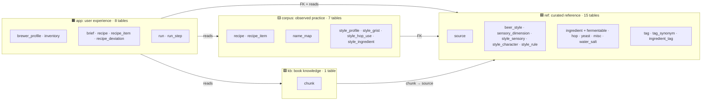
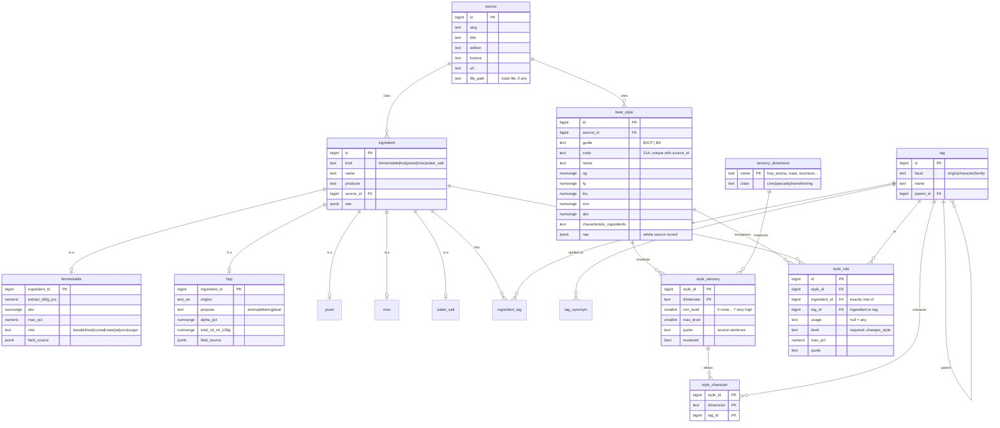
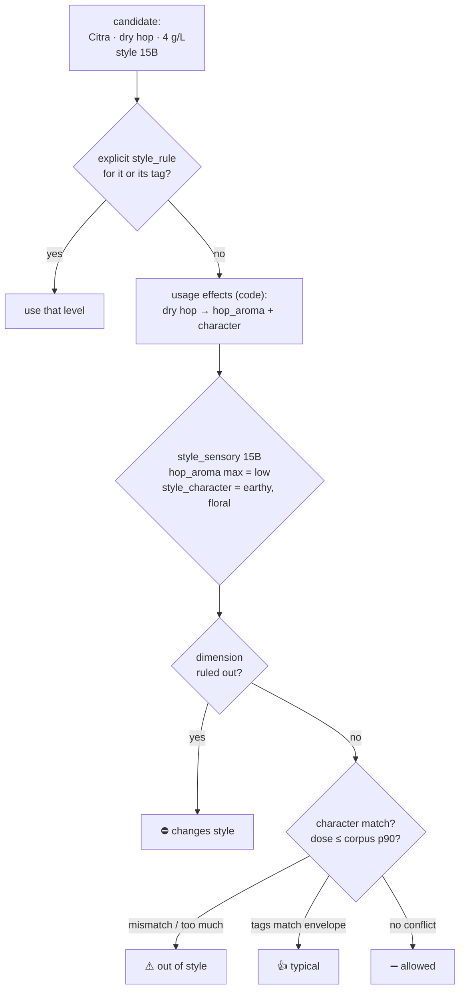
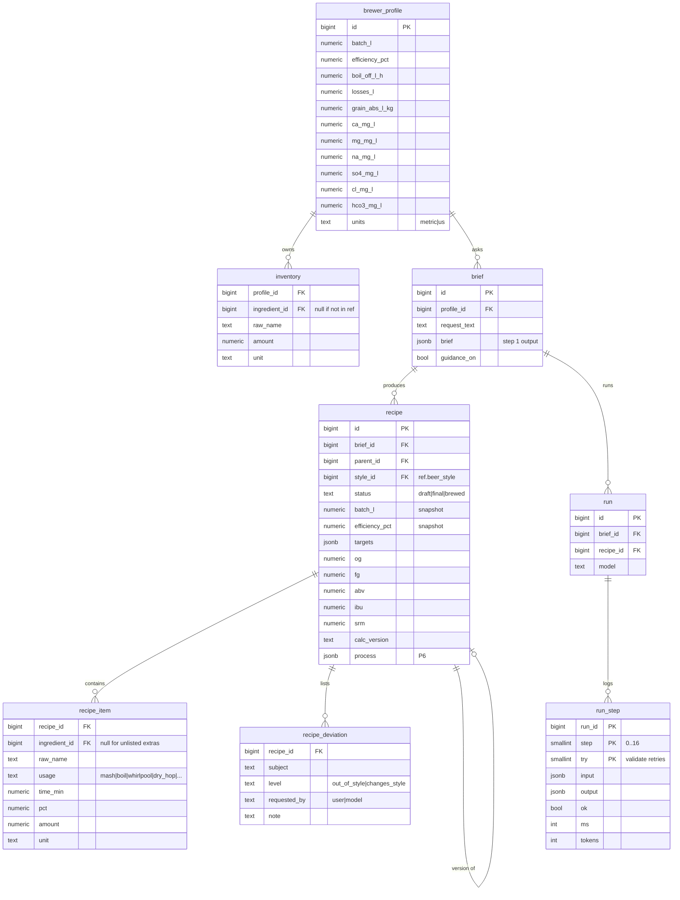

# Database design

> **Status:** built 2026-10-11 ([`slim-ref`](work/slim-ref/plan.md)) from the approved
> [DATABASE-REVIEW.md](DATABASE-REVIEW.md). The `.sql` files in [`db/`](../db/) (`010`–`015`)
> are the exact definitions, applied as `postgres` ([OPERATIONS.md](OPERATIONS.md) §4); this
> file explains them. All tables were created up front, empty, **by user decision**
> (2026-10-11), not in the phase that fills them; each table below names the phase that fills
> it. Row counts were measured on the live DB on 2026-10-11.
> Workflow context: [RECIPE-ROADMAP.md](RECIPE-ROADMAP.md).

---

## TL;DR

- **4 schemas, split by how much you can trust the data**, not just "fact vs user".
- `ref` = curated reference. **Every row has a source + version.** Read-only for the app.
- `corpus` = what brewers actually do (community recipes, quality-weighted). Evidence for ratios, **never cited, never embedded**.
- `kb` = book text for RAG + citations.
- `app` = everything the user experience creates: profile, inventory, briefs, recipes, logs.
- Data only points **inward**: `app` → `ref`, never `ref` → `app`.
- **The column rule:** a typed column exists only if a pipeline step reads it. Everything else
  the source said stays in `raw jsonb`, so a field needed later is a migration plus a loader
  re-run ([review](DATABASE-REVIEW.md) §1).
- **Behaviour lives in code, not tables:** usage effects, hint knobs, sensory cut points and
  source weights are dicts next to their tests (§8, PROJECT.md §6.8).

---

## 1. The four schemas

| Schema | Holds | Trust | Written by | Cited in a recipe? |
|---|---|---|---|---|
| 🟦 `ref` | styles, sensory envelopes, ingredient specs, tags | ⭐⭐⭐ authoritative, sourced, reviewed | load scripts + your review | ✅ as data ("BJCP 2021, 21A") |
| 🟨 `corpus` | community recipes + computed per-style stats | ⭐⭐ evidence of practice | one-off load + recompute job | ❌ only as "common practice: 88 % of recipes…" |
| 🟩 `kb` | book chunks + embeddings | ⭐⭐ cited knowledge | ingestion | ✅ with page/section |
| 🟧 `app` | user data, recipes, logs | yours | the pipeline | — |

31 tables in all (`ref` 15, `corpus` 7, `kb` 1, `app` 8), every one owned by `postgres`.

**Why "curated", not "absolute truth":** BJCP gets revised (2015 → 2021), Weyermann and
Viking report the same malt type differently, and books disagree (IBU formulas). Source +
version per row lets two editions coexist and lets every number be traced.

---

## 2. `ref`: curated reference

Defined in [`db/010_ref_schema.sql`](../db/010_ref_schema.sql) (sources, styles, ingredients),
[`db/011_ref_sources.sql`](../db/011_ref_sources.sql) (source rows) and
[`db/012_style_fit.sql`](../db/012_style_fit.sql) (style-fit vocabulary).

| Table | Key columns | Filled from | Rows (2026-10-11) |
|---|---|---|---|
| `source` | slug, title, edition, licence, url, `file_path` (book file, for `kb`) | by hand, `db/011_ref_sources.sql` | 10 |
| `beer_style` | guide, code (unique per source), ranges (`numrange`), characteristic ingredients, `raw` | `styles.json`, `ba_styles.json` | 285: BJCP 2021 116 + BA 2026 169 |
| `ingredient` | kind, name, producer, source, `raw` | all kind loaders | 164 |
| `fermentable` | extract (% dbfg, as the sources state it), colour (EBC range), max % of grist, `role`, `field_source` | hopline malt pages + Weyermann, Viking, Simpsons catalogues | 74 (74 with extract, 73 with EBC, 62 with `max_pct`); `role` empty until P3 |
| `hop` | origins, purpose, alpha range, total oil, `field_source` | hopline hop pages | 90 (87 with alpha) |
| `yeast` | product id, type, form, attenuation range, temperature range, flocculation, alcohol tolerance | Brewtarget data (296 + 275) | empty, P1 (`yeast-loader`) |
| `water_salt` | formula, ions per gram | computed from atomic masses | empty, P1 (`water-salts`) |
| `misc` | `category` (spice, fruit, wood, lactose, …), **no gravity data** | corpus `misc` names, by hand | empty, P3 |
| `tag` · `tag_synonym` | facet, name, parent ("citrusy" → citrus) · source word → tag | hop descriptors, malt roles, yeast families | empty, P3 |
| `ingredient_tag` | ingredient ↔ tag, `reviewed` (false = derived by code); no weight, match strength comes from the tag tree | derived by code from the ingredient's own data ([STYLE-FIT.md](STYLE-FIT.md) §2) | empty, P3 |
| `sensory_dimension` | name, class (core · specialty · transforming) | by hand | empty, P3 |
| `style_sensory` | per style and dimension: min/max level, quote, `reviewed` | BA: parsed by code · BJCP: LLM extract → **you review** | empty, P3 |
| `style_character` | characters a style allows for a dimension (15B hop_aroma: earthy, floral); FK to its `style_sensory` row and to `tag` | same as `style_sensory` | empty, P3 |
| `style_rule` | style, **exactly one of** ingredient or tag (check constraint), usage, level, cap, quote | by hand, rare | empty, P3 |

Dropped from the first design by the review (§4.1): `beer_style.edition` (it is
`source.edition`), `co2_vol` (no source has it; §9), `fermentable.potential_sg` (computed from
extract in code), `fermentable.type` (replaced by `role`), `hop.beta_pct` and `oils_pct` (no step
reads them; beta stays in `raw`), `water_salt.molar_mass` (computed in code).

**Rules for `ref`**
- Every row has `source_id` (and the source has an edition).
- Units are SI (kg, L, °C, SG, EBC). Conversion happens only at display.
- A value no source states stays `NULL`, never 0. Computed values (potential SG, molar mass) are
  not stored.
- Extras without gravity data (cinnamon, vanilla) are `misc` and **never enter the OG/IBU/SRM
  maths**.
- Fermentable `role` is derived by code from EBC + name keywords.

### How a style rule is resolved (pure SQL + code, no LLM)

✅ *required* comes from the style's characteristic ingredients and is checked at recipe
level ("the recipe has no pale base malt").

---

## 3. `corpus`: observed practice

Defined in [`db/013_corpus.sql`](../db/013_corpus.sql). All empty: P1b loads the recipes, P3
builds the name map and computes the profiles.

| Table | Holds | Notes |
|---|---|---|
| `recipe` | one row per recipe: source, external id, mapped style, batch, efficiency, boil, OG/FG/IBU/SRM/ABV as reported, views, **`gates jsonb`** (G1–G7 flags), **quality weight**, `raw` | Brewer's Friend (CC0): 35,620 in the archive dump. Unique on (source, external id). Gates: [STYLE-PROFILES.md](STYLE-PROFILES.md) §2 |
| `recipe_item` | kind, raw ingredient string (as written) + its `raw_key`, amount, use, time, reported alpha | raw strings kept as they are; indexed on `recipe_id` and `(kind, raw_key)` |
| `name_map` | (kind, raw key) → `ref.ingredient` or just a role (base / crystal / roast…) + method (exact · rule · reviewed) | needed before any stats. Unmapped = absent, never guessed |
| `style_profile` | per style: `n_recipes` after gates, family-blend share, computed at | **computed** by a job, re-runnable; parent of the three below |
| `style_grist` | per style and role: p25 / p50 / p75 % of grist, share of recipes using it | |
| `style_hop_use` | per style and use: hop mass share, g/L p10 / p50 / p90 | |
| `style_ingredient` | per style: top yeasts, hops, malts, extras with share of recipes, typical use, median dose | |

- ⛔ Never embedded into `kb`. Self-reported, unvalidated data must not look like a citation.
- The style profile tables are the D7 ratio source. They feed steps 5–9 of the workflow.
- Gates set flags and never delete; source weights (corpus 1, books 3, own batches 5…) are in
  code (§8).

---

## 4. `kb`: book knowledge

Defined in [`db/014_kb.sql`](../db/014_kb.sql). Empty until P7.

| Table | Holds |
|---|---|
| `chunk` | `source_id` → `ref.source` (a book is a source row, with `file_path`), section path, page, text, tokens, `embedding vector(1024)` (bge-m3), `fts tsvector` (generated, English) |

- No separate document table: title, edition and licence live in `ref.source`.
- `vector` 0.8.0 is installed in schema `extensions` (owner `supabase_admin`, like the other
  extensions; created by `postgres` as a supautils privileged extension).
- Hybrid retrieval: HNSW index on `embedding` (cosine) + GIN on `fts`, fused; plus an index on
  `source_id` to delete or re-ingest one book.
- Only prose is stored here. Tables and formulas found in a book go through the
  **doc → calculation pass** first and land in `ref` or in code ([roadmap](RECIPE-ROADMAP.md) §6).

---

## 5. `app`: user experience

Defined in [`db/015_app.sql`](../db/015_app.sql). All empty: P4–P5 fill them, `recipe.process`
in P6.

| Table | Why it exists |
|---|---|
| `brewer_profile` | equipment + water, stored once (step 0); the 6 source-water ions are typed columns |
| `inventory` | "use what I have" scoring in steps 6–9 |
| `brief` | the parsed request, so a recipe can be regenerated |
| `recipe` + `recipe_item` | the recipe **as rows**, with ratio (`pct`) **and** amount; typed results `og…srm`; `batch_l` and `efficiency_pct` snapshot the profile used, so editing the profile never changes an old recipe; `calc_version` names the maths that produced the numbers |
| `recipe_deviation` | the Deviations box: what is out of style, and whether you or the model asked for it |
| `run` + `run_step` | one log row per pipeline step and try: input, output, time, tokens. Debugging and evals |

Later (§9): `batch`, `tasting`, `inventory.best_before`.

---

## 6. Access rules

| Role | `ref` | `corpus` | `kb` | `app` |
|---|---|---|---|---|
| `postgres` (owner, migrations) | all | all | all | all |
| loader scripts | write | write | write | — |
| pipeline (n8n / service) | read | read | read | **read + write** |
| Supabase MCP (Claude Code) | read | read | read | read |

- All objects are owned by `postgres` and created from `.sql` files in the repo
  ([OPERATIONS.md](OPERATIONS.md) §4), never through MCP.
- `ref` has no foreign keys pointing into `app`.

---

## 7. Fill order

All tables exist (§1). This is the order they get data in.

| # | Step | Tables filled | Done when |
|---|---|---|---|
| 1 | Styles | `ref.source`, `ref.beer_style` ← both style JSONs | ✅ loaded: 285 rows (BJCP 116 + BA 169), 10 sources; the spot-check against the PDFs is still to do (`ref-spotcheck`) |
| 2 | Ingredients | `ref.ingredient` + kind tables ← malts, hops, Brewtarget yeasts, salts | 🟡 malts 74, hops 90 (164 ingredients); yeasts (`yeast-loader`) and salts (`water-salts`) not loaded yet |
| 3 | Style-fit vocabulary | `ref.tag`, `tag_synonym`, `ingredient_tag`, `misc`, `fermentable.role` | every hop has ≥ 1 character tag |
| 4 | Corpus | `corpus.recipe`, `recipe_item` ← archive dump · `name_map` · profile job → `style_profile`, `style_grist`, `style_hop_use`, `style_ingredient` | ≥ 90 % of grist mass mapped to a role for the test styles |
| 5 | Envelopes | `ref.sensory_dimension`, `style_sensory`, `style_character` for the test styles (BA parsed, BJCP extracted + reviewed); `style_rule` where needed | the Citra table in the roadmap reproduces from SQL + code |
| 6 | Pipeline | `app.*` | a test brief → recipe rows + run_step log |
| 7 | Books | `kb.chunk` (and `ref.source.file_path`) | after the doc → calculation pass per book |

---

## 8. Behaviour in code, not tables

These say *how the algorithm behaves*, so they live in code next to their tests, where a reader
sees them with the logic that uses them (PROJECT.md §6.8; review §4.3):

| Behaviour | Was planned as | Lives in |
|---|---|---|
| Usage effects (dry hop → hop aroma + character, ~20 entries) | `ref.usage_effect` | a dict in the style-fit code ([STYLE-FIT.md](STYLE-FIT.md) §3) |
| Hint knobs (hint word → knob + direction, ~20 entries, each with its book source) | `ref.hint_knob` | a dict in the targets step ([RECIPE-ROADMAP.md](RECIPE-ROADMAP.md) §7) |
| Sensory intensity cut points (calibrated on the corpus) | columns on `ref.sensory_dimension` | the style-fit code ([STYLE-FIT.md](STYLE-FIT.md) §4) |
| Source weights (corpus 1, books 3, own batches 5…) | `corpus.source_weight` | the profile job ([STYLE-PROFILES.md](STYLE-PROFILES.md) §4) |
| Potential SG from extract, molar mass and ion contributions | `fermentable.potential_sg`, `water_salt.molar_mass` | the maths library (tested) |

---

## 9. Later

Not built; each comes with the feature or source that needs it.

| What | When |
|---|---|
| `ref.fault` (name, descriptors, causes ← `beer_faults.json`, 21) | fault diagnosis (Priority 2) |
| `app.batch` + `tasting` | batch log feature |
| `app.inventory.best_before` | when a step reads it |
| `ref.beer_style.co2_vol` | P6 (step 15), together with a source that states it (e.g. Palmer ch. 11) |
