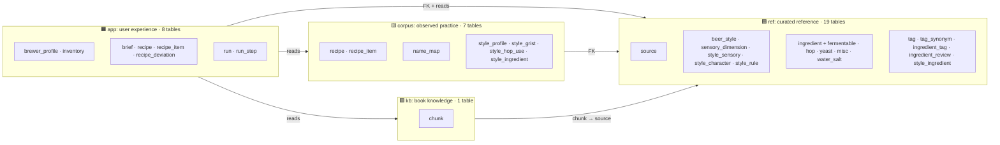
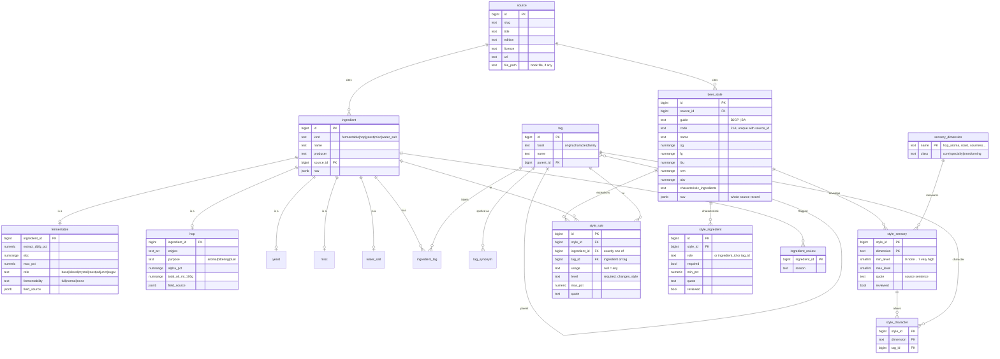
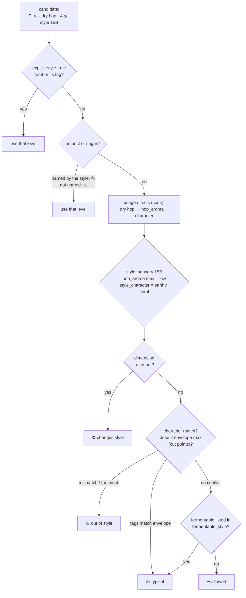
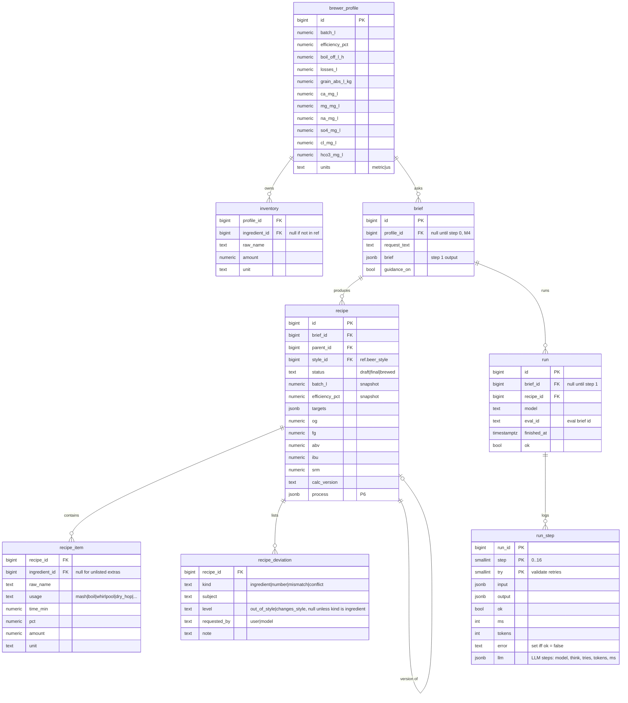

# Database design

> **Status:** built 2026-10-11 ([`slim-ref`](finished/slim-ref/plan.md)) from the approved
> [DATABASE-REVIEW.md](DATABASE-REVIEW.md). The `.sql` files in [`db/`](../db/) (`010`–`015`)
> are the exact definitions, applied as `postgres` ([OPERATIONS.md](OPERATIONS.md) §4); this
> file explains them. All tables were created up front, empty, **by user decision**
> (2026-10-11), not in the phase that fills them; each table below names the phase that fills
> it. Row counts were measured on the live DB on 2026-10-11. P1a (`ref` load, fill-order steps
> 1–2) is done and spot-checked ([`ref-spotcheck`](finished/ref-spotcheck/plan.md),
> `db/checks/ref_spotcheck.sql`). The same pack lists the intake rows with their sources, and
> the intake misc rows (purpose, category, usages, time, dose, source, file) for you to check
> against the cited page ([`s9-misc-extras`](finished/s9-misc-extras/plan.md), 2026-10-18).
> Workflow context: [RECIPE-ROADMAP.md](RECIPE-ROADMAP.md).

---

## TL;DR

- **4 schemas, split by how much you can trust the data**, not just "fact vs user".
- `ref` = curated reference. **Every row has a source + version.** Read-only for the app.
- `corpus` = what brewers actually do (community recipes, quality-weighted). Evidence for ratios, **never cited, never embedded**.
- `kb` = book text for RAG + citations.
- `app` = everything the user experience creates: profile, inventory, briefs, recipes, logs.
- Data only points **inward**: `app` → `ref`, never `ref` → `app`.
- **The column rule:** a typed column exists only if a pipeline step reads it. Everything else
  the source said stays in `raw jsonb`, so a field needed later is a migration plus a loader
  re-run ([review](DATABASE-REVIEW.md) §1).
- **Behaviour lives in code, not tables:** usage effects, hint knobs, sensory cut points and
  source weights are dicts next to their tests (§8, PROJECT.md §6.8).

---

## 1. The four schemas

| Schema | Holds | Trust | Written by | Cited in a recipe? |
|---|---|---|---|---|
| 🟦 `ref` | styles, sensory envelopes, ingredient specs, tags | ⭐⭐⭐ authoritative, sourced, reviewed | load scripts + your review | ✅ as data ("BJCP 2021, 21A") |
| 🟨 `corpus` | community recipes + computed per-style stats | ⭐⭐ evidence of practice | one-off load + recompute job | ❌ only as "common practice: 88 % of recipes…" |
| 🟩 `kb` | book chunks + embeddings | ⭐⭐ cited knowledge | ingestion | ✅ with page/section |
| 🟧 `app` | user data, recipes, logs | yours | the pipeline | — |

35 tables in all (`ref` 19, `corpus` 7, `kb` 1, `app` 8), every one owned by `postgres` (measured 2026-10-15).

**Why "curated", not "absolute truth":** BJCP gets revised (2015 → 2021), Weyermann and
Viking report the same malt type differently, and books disagree (IBU formulas). Source +
version per row lets two editions coexist and lets every number be traced.

---

## 2. `ref`: curated reference

Defined in [`db/010_ref_schema.sql`](../db/010_ref_schema.sql) (sources, styles, ingredients),
[`db/011_ref_sources.sql`](../db/011_ref_sources.sql) (source rows) and
[`db/012_style_fit.sql`](../db/012_style_fit.sql) (style-fit vocabulary).

| Table | Key columns | Filled from | Rows (2026-10-11; style-fit tables 2026-10-15) |
|---|---|---|---|
| `source` | slug, title, edition, licence, url, `file_path` (book file, for `kb`) | by hand, `db/011_ref_sources.sql`; also `shared/ingredients/sources/` through `loaders/extra_ingredients.py` | 36 (0 from intake files, measured 2026-10-18) |
| `beer_style` | guide, code (unique per source), ranges (`numrange`), characteristic ingredients, `raw` | `styles.json`, `ba_styles.json` | 285: BJCP 2021 116 + BA 2026 169 |
| `ingredient` | kind, name, producer, source, `raw` | all kind loaders, and the intake files in `shared/ingredients/` (`loaders/extra_ingredients.py`; `raw ? 'intake'`; 4 intake rows, all misc, measured 2026-10-18) | 301 (81 fermentable, 89 hop, 119 yeast, 8 water_salt, 4 misc; Sterling removed 2026-10-15) |
| `fermentable` | extract (% dbfg, as the sources state it), colour (EBC range), max % of grist, `role`, `fermentability` (`full` / `normal` / `none`), `enzyme_activity` (`none` / `low` / `normal` / `high`), `min_boil_min` (60-120), `description`, `description_ref`, `field_source` | hopline malt pages + Weyermann, Viking, Simpsons catalogues; hopline flake and sugar pages + Palmer, *How to Brew* Tables 18.5 and 24.1 (adjuncts) | 81: 74 malts + 7 adjuncts (4 flakes, brown candi sugar, lactose, honey); 81 with extract, 78 with EBC (the 4 flakes have a sourced colour; Honey, Lactose, Enzyme Malt do not), 81 with `max_pct` (63 from the catalogues, 18 `user-supplied`, decision E); fermentability `normal` 78, `full` 2, `none` 1; `role` 81 (base 20, kilned 13, crystal 27, roast 13, adjunct 5, sugar 3); `enzyme_activity` 51 (none 30, high 12, low 6, normal 3; 30 empty, listed in the s2 report); `min_boil_min` 81 (60, and 90 for 7); `description` 81. Loaded by `loaders/fermentable_facts.py`, which must run after `loaders.malts` and `loaders.adjuncts` (they rewrite `max_pct` and `field_source`). An intake fermentable (`shared/ingredients/`) carries its own facts in its file and has no `fermentable_facts.toml` entry |
| `ingredient_alias` | ingredient, alias (words a brewer types for a product); read first by `app.resolve_ingredient`, which falls back to `app.resolve_ingredient_by_name` | intake files through `loaders/extra_ingredients.py`; `ALIASES` in `loaders/adjunct_products.py` through `loaders/adjuncts.py` | 11 (10 from the 4 misc files, 1 from the adjunct loader: "dark candi sugar" → Brown Candi Sugar; measured 2026-10-18) |
| `fermentable_substitute` · view `fermentable_substitutes` | pair of fermentables stored once (smaller id first), source, note; the view lists both directions | `loaders/fermentable_facts.py` (substitution chart, user decisions) | 27 pairs (19 chart, 8 user decisions) |
| `fermentable_style` | malt ↔ style it is typically used for, source | `loaders/fermentable_facts.py` (maltster catalogues, mapped through the approved `[style_names]` table) | 623 rows, 59 malts |
| `hop` | origins, purpose, alpha range, total oil, `field_source` | hopline hop pages; values hopline lacks (4 hops' alpha/oil, Enigma's purpose) from Beer Maverick through the hop loader | 89 (all with alpha and total oil; Sterling removed 2026-10-15) |
| `yeast` | product id, type (ale, kveik, lager, brett, lacto, or null), form, attenuation range, temperature range, flocculation, alcohol tolerance | hopline dry and liquid yeast pages; attenuation from the makers' catalogues and data sheets (Brewfather for Gozdawa and Brewline) | 119 (dry 81, liquid 38; 93 with attenuation); types ale 75, kveik 20, lager 17, brett 2, lacto 2 (YF-998, YF-999, from their text), null 3 |
| `water_salt` | formula, ions per gram | computed from IUPAC atomic masses (`loaders/water_salts.py`) | 8 |
| `misc` | `purpose` (`flavour` · `process`), `category` (9 flavour: spice, herb, fruit, wood, coffee, cacao, vanilla, smoke, other; 5 process: fining, nutrient, enzyme, acid, other-process; a check ties each category to its purpose), `usages` (`text[]`, at least one of mash, boil, whirlpool, ferment, secondary, packaging), `time_min` (minutes, optional), `dose_g_per_l` (`numrange`, optional, g per litre of finished beer), `description`, `field_source` (jsonb: the source slug and page of `purpose`, `category`, `usages`, `description`, `dose_g_per_l`, `time_min`, as for hops); **no gravity data** | hand-filled intake files in `shared/ingredients/misc/` through `loaders/extra_ingredients.py` (`load_misc`, [s9](finished/s9-misc-extras/plan.md)); the page refs of each figure also stay in `raw.intake` | 4 (coffee whole beans, coffee cold brew, vanilla bean, orange peel; all flavour; measured 2026-10-18). Not loaded: a liquid extract dosed in mL/L (`dose_ml_per_l`) waits; an enzyme, an acid and a fruit with a sourced sugar content load and are reported "waits for maths" |
| `tag` · `tag_synonym` | facet, name, parent ("citrusy" → citrus) · source word → tag | `loaders/style_fit_vocab.toml` through `loaders/tags.py` | 78 tags (10 origin, 43 character, 25 family; the 9 new family tags are the flavour misc categories), 239 synonyms (2026-10-18) |
| `ingredient_tag` | ingredient ↔ tag, `reviewed` (false = derived by code); no weight, match strength comes from the tag tree | derived by code from the ingredient's own data ([STYLE-FIT.md](STYLE-FIT.md) §2) | 815 rows for 293 ingredients: fermentable 234 (81), hop 343 (89), yeast 229 (119), misc 9 (4); all `reviewed = false`; 38 yeasts in `ingredient_review` instead (2026-10-18). A flavour misc gets a family tag named after its category and a character tag per descriptor; a process aid gets none and no review row ([STYLE-FIT.md](STYLE-FIT.md) §2) |
| `sensory_dimension` | name, class (core · specialty · transforming) | by hand | 18 (2026-10-15) |
| `style_sensory` | per style and dimension: min/max level, quote, `reviewed` | BJCP and BA prose: LLM extract (D2 model) → **you review** | 190 rows for 25 styles, all reviewed (31B and the BA Specialty Honey Beer have none by the user's choice; 30A has one `spice` row, very low to very high, written by hand because its text says "Varies by base style") (2026-10-18) |
| `style_character` | characters a style allows for a dimension (15B hop_aroma: earthy, floral); FK to its `style_sensory` row and to `tag` | same as `style_sensory` | 237 (2026-10-15) |
| `style_rule` | style, **exactly one of** ingredient or tag (check constraint), usage, level, cap, quote | by hand, rare | empty: the golden set and the reference recipes need no override (2026-10-15) |
| `style_ingredient` | per style: a characteristic ingredient (an ingredient or a tag, or a role), `required`, `min_pct`, the guideline `quote`, `reviewed` | BJCP and BA prose: LLM extract (D2 model) → **you review** (`loaders/style_envelopes.py`) | 116 rows for the 26 s3 styles, all reviewed (2026-10-15) |
| `ingredient_review` | an ingredient the tagger could not tag from its own data, with the `reason`; nothing is guessed | `loaders/tags.py` | 38 (all yeasts) (2026-10-15) |

Dropped from the first design by the review (§4.1): `beer_style.edition` (it is
`source.edition`), `co2_vol` (no source has it; §9), `fermentable.potential_sg` (computed from
extract in code), `fermentable.type` (replaced by `role`), `hop.beta_pct` and `oils_pct` (no step
reads them; beta stays in `raw`), `water_salt.molar_mass` (computed in code).

**Rules for `ref`**
- Every loaded row is sourced: `beer_style` and `ingredient` have `source_id` (and the source
  has an edition); the kind tables are sourced through their `ingredient` row, and fermentables,
  hops and yeasts record each field's source in `field_source`. The style-fit vocabulary (`tag`,
  `tag_synonym`, `sensory_dimension`, …) is hand-made and reviewed; envelopes and rules carry
  their guideline `quote` instead.
- Units are SI (kg, L, °C, SG, EBC). Conversion happens only at display.
- A value no source states stays `NULL`, never 0. Computed values (potential SG, molar mass) are
  not stored.
- Anything with gravity (malts, flakes, sugars, lactose, honey) is a `fermentable` and enters
  OG through its extract. Its `fermentability` says how much of that extract yeast can ferment:
  `full` all of it, `normal` follows the yeast's attenuation (grain malts and flakes; the
  default, needs no source), `none` none of it (lactose stays whole in FG). `full` and `none`
  must be stated by a source and recorded in `field_source`.
  Sugar and honey extracts are Palmer's as-sold PPG ÷ 46 (water included), not dry basis:
  apply no moisture correction to them.
- Extras without gravity data (cinnamon, vanilla) are `misc` and **never enter the OG/IBU/SRM
  maths**. All fruit is flavour misc for now; a fruit file with a sourced sugar content loads
  and waits (fruit as a fermentable is decided with M6, a Later item in
  [RECIPE-ROADMAP.md](RECIPE-ROADMAP.md)). A process aid (`purpose = 'process'`) has no flavour
  effect: it gets no tags and is `allowed` in every style.
- Fermentable `role` is derived by code from EBC + name keywords.

### How a style rule is resolved (pure SQL + code, no LLM)

✅ *required* comes from the style's characteristic ingredients and is checked at recipe
level ("the recipe has no pale base malt").

---

## 3. `corpus`: observed practice

Defined in [`db/013_corpus.sql`](../db/013_corpus.sql). All empty: P1b loads the recipes, P3
builds the name map and computes the profiles.

| Table | Holds | Notes |
|---|---|---|
| `recipe` | one row per recipe: source, external id, mapped style, batch, efficiency, boil, OG/FG/IBU/SRM/ABV as reported, views, **`gates jsonb`** (G1–G7 flags), **quality weight**, `raw` | Brewer's Friend (CC0): 35,620 in the archive dump. Unique on (source, external id). Gates: [STYLE-PROFILES.md](STYLE-PROFILES.md) §2 |
| `recipe_item` | kind, raw ingredient string (as written) + its `raw_key`, amount, use, time, reported alpha | raw strings kept as they are; indexed on `recipe_id` and `(kind, raw_key)` |
| `name_map` | (kind, raw key) → `ref.ingredient` or just a role (base / crystal / roast…) + method (exact · rule · reviewed) | needed before any stats. Unmapped = absent, never guessed |
| `style_profile` | per style: `n_recipes` after gates, family-blend share, computed at | **computed** by a job, re-runnable; parent of the three below |
| `style_grist` | per style and role: p25 / p50 / p75 % of grist, share of recipes using it | |
| `style_hop_use` | per style and use: hop mass share, g/L p10 / p50 / p90 | |
| `style_ingredient` | per style: top yeasts, hops, malts, extras with share of recipes, typical use, median dose | |

- ⛔ Never embedded into `kb`. Self-reported, unvalidated data must not look like a citation.
- The style profile tables are the D7 ratio source. They feed steps 5–9 of the workflow.
- Gates set flags and never delete; source weights (corpus 1, books 3, own batches 5…) are in
  code (§8).

---

## 4. `kb`: book knowledge

Defined in [`db/014_kb.sql`](../db/014_kb.sql). Filled by [`loaders/books.py`](../loaders/books.py), one book at a time; the books, how to add one and the doc → calc notes are in [BOOKS.md](BOOKS.md). Measured 2026-10-16: all five books loaded, 2,180 chunks (*How to Brew* 943, *Water* 357, *Yeast* 454, *Malt* 341, BJCP study guide 85). Twelve articles added the same day: 258 chunks, 205 from ten Markdown sources and 53 from two PDFs (`s7-kb-articles`; per source in [BOOKS.md](BOOKS.md) §1c).

| Table | Holds |
|---|---|
| `chunk` | `source_id` → `ref.source` (a book is a source row, with `file_path`), section path, page, text, tokens, `embedding vector(1024)` (bge-m3), `fts tsvector` (generated, English) |

- No separate document table: title, edition and licence live in `ref.source`.
- `vector` 0.8.0 is installed in schema `extensions` (owner `supabase_admin`, like the other
  extensions; created by `postgres` as a supautils privileged extension).
- `pg_jsonschema` 0.3.3 is installed in schema `extensions` the same way (created in
  `db/015_app.sql`). Step contracts are checked with `extensions.jsonschema_validation_errors`.
- Hybrid retrieval: HNSW index on `embedding` (cosine) + GIN on `fts`, fused by reciprocal rank in
  `app.kb_search(query_text, query_embedding, k)` ([`db/040_kb_search.sql`](../db/040_kb_search.sql)),
  which returns `chunk_id, source_slug, source_title, source_url, section_path, page, text, score,
  vec_rank, fts_rank`;
  plus an index on `source_id` to delete or re-ingest one book.
- `page` is the PDF page (1-based), not the printed page. It is null for a Markdown source (a saved
  web page); that source is cited by `ref.source.title` and `url`. `tokens` is bge-m3's count of the
  embedded text, heading path included; `text` keeps the prose only.
- Only prose is stored here. Tables and formulas found in a book go through the
  **doc → calculation pass** first and land in `ref` or in code ([roadmap](RECIPE-ROADMAP.md) §6).

---

## 5. `app`: user experience

Defined in [`db/015_app.sql`](../db/015_app.sql). All empty: P4–P5 fill them, `recipe.process`
in P6.

| Table | Why it exists |
|---|---|
| `brewer_profile` | equipment + water, stored once (step 0); the 6 source-water ions are typed columns |
| `inventory` | "use what I have" scoring in steps 6–9 |
| `brief` | the parsed request, so a recipe can be regenerated; `profile_id` is null until step 0 builds profiles (M4) |
| `recipe` + `recipe_item` | the recipe **as rows**, with ratio (`pct`) **and** amount; typed results `og…srm`; `batch_l` and `efficiency_pct` snapshot the profile used, so editing the profile never changes an old recipe; `calc_version` names the maths that produced the numbers |
| `recipe_deviation` | the Deviations box: every step 3 deviation and what the model chose itself; `kind` is ingredient, number, mismatch or conflict, and only an ingredient row has a `level` (`db/045`); `requested_by` says whether you or the model asked for it |
| `run` + `run_step` | one log row per pipeline step and try: input, output, time, tokens. Debugging and evals. A run exists before its brief (step 1 writes it), so `run.brief_id` can be null; `finished_at` / `ok` stay null until the run ends; a failed step always says why (`error` is set exactly when `ok` is false); `llm` holds an LLM step's model, thinking, tries, tokens, time and first-try errors |

Function `app.step1_read_answer(request, content, contract)` (db/020_step1.sql) checks a model's step 1 answer: parses it, drops repeated words, validates it against the contract, and requires every `stated` number to be written in the request.

Function `app.style_pair()` (db/021_style_pairs.sql) lists the 151 decided BA 2026 to BJCP 2021 style pairs (`ba_code`, `bjcp_code`); step 2 returns the BJCP style when the best fit is a paired BA style.

Step 2 signal functions (db/022_step2.sql), each tested alone: `app.style_words`, `app.style_alias`, `app.style_name_score` (name match, 0 to 1), `app.style_number_score` (stated numbers against a style's ranges), `app.brief_words`, `app.style_tags`, `app.style_word_score` (hints and unknown words against tags and text), `app.style_name_covers` (every named word is in the style's name), `app.guide_from_request` and `app.specialty_style` (rows by adjunct word for honey and molasses, and rows by misc category for the rest: fruit 29A; spice, herb, coffee, cacao and vanilla 30A; wood 33A; smoke 32A; BA equivalents; none for `other`; a featured misc product moves step 2 to that style with the base style first in the alternatives).

Ingredient-word resolver (`db/036_ingredient_resolver.sql`, first version, M5 extends it): `app.resolve_ingredient(word)` returns the `ref.ingredient` products a word names (kind words malt, hop and yeast restrict the kind; rule 1 the same words as a product's name, rule 2 every remaining word among name and producer words), with `app.ingredient_words`, `app.ingredient_synonym` and `app.ingredient_kind_word`. A third fallback, rule `yeast type`, applies when aliases and names find nothing: a word listed in `app.yeast_type_word()` ("Lactobacillus", "lacto") finds every yeast of that type.

Step 3 rules (`db/037_step3.sql`, no LLM): `app.hint_knob()` (the RECIPE-ROADMAP §7 hint table, one row per hint and knob, with `position` in the style range for og/ibu/srm, `mash_c`, `intent` and `source`; step 4 and step 5 read it too), `app.step3_conflicts(hints)` (one conflict per pair of sides pushing a knob in opposite directions), `app.step3_numbers(stated, style_code)` (abv, og, ibu, srm outside the style's range, bounds inclusive; batch_l never) and `app.step3_mismatch(stated, mismatch)` (step 2's mismatch as one deviation). Each returns a jsonb list of `step3.output` deviations.

Step 4 numbers (`db/039_step4.sql`, no LLM): `app.range_position(range, fraction)`, `app.og_for_abv(abv, fg)` and `app.fg_for_abv(og, abv)` (inverses of `app.abv` by bisection), `app.hint_moves(hints)` (the `app.hint_knob()` rows of the brief's hints, minus knobs pulled both ways), `app.step4_pick(...)` (one range-based target) and `app.step4_numbers(style_code, stated, hints)` (OG, FG, ABV, IBU, SRM as `{value, from, because}`).

Step 4 output (`db/039_step4.sql`, no LLM): `app.step4_targets(brief, style, profile, deviations)` returns the style used (step 2's, or its first alternative with ranges, `from: base_style`), batch size (stated or profile), the `app.step4_numbers` targets, the mash temperature (hinted, else the middle of rule 10's range), the applied knobs and step 3's conflicts. Contracts `step4.input` and `step4.output`.

Step 5 design frame (`db/041_step5.sql`, no LLM, no ratio numbers): `app.step5_refs(word)` and `app.step5_refs_of_id(id)` (the products a word or id names, as `{ingredient_id, kind, name, role, max_pct, misc}`; `misc` comes from `app.step5_misc(id)`: purpose, category, usages, time, the sourced dose range and a `because` that says "no sourced dose" when the row has none, and is null for other kinds), `app.step5_attenuation(step 4 output)` (the attenuation the targets need, `100 x (OG - FG)/(OG - 1)`, with the yeast band that `app.mash_attenuation` turns back into it at the mash temperature) and `app.step5_frame(brief, profile, targets)` (rules, limits, one slot per wanted item, the excluded and inventory words with their products, the hint intents, the attenuation). Contracts `step5.input` and `step5.output`.

Steps 6-9, choose yeast, fermentables, hops and extras (`db/042` to `db/044`; one LLM call picks ids from a code-built table, code checks and finishes the picks). `db/042_choose_table.sql`: `app.choose_table(brief, style, targets, frame)` (the candidate table: rows per kind with their style level at each usage choice, inventory and wanted marks, `keeps_best`, the yeast rules, slots, absent and unused inventory), `app.choose_excluded(frame)` (excluded products plus siblings, `app.hop_form_word()`), `app.choose_prompt(table, brief)` (the user message text), and their helpers. A style with no reviewed envelope is treated as guidance off (`style_rated` false in the table). `db/043_choose_check.sql`: `app.misc_dose(id, role)` (the dose rule: one point as is, `feature` the high end, `background` the low end, no range null), `app.step6_errors` to `app.step9_errors` (rules R1-R7, every error starts `step N: `), `app.choose_check(table, proposal)` and `app.choose_read_answer(content, contract, table)` (JSON, contract, then the check). `db/044_choose_outputs.sql`: `app.step6_output` to `app.step9_output` and `app.choose_outputs(table, proposal)` (`{step6, step7, step8, step9}`; each pick is read only from its table row by id and an id outside the table raises; code adds level, inventory, wanted, slot, `because`, and for extras the dose from `app.misc_dose`); helpers `app.choose_pick`, `app.choose_absent`, `app.choose_unused`, `app.choose_hop_choice`. Contracts `step6.input` to `step9.output`, `choose.input` and `choose.proposal`.

Step 10, compute (`db/046_compute.sql`; no LLM, s1's functions only): `app.solve_colour(target_srm, grist, target_og, efficiency_pct, volume_l, fixed)` (rule 7: the darkest non-crystal fermentable changes its share, within its `max_pct` and the room left under rules 3 and 5, and the largest base malt takes up the difference, closed form; when a limit stops that and SRM is still more than 1 away, one second pass holds the fermentable that stopped it in `fixed`, and `second` reports it), `app.step10_boil(grist_ids, hops)` (`{boil_min, because}`: the largest of 60, the grist's `min_boil_min` and the longest boil addition), `app.step10_abv(og, grist, efficiency_pct, volume_l, attenuation_pct)` (ABV of a grist at an OG, for the OG move) `app.step10_og_move(...)` (the OG move inside +-0.002 towards the ABV target, `{value, because}`) and `app.step10_compute(profile, targets, step6, step7, step8, step9, brief)` (amounts and numbers, the OG move, the mash move (when the FG predicted at the OG used is below `app.rule10_fg_range` and the mash is not a hint, the mash is raised inside 68.3 to 69 C towards the FG target; the OG move is then made again; `mash_c` is the mash used), misc grams as dose x batch, one pack per yeast, and `recipe`, the `formulation_check.input` object step 11 checks, whose `targets.og` is the OG used). A yeast with no attenuation figure gives null FG and ABV. Contracts `step10.input` and `step10.output`. `app.rule10_fg_range(style_code, target_fg, stated)` (db/032, the FG range rule 10 checks: the target FG +-0.002 when FG or ABV is stated, else the style's range) is read by both `app.check_rule_10` and the mash move.

Step 11, validate (`db/047_validate.sql`; no LLM): `app.recipe_tolerances()` (OG 0.002, ABV 0.2, IBU 2, SRM 1, batch exact; `evals/grade.py` must equal it) and `app.step11_validate(step10, brief, targets, frame, picks)`: failures of kind `numbers` (targets and stated numbers; a number that cannot be computed fails), `rule` (every failed `app.check_recipe` rule except rule 9's OG and ABV lines, which step 10's OG move breaks on purpose) and `pick` (with guidance on, a self-picked line `out_of_style` or `changes_style` in `app.style_fit_recipe(.., null, false)`, an excluded product, an item without an id); only self-picks get a `ban`. With guidance off those lines come back as `model_deviations`. Contracts `step11.input` and `step11.output`. Task 9c: each feedback line is the failure text, then ` To fix: <sentence>` when `app.step11_fix(failure, step10, targets, stated)` gives one (a lighter or an added base malt, lowering the crystal, a second dark malt, a less or more attenuative yeast, a yeast attenuating about N % for the ABV, an alcohol tolerance, points to take off for rules 3 and 4; picks and the other rules have none), then the ban suffix; every number in it comes from the failure, step 10's output, `ref` or `app.attenuation_for_fg(grist, og, efficiency_pct, volume_l, fg)` (the attenuation at which `app.fg` reaches the FG, bisection clamped to 0..100). The failure objects and the contracts are unchanged. `app.choose_feedback_prompt` (db/042) says in its header: "Where a line says To fix, do that."

Saving (`db/048_save_recipe.sql`; no LLM): `app.save_recipe(run_id, step3, targets, step10, step11) returns bigint` raises unless `step11.passed` and the run has a `brief_id`, then in one transaction inserts the `app.recipe` row (draft, step 4's output as `targets`, the numbers, batch and efficiency of step 10, `calc_version`), one `app.recipe_item` per fermentable (kg), hop (g, minutes, share as `pct`), yeast (1 pack, `ferment`) and extra (g), one `app.recipe_deviation` per step 3 deviation (`requested_by` user) and per `step11.model_deviations` row (kind ingredient, `requested_by` model), and sets `app.run.recipe_id`.

Rule 9 (`app.check_rule_9`, `db/032_formulation_check.sql`) calls `app.step4_numbers` with the recipe's `hints`: an unstated OG, FG, IBU or SRM must be where step 4 puts it (within `midpoint_tolerance`), and the ABV target must be `app.abv` of the OG and FG targets within `midpoint_tolerance.abv`. The `formulation_check` input requires `hints`.

Step 3 best-case rating (`db/037_step3.sql`): `app.level_rank(level)` (order of the 5 levels), `app.ingredient_choices(ingredient_id, role)` (usage and dose choices a later step could make: mash or boil; a misc one choice per usage of its row, no dose; hop boil bands, whirlpool, dry hop, feature hops late only; yeast range ends and warm steps) and `app.rate_wanted(style_code, item, role)` (best level over every product the word names and every choice; level null with a reason when it cannot be rated).

Step 3 output (`db/037_step3.sql`): `app.step3_deviations(brief, style)` returns `{deviations, unrated, guidance}` (`step3.output`): numbers, mismatch, conflicts, then each wanted word at its best choice (`out_of_style` / `changes_style` is a deviation; a word that cannot be rated goes to `unrated`). With no style it gives conflicts only and every wanted word unrated. `excluded` and `inventory` are not read.

Function `app.step2_best_style(brief, request, guide_preference)` (db/022_step2.sql) picks the best-fit style: scores both guides (name, numbers with a tightness bonus, words), returns the BJCP pair of a BA winner unless that pair is a catch-all in `app.bjcp_catch_all()`, applies the specialty and mismatch rules and returns the style, alternatives, scores and reasons.

Step 0 (`db/038_step0.sql`, no LLM): `app.step0_profile(profile_id)` returns the `step0.output` shape for a profile id, or for the `default` row when the id is null (batch 20 L, efficiency 72 %, boil-off 4 L/h, losses 2 L, grain absorption 1.0 L/kg, six ions 0 = distilled water, `metric`; placeholder until the user can set their own water). The `default` row is inserted only when absent, so a re-run keeps edited values.

Later (§9): `batch`, `tasting`, `inventory.best_before`.

---

## 6. Access rules

| Role | `ref` | `corpus` | `kb` | `app` |
|---|---|---|---|---|
| `postgres` (owner, migrations) | all | all | all | all |
| loader scripts | write | write | write | — |
| pipeline (n8n) | read | read | read | **read + write** |
| Supabase MCP (Claude Code) | read | read | read | read |

- All objects are owned by `postgres` and created from `.sql` files in the repo
  ([OPERATIONS.md](OPERATIONS.md) §4), never through MCP.
- `ref` has no foreign keys pointing into `app`.

---

## 7. Fill order

All tables exist (§1). This is the order they get data in.

| # | Step | Tables filled | Done when |
|---|---|---|---|
| 1 | Styles | `ref.source`, `ref.beer_style` ← both style JSONs | ✅ 285 rows (BJCP 116 + BA 169), 18 sources, 0 rows without a source; 10 rows per table spot-checked against the sources, no errors (2026-10-11, `ref-spotcheck`). `co2_vol` was dropped: no source has it; back in P6 |
| 2 | Ingredients | `ref.ingredient` + kind tables ← malts, hops, hopline yeasts, salts, and hand-filled intake files (`loaders.extra_ingredients`, which also loads `misc/` files, one entry per form of a product; load order `malts → adjuncts → fermentable_facts → hops → yeasts → extra_ingredients → tags → style_envelopes`; 4 intake rows so far, all misc) | ✅ malts 74, adjuncts 7, hops 89 (Sterling removed by the user 2026-10-15), yeasts 119, salts 8, misc 4 from intake files ([`s9-misc-extras`](finished/s9-misc-extras/plan.md), 2026-10-18: coffee whole beans, coffee cold brew, vanilla bean, orange peel; doses from Janish and *How to Brew* p. 225, [doc-calc.md](finished/s9-misc-extras/doc-calc.md)) (301 ingredients), 0 without a source; 10 rows per table spot-checked, no errors (2026-10-11). Adjuncts (2026-10-11): 4 flakes (oats, corn, rice, barley), brown candi sugar and lactose from hopline, honey from Palmer, extract from Palmer Tables 18.5/24.1. Gaps: the malts are grain malts from three maltsters only; no malt extracts, and other hopline adjuncts (rye, wheat, chit flakes, white candi, fructose) are not loaded; 8 hop values were entered by hand from Beer Maverick (`hop.field_source` = `beermaverick`): alpha and oil of Delta, Lotus and Sterling, Mount Hood's oil and Enigma's purpose; all 8 checked against beermaverick.com by the user, all match (2026-10-11) |
| 3 | Style-fit vocabulary | `ref.tag`, `tag_synonym`, `ingredient_tag`, `misc`, `fermentable.role` | ✅ every hop has ≥ 1 character tag: 89 of 89 hops tagged (343 hop tags), 38 yeasts flagged in `ingredient_review` instead of guessed (measured 2026-10-15, `s3-style-fit`); `misc` was empty here; s9 filled it with 4 intake rows and 9 family tags (2026-10-18) |
| 4 | Corpus (not loaded, D7, 2026-10-14; style fit does not use it) | `corpus.recipe`, `recipe_item` ← archive dump · `name_map` · profile job → `style_profile`, `style_grist`, `style_hop_use`, `style_ingredient` | ≥ 90 % of grist mass mapped to a role for the test styles |
| 5 | Envelopes | `ref.sensory_dimension`, `style_sensory`, `style_character`, `style_ingredient` for the 26 s3 styles (BJCP and BA extracted by the LLM + reviewed); `style_rule` where needed | ✅ 26 styles reviewed (116 `style_ingredient`, 189 `style_sensory`, 237 `style_character` rows); the Citra table reproduces from SQL + code and the 53 golden cases pass (measured 2026-10-15, `s3-style-fit`) |
| 6 | Pipeline | `app.*` | a test brief → recipe rows + run_step log |
| 7 | Books | `kb.chunk` (and `ref.source.file_path`) | ✅ all five books, 2,180 chunks, prose only, tables cut (measured 2026-10-16, `s4-books-kb`); doc → calc notes per book in [BOOKS.md](BOOKS.md) |

---

## 8. Behaviour in code, not tables

These say *how the algorithm behaves*, so they live in code next to their tests, where a reader
sees them with the logic that uses them (PROJECT.md §6.8; review §4.3):

| Behaviour | Was planned as | Lives in |
|---|---|---|
| Usage effects (dry hop → hop aroma + character, ~20 entries) | `ref.usage_effect` | `app.usage_effects()` ([STYLE-FIT.md](STYLE-FIT.md) §3) |
| Hint knobs (hint word → knob + direction, ~20 entries, each with its book source) | `ref.hint_knob` | a dict in the targets step ([RECIPE-ROADMAP.md](RECIPE-ROADMAP.md) §7) |
| Sensory intensity cut points (from *How to Brew* and OBC, or set by the user) | columns on `ref.sensory_dimension` | `app.style_fit_cut_points()` ([STYLE-FIT.md](STYLE-FIT.md) §4) |
| Source weights (corpus 1, books 3, own batches 5…) | `corpus.source_weight` | the profile job ([STYLE-PROFILES.md](STYLE-PROFILES.md) §4) |
| Potential SG from extract | `fermentable.potential_sg` | the maths library (tested) |
| Salt molar mass | `water_salt.molar_mass` | `loaders/water_salts.py` (tested), which stores only the result, `water_salt.ion_mg_per_l_per_g` |

---

## 9. Later

Not built; each comes with the feature or source that needs it.

| What | When |
|---|---|
| `ref.fault` (name, descriptors, causes ← BJCP fault list 2012 (24) and the study guide's *Beer Characteristics* (25), `shared/rag-files/sensory/`; `beer_faults.json` was lost) | fault diagnosis (Priority 2) |
| `app.batch` + `tasting` | batch log feature |
| `app.inventory.best_before` | when a step reads it |
| `ref.beer_style.co2_vol` | P6 (step 15), together with a source that states it (e.g. Palmer ch. 11) |
| A style family for BA styles | when a BA style needs a style profile (D1: step 2 can pick a BA style): `category_code` is `NULL` for all 169 BA rows (the source has none), so the thin-style family fallback ([STYLE-PROFILES.md](STYLE-PROFILES.md) §3) would use BA's `category` text (10 origin families, e.g. *British Origin Ale Styles*) |
