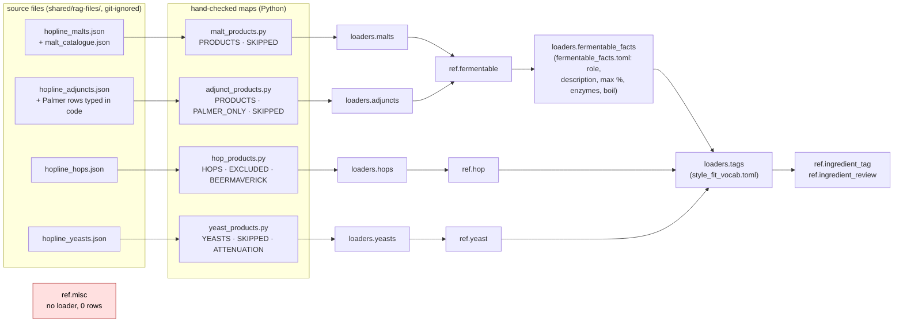
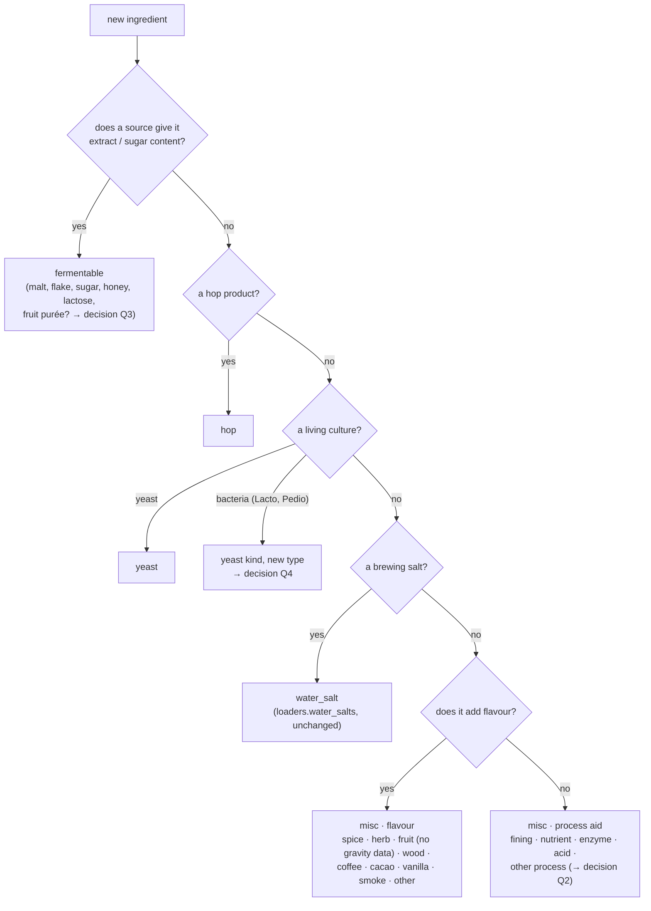
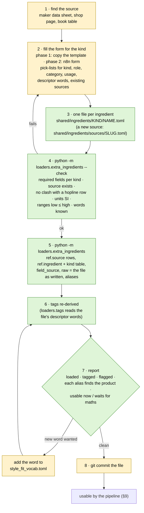
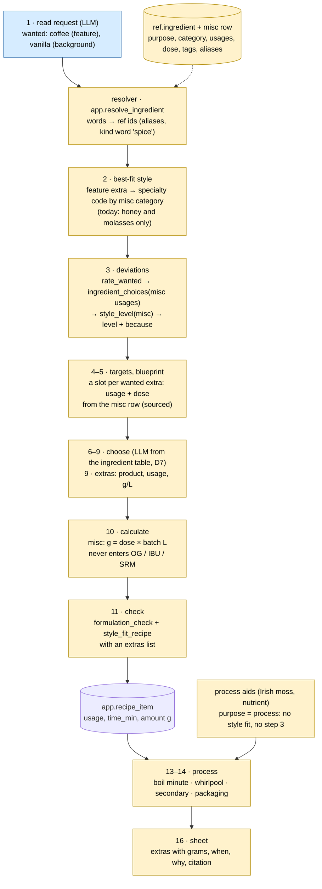

# Adding ingredients: discovery

> **Status:** discovery only, 2026-10-17; updated the same day with your answers (the form, process
> aids, "fully usable" conditions). No code, SQL, loader, workflow or test was changed.
> Everything under "today" was read from the repo or measured on the live DB on 2026-10-17
> (read-only queries). Everything under "proposed" is a proposal for you to accept, change or drop.
> Links: [PROJECT.md](../PROJECT.md) · [DATABASE.md](DATABASE.md) · [STYLE-FIT.md](STYLE-FIT.md) ·
> [RECIPE-ROADMAP.md](RECIPE-ROADMAP.md) · [WORKFLOW-ROADMAP.md](WORKFLOW-ROADMAP.md)

---

## TL;DR

- **Today there is no general way to add one ingredient.** Every product came in through a
  shop-specific loader (hopline SKU maps), and a fermentable needs two loaders plus a hand-edited
  facts file, in a fixed order. A product hopline does not sell (Special B, Lactobacillus) has no
  path at all.
- **Misc is a table and nothing else.** `ref.misc` has 0 rows and one column (`category`). Style
  fit, step 3 rating, the formulation check and the recipe check all leave misc out, and
  `app.style_level` raises an error for it. Process aids (Irish moss, yeast nutrient) have no place
  at all.
- **Decided (you, 2026-10-17): a form you fill in yourself writes a reviewed intake file.** One
  loader checks the file, loads it into `ref` and re-derives the tags. No LLM and no Claude are
  needed to add a hop, a malt, a yeast, a spice or a process aid (§6, §7).
- **Two phases.** Phase 1 (s8): the "form" is a template per kind in `shared/ingredients/`, filled
  in an editor, checked and loaded by one command. Phase 2 (later, `s10-ingredient-form`): an n8n
  form writes the same files, so the checks and the loader stay the same.
- **An entry is fully usable** when its kind's fields are filled, its words come from the pick-lists,
  and it has a source (§8). Ingredients that change the numbers (enzymes, acids, souring cultures)
  load from the form too, but they also need maths code before the pipeline can use them.
- **Three new side tracks** (`s8-ingredient-intake`, `s9-misc-extras`, later
  `s10-ingredient-form`), plus edits to the M4–M8 briefs and to eleven shipped pieces (§10, §11).
- **Nine decisions** are still open (§12).

---

## 1. What "add an ingredient" means here

You described it as (2026-10-17): a new hop comes out, a new malt can be bought, or you want to
fill misc with spices or with brewing helpers (Irish moss, yeast nutrient and the like), and you
want to add them yourself, from a form, with the source, without Claude.

| Lane | Who | What | Where it lands | When |
|---|---|---|---|---|
| **A · catalogue** | you, through the form (or by editing the template) | a product with sourced figures: a new hop, a new malt, a yeast or souring culture, a spice, a process aid | `ref` (curated, sourced, reviewed by you) | s8, s9, s10 |
| **B · my own stuff** | you, as brewer, in the chat | "I have 500 g of home-grown hops", "use the vanilla I have" | `app.inventory` (`ingredient_id` null + `raw_name`) and later a proposal for lane A | later (Priority 2) |

The project is single-user (PROJECT.md §2, non-goals), so you are both the maintainer and the
reviewer. Lane A is the one that has to be easy. Lane B stays as the schema already allows: an
unmatched inventory word is kept as text and reported `absent`, never invented (PROJECT.md §6.3).

---

## 2. How an ingredient enters today (measured)

`ref.ingredient` 297 rows: fermentable 81, hop 89, yeast 119, water_salt 8, **misc 0**.
`ref.ingredient_tag` 806, `ref.ingredient_review` 38, `ref.source` 36 (measured 2026-10-17).



What is good and should stay:

- Every row has a source, every filled field names its source in `field_source`, `raw` keeps the
  original record, unknown stays `NULL`.
- A new hopline product never loads silently: an SKU missing from the map raises.
- Tags are derived by code; an unknown descriptor word goes to `ref.ingredient_review`, never
  guessed.
- Every loader is idempotent (`upsert_ingredient` on `(kind, producer_key, name_key)`).

What makes adding one ingredient hard (the gaps, numbered for §10–§11):

| # | Gap | Where |
|---|---|---|
| G1 | **Every path is a hopline path.** A product from another shop, a maker's data sheet or a book has nowhere to go. Special B (b10) and Lactobacillus (b14) were left out for exactly this reason (`docs/finished/adjunct-fermentables/report.md`). | `loaders/*_products.py` |
| G2 | **A fermentable needs two loaders in order.** `loaders.malts`/`loaders.adjuncts` write the row, then `loaders.fermentable_facts` adds `role`, `description` and the rest. A fermentable without `role` breaks `app.style_level` and the formulation rules (both read `role`). The malt and adjunct loaders rewrite `max_pct` and `field_source` wholesale, so the order matters. | `loaders/fermentable_facts.py` header |
| G3 | **The tagger reads hopline page shapes.** Hop words come from `raw['hopline-hops'][sku]['spec']`, yeast words from hopline's Aroma field. A hop or yeast loaded from any other source gets no character tags and lands in `ingredient_review`. Misc has no branch at all. | `loaders/tags.py` `hop_words`, `yeast_words` |
| G4 | **Resolver synonyms and kind words are hard-coded SQL.** `app.ingredient_synonym()` has 3 rows, `app.ingredient_kind_word()` knows malt, hop and yeast only. Adding "cinnamon stick → cinnamon" or "spice" as a kind word means editing and re-applying `db/036`. | `db/036_ingredient_resolver.sql` |
| G5 | **Misc is a stub.** `ref.misc` has only `category` (10 values: spice, herb, fruit, wood, coffee, cacao, vanilla, smoke, fining, other). No purpose, usage, time, dose, description or `field_source`; no loader; 0 rows. Process aids other than finings have no category. | `db/012_style_fit.sql` |
| G6 | **Style fit and step 2 ignore misc.** Step 2's `app.specialty_style()` maps only honey and molasses to a specialty style. `app.usage_effects()` has no misc rows (STYLE-FIT.md §3 lists "spice · fruit · wood · smoke → any", not built). `app.style_level` raises `usage % is not valid for a misc`. `app.ingredient_choices` returns no choices for misc, so step 3 puts every misc word in `unrated`. `app.style_fit_cut_points()` has no dose → intensity points for spice, fruit, wood or smoke. | `db/022`, `db/033`, `db/034`, `db/037` |
| G7 | **Envelopes barely cover extras.** The 4 specialty dimensions exist (`spice`, `fruit`, `wood`, `smoke`), but only 25B has one of them (spice), and no specialty style (29 fruit, 30 spice, 33 wood, 32 smoked) has an envelope. | `ref.style_sensory`, measured |
| G8 | **Recipe-level checks have no extras slot.** `formulation_check.input` has `fermentables`, `hops`, `yeast` only; `app.style_fit_recipe` builds lines for those three only. | `shared/contracts/`, `db/032`, `db/034` |
| G9 | **Kinds that don't fit the four.** Fruit purée has gravity (so by DATABASE.md §2 it is a fermentable) but no role fits it; a bacterium (Lactobacillus) has no `ref.yeast.type` for it. | `fermentable.role`, `ref.yeast.type` |
| G10 | **Tests pin catalogue sizes.** `len(HOPS) == 89`, `len(YEASTS) == 119`, `len(PRODUCTS) == 74`, `len(rows) == 81` (×3), tags `== 89`. Any added row fails them even when it is right. | `tests/test_hops.py:169`, `test_yeasts.py:229`, `test_malts.py:170`, `test_fermentable_facts.py:137,347,371,437`, `test_tags.py:115` |
| G11 | **Docs still say "from the corpus".** DATABASE.md says misc is filled from "corpus misc names"; RECIPE-ROADMAP step 9 says "stage + dose from corpus misc usage stats"; the M4 and M5 briefs score by corpus popularity. The corpus was set aside on 2026-10-14 (D7). | docs |
| G12 | **Sources are added by SQL.** A new `ref.source` row means editing `db/011_ref_sources.sql` and applying it as `postgres`; a form cannot do that. | `db/011_ref_sources.sql` |

---

## 3. What the pipeline reads, per kind

An ingredient is "usable" when every step that touches it finds the fields it needs. This is the
minimum record, and so the list of fields on the form (§6) and in the template (§7).

| Field | Fermentable | Hop | Yeast | Misc · flavour | Misc · process aid | Read by |
|---|---|---|---|---|---|---|
| name, producer, source | ✔ | ✔ | ✔ | ✔ | ✔ | resolver (step 3, M5), sheet (16) |
| words / aliases a brewer types | ✔ | ✔ | ✔ | ✔ | ✔ | resolver (step 3, M5) |
| description (one to three sentences, sourced) | ✔ | ✔ | ✔ | ✔ | ✔ | LLM ingredient table (steps 6–9, D7), sheet |
| descriptor words → tags | name/description | aroma words | aroma words, family | flavour words | — | style fit (step 3), hop picks (8) |
| `extract_dbfg_pct`, `fermentability` | ✔ | | | | | OG/FG maths (10) |
| `ebc` | ✔ (null allowed, then colour check says so) | | | | | SRM maths (10), style fit |
| `role` | ✔ | | | | | style fit, formulation rules (11) |
| `max_pct`, `enzyme_activity`, `min_boil_min` | optional | | | | | formulation rules (11), boil (13) |
| `alpha_pct`, `purpose`, `origins` | | ✔ | | | | IBU maths (10), style fit, hop picks (8) |
| `total_oil_ml_100g` | | optional | | | | style fit cut points (dry hop) |
| `attenuation_pct`, `temp_c`, `type` | | | ✔ | | | FG (4, 10), ferment schedule (14), lager vs ale (6) |
| `flocculation`, `alcohol_tolerance_pct` | | | optional | | | yeast pick (6) |
| **new:** `purpose` (`flavour` · `process`), `category` | | | | ✔ | ✔ | style fit (flavour only), process (13–14) |
| **new:** usage(s), time, dose range g/L, each with its source | | | | ✔ | ✔ | blueprint slot (5, flavour), extras (9), process (13–14), style fit dose |

A process aid has no flavour, so it never reaches style fit or step 3: it is neutral in every
style and is never a deviation. Only the process steps (13–14) and the sheet read it.

---

## 4. Which kind is it?

The first question for any new ingredient, and the first question on the form. This keeps the
existing rule ("anything with gravity is a fermentable, extras without gravity are misc and never
enter the maths").



---

## 5. Proposed intake flow (lane A)

One place you write to, one command, one report. The shop loaders stay as they are, for bulk
catalogue refreshes; the intake folder is for everything added by hand.



Load order after s8: `loaders.malts` → `loaders.adjuncts` → `loaders.fermentable_facts` →
`loaders.hops` → `loaders.yeasts` → **`loaders.extra_ingredients`** → `loaders.tags` →
`loaders.style_envelopes`. Running everything twice gives the same rows, as today.

---

## 6. The form

**Decided (you, 2026-10-17):** the form writes the intake file; the n8n form comes later.

### Different structures, one loader

The kinds differ in one place only, their detail row (`ref.hop`, `ref.fermentable`, `ref.yeast`,
`ref.misc`). Everything else is the same for every kind: name, producer, source, aliases,
description, descriptor words, the `ref.ingredient` row, the tags. So there are not four loaders
but **one loader with one plain function per kind** (`load_hop`, `load_fermentable`, `load_yeast`,
`load_misc`), each readable on its own (PROJECT.md §6.8), and **one form that asks for the kind
first** and then shows only that kind's fields.

### Why the form writes a file, not the database

| | Form → intake file (decided) | Form → database directly |
|---|---|---|
| History | every ingredient is in git, diff per ingredient, undo by `git revert` | none |
| Rebuild | reloading `ref` from the loaders brings it back | lost on a reload |
| Rules | `ref` stays "load scripts + your review"; the pipeline keeps reading `ref` only (DATABASE.md §6) | n8n would write `ref`, which the access rules forbid |
| Checks | one checker, in Python, with tests | a second checker in n8n |
| Cost | one command (or later a button) after saving | instant |

### Where the files live

`shared/ingredients/`, one file per ingredient, in a folder per kind:

```
shared/ingredients/
  sources/<slug>.toml          a new ref.source row (slug, title, edition, publisher, url, licence)
  fermentable/<name>.toml
  hop/<name>.toml
  yeast/<name>.toml
  misc/<name>.toml
  _templates/                  one commented template per kind (phase 1's "form")
```

- `shared/` is in git (only `rag-files/`, `extracted-images/` and `docling-scratch/` are ignored),
  and the n8n container already mounts it as `/data/shared` (`docker-compose.yml`), so the phase 2
  form can write there.
- One file per ingredient means the form creates a file and never edits a shared one; removing an
  ingredient is deleting its file (the loader then reports the `ref` row it no longer finds, and
  you decide). See decision Q9.
- Sources go in the same folder so a form can add one too (G12). `db/011_ref_sources.sql` keeps
  the existing rows.

### What the form asks, per kind

Pick-lists wherever the pipeline reads the value; free text only for name, description, aliases
and source references (page, URL).

| Kind | Pick-list fields | Number fields (each with "source" and "page/URL") | Free text |
|---|---|---|---|
| all | kind, source (existing, or "new source"), descriptor words (from the known tags) | — | name, producer, aliases, description |
| fermentable | role (base · kilned · crystal · roast · adjunct · sugar), fermentability (full · normal · none), enzyme activity | extract % dbfg, EBC low–high, max %, minimum boil | — |
| hop | purpose (aroma · bittering · dual), origin (country list) | alpha % low–high, total oil mL/100 g | — |
| yeast | type (ale · lager · kveik · brett · lacto · pedio, Q4), flocculation, form (dry · liquid) | attenuation % low–high, temperature °C low–high, alcohol tolerance % | product id |
| misc · flavour | category, usages (mash · boil · whirlpool · ferment · secondary · packaging) | dose g/L low–high, time (boil minutes, or days in secondary) | — |
| misc · process aid | category (Q2), usages | dose g/L low–high, time | — |

A descriptor word that is not in the list can be typed, but the checker then says "new word:
add it to `style_fit_vocab.toml` first, or pick a known one". That is the only point where the
form can't finish the job alone, and it is still a one-line edit you make yourself.

### Phase 1 (s8): templates

The "form" is a commented template per kind in `shared/ingredients/_templates/`. You copy it,
fill it in an editor, run the checker. Nothing to build beyond the loader and its checks, and it
works on day one.

### Phase 2 (`s10-ingredient-form`, later): n8n form

A Form Trigger with a first page asking for the kind, then a page per kind, then a node that
writes the file into `/data/shared/ingredients/<kind>/`. The pick-lists come from `ref` (sources,
tags) through a Postgres read. Loading stays the same command; whether n8n can start the
Python loader itself is open. **Unverified:** how n8n forms handle a page per kind and how the
lists get filled (the docs check through Context7 failed on 2026-10-17 with an invalid API key);
s10's brief checks this first.

---

## 7. The intake file: shape (proposal)

The file follows `fermentable_facts.toml`: reviewed, versioned TOML, every value with its source.
The loader refuses a file that is missing a required field from §3.

The values below are **placeholders that show the shape**, not data.

```toml
# shared/ingredients/fermentable/special-b.toml
kind = "fermentable"
name = "Special B"
producer = "<maltster>"
source = "<slug>"                 # ref.source row for the data sheet
extract_dbfg_pct = 0.0            # <from the data sheet>
extract_ref = "p. N"
ebc = [0, 0]                      # low, high
ebc_ref = "p. N"
role = "crystal"
description = "<one to three sentences from the source>"
description_ref = "p. N"
aliases = ["special b"]
descriptors = ["dried-fruit", "caramel"]
```

```toml
# shared/ingredients/hop/<variety>.toml
kind = "hop"
name = "<variety>"
source = "<slug>"
alpha_pct = [0.0, 0.0]
alpha_ref = "<URL>"
purpose = "aroma"                 # aroma | bittering | dual
origins = ["US"]
descriptors = ["citrus", "pine"]  # read by loaders.tags instead of the hopline Aroma line
```

```toml
# shared/ingredients/misc/irish-moss.toml
kind = "misc"
purpose = "process"               # flavour | process
category = "fining"
name = "Irish Moss"
source = "<slug>"
usages = ["boil"]
time_min = 0                      # <boil minutes, from the source>
dose_g_per_l = [0.0, 0.0]         # <from the source>
dose_ref = "<page or URL>"
description = "<from the source>"
aliases = ["irish moss"]
```

```toml
# shared/ingredients/misc/cinnamon.toml
kind = "misc"
purpose = "flavour"
category = "spice"
name = "Cinnamon"
source = "<slug>"
usages = ["boil", "secondary"]
dose_g_per_l = [0.0, 0.0]         # the dose source for coffee can be janish-coffee-beers
dose_ref = "<page or URL>"
description = "<from the source>"
aliases = ["cinnamon stick", "fahéj"]
descriptors = ["spicy"]
```

```toml
# shared/ingredients/sources/<slug>.toml
slug = "<slug>"
title = "<title>"
edition = "<edition or version>"
publisher = "<publisher>"
url = "<URL>"
```

Checks the loader runs before writing anything (each a test):

1. every file has its kind's required fields (§3) and a `source` that exists in `ref.source` or
   in `sources/`; every source has an edition or version;
2. `(kind, producer, name)` does not clash with a row another loader owns (hopline rows stay
   hopline's);
3. ranges are low ≤ high, units are SI (°C, g/L, EBC);
4. every descriptor word is a known tag or synonym; every alias resolves, through
   `app.resolve_ingredient`, to this product and nothing else of another kind;
5. `fermentability` other than `normal` has a source (DATABASE.md §2 rule);
6. a misc `category` that changes the numbers (enzyme, acid, Q2) and a culture type without maths
   yet (lacto, pedio) load, and the report marks them "waits for maths" (§8).

---

## 8. When is a form entry fully usable?

You asked (2026-10-17) whether an entry made from name, figures, descriptor words and sensory
words, without Claude, becomes a full-value item in the workflow. Yes, under these conditions:

| You add | Fully usable from the form alone? | Condition |
|---|---|---|
| **Hop** (alpha, oil, purpose, origin, aroma words) | ✅ after s8 | aroma words from the tag list |
| **Malt or other fermentable** (extract, EBC, role, max %, description) | ✅ after s8 | role from the six roles; typical styles (`fermentable_style`) optional |
| **Yeast** (attenuation, temperature, type, flocculation, aroma words) | ✅ after s8 | words from the tag list |
| **Flavour misc** (spice, herb, fruit without gravity data, wood, coffee, cacao, vanilla, smoke) | ✅ after s9 | s9 gives each category its sensation, usage effect and dose cut points once; a new spice then needs only its file |
| **Process aid without effect on the numbers** (Irish moss, Whirlfloc, gelatin, yeast nutrient) | ✅ after s9 | category, usage, time, dose; neutral in style fit; placed by the process steps (m7) |
| **Ingredient that changes the numbers** (enzymes such as glucoamylase, acids such as lactic acid, souring bacteria) | ⚠️ loads, but waits | FG, mash pH and acidity are brewing maths, so they need tested code first (CLAUDE.md): enzymes with the attenuation model (s5/m6), acids with the water step (m7), souring with m7's souring schedule. The report says "waits for maths" until then |

The conditions in one list:

1. s8 is built (all kinds but misc), and s9 for misc.
2. Every field the pipeline reads (§3) is filled, from a source, with its page or URL.
3. Descriptor words come from the known tags (69 today); a new word is first added to
   `loaders/style_fit_vocab.toml` (one line, no code).
4. The source exists, or is added as a `sources/` file in the same go.
5. The checker passes and the loader has run.
6. The ingredient does not need new maths (last row of the table).

What still needs code (or Claude), because it is not an ingredient but a new kind of behaviour:

- a new sensory dimension, or a new process-aid category that the process steps must handle;
- an envelope for a specialty style (fruit beer, spice beer); it comes from the style guidelines,
  not from the ingredient;
- the maths for an ingredient that changes the numbers.

The counts in PROJECT.md and DATABASE.md are text you update by hand (or the loader's report
gives you the numbers to paste).

---

## 9. How one added ingredient flows through the pipeline

Example: the brief "a coffee stout with vanilla" after s8 and s9. The blue box exists today; the
yellow ones are what s9 and the brief edits add.



The same path holds for an added fermentable, hop or yeast, with one difference: those kinds
already work in steps 3, 10 and 11, so s8 alone makes them usable. Misc needs s9 as well. Process
aids join at the process steps only; who decides to add them is decision Q10.

---

## 10. What to change in the briefs

### Delivery briefs (`docs/work/<slug>/brief.md`, all drafts)

| Brief | Change | Why |
|---|---|---|
| [`m4-targets-blueprint`](work/m4-targets-blueprint/brief.md) | R7: a slot for **every** wanted flavour ingredient, not only adjuncts: a misc slot takes its usage and dose from the misc row (s9), a fermentable extra its % (≤ `max_pct`). Drop the `corpus.style_profile` wording (R6–R8, Needs) in line with D7. Needs: add `s8`, `s9`. | G5, G11 |
| [`m5-choose-ingredients`](work/m5-choose-ingredients/brief.md) | Rewrite to D7: the LLM picks from the ingredient table and code checks it, instead of "scored by code … corpus popularity". Step 9 extras becomes real (it now "passes through with an empty list"). Resolver scope: aliases from the intake files instead of growing `app.ingredient_synonym()`. Open question 1 (b14 souring culture) is answered by s8: add one culture as a `yeast` file. A10: the added Special B fills b10's slot. Needs: `s8`, `s9`. | G1, G4, G9, G11 |
| [`m6-compute-validate`](work/m6-compute-validate/brief.md) | R1/R5: misc amounts (g from g/L × batch) saved as `recipe_item` rows, outside the gravity maths. R2: `formulation_check.input` and `app.style_fit_recipe` get an `extras` list (contract change). If fruit purée is a fermentable (Q3), it enters OG like any sugar. | G8 |
| [`m7-process`](work/m7-process/brief.md) | R3/R4: extras and process aids appear in the schedule at their usage (boil minute, whirlpool, secondary day, packaging); process aids are added as Q10 decides. Lactobacillus from the intake files feeds the b14 souring schedule. Acids, if loaded, wait for the water maths of step 12. | G5, G9 |
| [`m8-recipe-sheet-chat`](work/m8-recipe-sheet-chat/brief.md) | R2: an "Extras and process aids" section (grams, when, why). Later, lane B: an unmatched inventory word is listed as "not in the catalogue" with a pointer to the form. | lane B |
| [`s5-mash-attenuation`](work/s5-mash-attenuation/brief.md) | No change now. An enzyme added through the form would need its effect on attenuation here or in m6 before it is usable. | §8 |

### New work items

| Slug | Delivers | Needs |
|---|---|---|
| `s8-ingredient-intake` | `shared/ingredients/` with templates, `loaders/extra_ingredients.py` (checker + one function per kind + sources), aliases in the resolver, the tagger reading the files, size-free tests, spot-check rows, the §11 checklist | — |
| `s9-misc-extras` | `ref.misc` columns and categories, misc in style fit, step 2 and step 3, process aids as neutral, dose cut points with a source, envelopes for the specialty styles the new test briefs need | s8 |
| `s10-ingredient-form` (later) | the n8n form writing the same files, pick-lists from `ref` | s8, s9 |

### Recipe test briefs (`evals/recipe_briefs.toml`)

None of the 22 briefs asks for a misc extra (all `wanted` items are oats, rice, corn or honey),
so nothing measures step 9 today. Proposal: two new briefs written in s9 and approved by you,
for example a coffee-vanilla stout (feature extra → specialty style) and a pale ale "with a
little orange peel" (background extra → base style + deviation). Changing P0 needs your approval
(`test-briefs` rules).

### Project docs

| Doc | Change |
|---|---|
| [DATABASE.md](DATABASE.md) §2 | `misc` row: real columns, flavour and process purposes, "filled from `shared/ingredients/`", not "corpus misc names". Fill order step 2: add the intake loader. `ref.source`: also loaded from `shared/ingredients/sources/`. |
| [RECIPE-ROADMAP.md](RECIPE-ROADMAP.md) §3 | Step 9: "stage + dose from the misc row (sourced)", not "corpus misc usage stats". |
| [STYLE-FIT.md](STYLE-FIT.md) §2–§4 | Misc tagging rule as built, misc usage effects, misc dose cut points; process aids neutral. |
| [WORKFLOW-ROADMAP.md](WORKFLOW-ROADMAP.md) | s8 and s9 in the diagram and the work-item table, before m5; s10 later. |
| [OPERATIONS.md](OPERATIONS.md) | The "add an ingredient" checklist (§13). |

---

## 11. What to change in shipped steps

Each of these is already merged; the change goes into the work item named.

| Shipped piece | Change | Gap | In |
|---|---|---|---|
| `db/012_style_fit.sql` · `ref.misc` | add `purpose` (`flavour` · `process`), `usages text[]`, `time_min`, `dose_g_per_l numrange`, `description`, `field_source jsonb`; categories as decided (Q2) | G5 | s9 |
| `loaders/tags.py` | read `raw.descriptors` for rows the intake loader wrote (hop, yeast, misc); a misc branch: category → family tag, descriptors → character tags; process aids get no tags | G3 | s8 (hop, yeast) · s9 (misc) |
| `db/036_ingredient_resolver.sql` | read aliases (new `ref.ingredient_alias`, loaded from the intake files); kind words for misc (`spice`, `fruit`, …) | G4 | s8 |
| `db/022_step2.sql` · `app.specialty_style()` | specialty codes by misc category rather than by word (spice/herb → 30A, fruit → 29A, wood → 33A, smoke → 32A, BA equivalents), so an added misc product needs no new row here; keep the honey and molasses rows | G6 | s9 |
| `db/033_style_fit_effects.sql` | flavour misc rows in `app.usage_effects()` (spice → spice, fruit → fruit, wood → wood, smoke → smoke; coffee, cacao, vanilla as decided in Q5); dose cut points for those dimensions, with a source; none for process aids | G6 | s9 |
| `db/034_style_level.sql` | accept misc usages; a process aid is `allowed` with "no flavour effect"; `style_fit_recipe` takes an `extras` list | G6, G8 | s9 |
| `db/037_step3.sql` · `app.ingredient_choices` | misc choices from the row's `usages` | G6 | s9 |
| `shared/contracts/formulation_check.input.schema.json` | optional `extras` array | G8 | m6 (or s9) |
| tests pinning sizes (G10 list) | count only the hopline rows (`raw ? 'hopline-…'`) or the map, so an added row doesn't fail them | G10 | s8 |
| `db/checks/ref_spotcheck.sql` | add the intake rows to the pack | — | s8 |
| envelopes (`loaders/style_envelopes.toml`) | envelopes for the specialty styles the new test briefs need (e.g. 30A, 30B, 20C with coffee), extracted and reviewed as in s3 | G7 | s9 |

Step 1 needs no change: it already outputs free `wanted` words with a `feature` / `background`
role.

---

## 12. Decisions

### Made

| # | Question | Decision | Why |
|---|---|---|---|
| Q1 | Where do hand-added products live, and how are they entered? | A form you fill in yourself writes the reviewed intake files; one loader checks and loads them. Phase 1 templates (s8), the n8n form later (s10). (You, 2026-10-17) | You want to add ingredients yourself, with the source, without Claude; files keep history and survive a reload |

### Open

| # | Question | Options | Recommend |
|---|---|---|---|
| Q2 | Misc categories and usages | a) usages `mash · boil · whirlpool · ferment · secondary · packaging`; flavour categories as today (spice, herb, fruit, wood, coffee, cacao, vanilla, smoke, other); process categories `fining`, `nutrient`, `enzyme`, `acid`, `other-process`, with enzyme and acid marked "changes the numbers"; b) the 10 categories as they are, process aids under `fining` and `other` | **a**: Irish moss and yeast nutrient get real places, and the checker knows which ones wait for maths |
| Q3 | Fruit | a) fruit with a sourced sugar content is a fermentable with a new role `fruit` (enters OG), fruit without one is flavour misc; b) all fruit is misc (no gravity) | **a**: keeps the "gravity → fermentable" rule true |
| Q4 | Souring cultures | a) `ref.yeast` with `type = 'lacto'` / `'pedio'` (the `sour` family tag exists); b) a new kind `culture` | **a**: no new table; the yeast steps already handle temperature and attenuation |
| Q5 | Coffee, cacao, vanilla: which sensation? | a) coffee and cacao → `roast` with their character tags, vanilla → `sweetness` + tag `vanilla`; b) new specialty dimensions `coffee`, `chocolate`, `vanilla` | **a** first; b only if a reviewed envelope needs it |
| Q6 | Aliases | a) per product in its intake file (new `ref.ingredient_alias`); b) keep growing `app.ingredient_synonym()` | **a** for product aliases; b stays for spelling rules (abbaye → abbey) |
| Q7 | Order | a) s8 → s9 → m4 → m5; b) m4 first, s8/s9 before m5 | **b**: m4 only needs the misc row shape for its slot, which s9's brief can fix first |
| Q8 | Lane B (chat adds an ingredient) | a) later, Priority 2: the chat writes a proposal file you check and keep; b) now | **a** |
| Q9 | One file per ingredient or one file for all | a) `shared/ingredients/<kind>/<name>.toml`, one per ingredient; b) one `extra_ingredients.toml` with a block per ingredient | **a**: a form creates a file and never edits a shared one; a diff and a delete are per ingredient |
| Q10 | Who adds process aids to a recipe? | a) the brewer profile lists the aids you use (e.g. "Irish moss in every boil"), and m7 adds them from there and from inventory; b) only when the brief asks; c) the LLM decides in step 9 | **a**: it is your habit, not the recipe's choice, and it keeps the LLM out of it |

---

## 13. After s8 (and s9 for misc): adding an ingredient, as a checklist

1. Find a source with the figures (§3 lists what each kind needs).
2. Fill the form for the kind (phase 1: copy `shared/ingredients/_templates/<kind>.toml` to
   `shared/ingredients/<kind>/<name>.toml`). A new source: add `shared/ingredients/sources/<slug>.toml`.
3. `python -m loaders.extra_ingredients --check`, fix what it names (a new descriptor word: add it
   to `loaders/style_fit_vocab.toml`).
4. `python -m loaders.extra_ingredients`, then `python -m loaders.tags`.
5. Read the report: loaded, tagged, each alias found, "usable now" or "waits for maths".
6. `pytest -m "not stack"` and the stack tests for the loaders.
7. Commit the file(s); update the counts in PROJECT.md and DATABASE.md from the report.

None of these steps needs an LLM or Claude. A project skill (`add-ingredient`) could still walk
Claude Code through them when you'd rather ask "add Special B from its data sheet"; it would only
fill the file and run the commands, and the checks stay in the loader's code.
