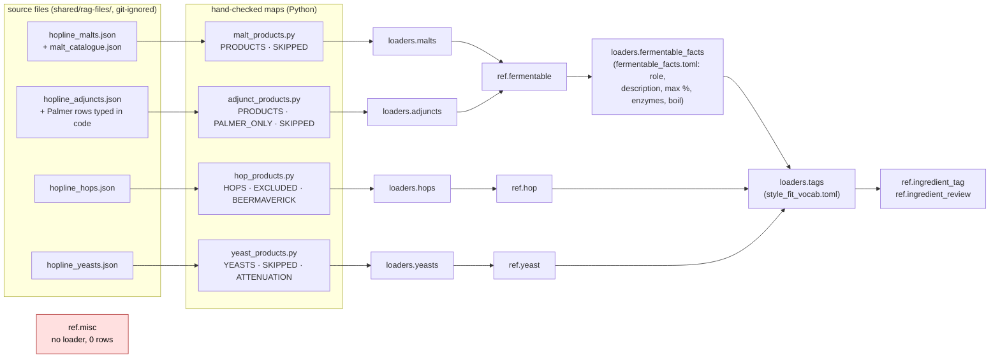
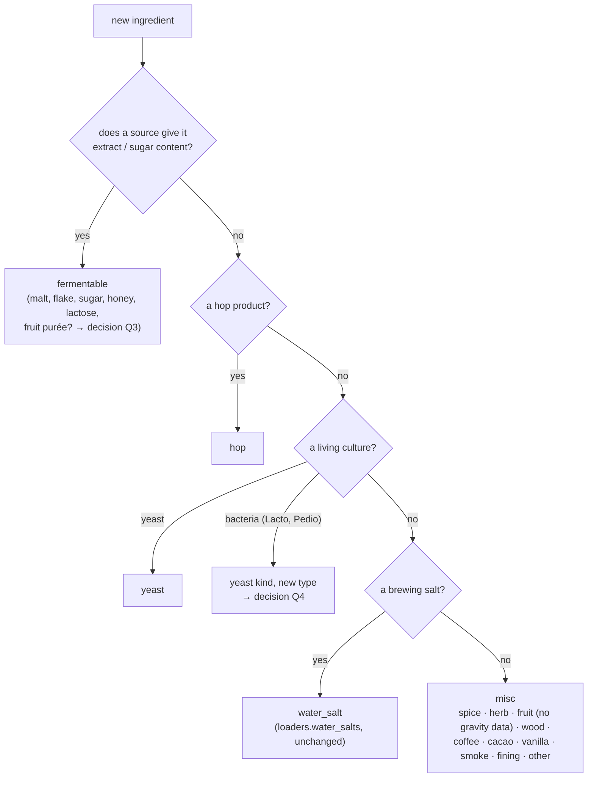
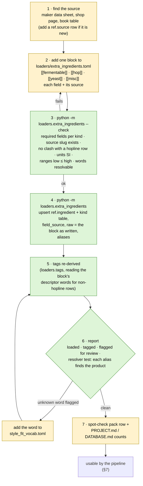
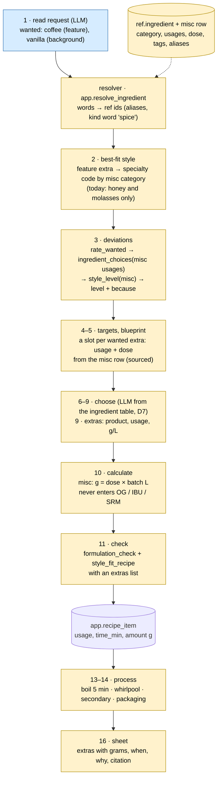

# Adding ingredients: discovery

> **Status:** discovery only, 2026-10-17. No code, SQL, loader, workflow or test was changed.
> Everything under "today" was read from the repo or measured on the live DB on 2026-10-17
> (read-only queries). Everything under "proposed" is a proposal for you to accept, change or drop.
> Links: [PROJECT.md](../PROJECT.md) · [DATABASE.md](DATABASE.md) · [STYLE-FIT.md](STYLE-FIT.md) ·
> [RECIPE-ROADMAP.md](RECIPE-ROADMAP.md) · [WORKFLOW-ROADMAP.md](WORKFLOW-ROADMAP.md)

---

## TL;DR

- **Today there is no general way to add one ingredient.** Every product came in through a
  shop-specific loader (hopline SKU maps), and a fermentable needs two loaders plus a hand-edited
  facts file, in a fixed order. A product hopline does not sell (Special B, Lactobacillus) has no
  path at all.
- **Misc (spices, fruit, coffee, vanilla, wood) is a table and nothing else.** `ref.misc` has
  0 rows and one column (`category`). Style fit, step 3 rating, the formulation check and the
  recipe check all leave misc out, and `app.style_level` raises an error for it.
- **Proposal: one reviewed intake file and one command.** `loaders/extra_ingredients.toml` holds
  hand-added products of every kind (`[[fermentable]]`, `[[hop]]`, `[[yeast]]`, `[[misc]]`), each
  field with its source. `python -m loaders.extra_ingredients` checks it, loads it, and re-derives
  tags. Adding an ingredient becomes "add a block, run one command, read the report".
- **Two new side tracks** (`s8-ingredient-intake`, `s9-misc-extras`) before M5, plus edits to the
  M4, M5, M6 and M7 briefs (and a small one to M8), and to eleven shipped pieces: SQL in
  `db/012`, `022`, `033`, `034`, `036`, `037`, `loaders/tags.py`, one contract, the size-pinned
  tests, the spot-check pack and the envelopes (tables in §8 and §9).
- **Eight decisions** are yours to make before s8 starts (§10).

---

## 1. What "add an ingredient" means here

There are two different people adding two different things:

| Lane | Who | What | Where it lands | When |
|---|---|---|---|---|
| **A · catalogue** | you, as maintainer (or Claude Code for you) | a real product with sourced figures: a malt hopline doesn't sell, a new hop, a souring culture, cinnamon | `ref` (curated, sourced, reviewed) | s8 and s9 (this proposal) |
| **B · my own stuff** | you, as brewer, in the chat | "I have 500 g of home-grown hops", "use the vanilla I have" | `app.inventory` (`ingredient_id` null + `raw_name`) and later a proposal for lane A | later (Priority 2) |

The project is single-user (PROJECT.md §2, non-goals), so the "user" who adds an ingredient is
you. Lane A is therefore the one that has to be easy. Lane B stays as the schema already
allows: an unmatched inventory word is kept as text and reported `absent`, never invented
(PROJECT.md §6.3).

---

## 2. How an ingredient enters today (measured)

`ref.ingredient` 297 rows: fermentable 81, hop 89, yeast 119, water_salt 8, **misc 0**.
`ref.ingredient_tag` 806, `ref.ingredient_review` 38, `ref.source` 36 (measured 2026-10-17).



What is good and should stay:

- Every row has a source, every filled field names its source in `field_source`, `raw` keeps the
  original record, unknown stays `NULL`.
- A new hopline product never loads silently: an SKU missing from the map raises.
- Tags are derived by code; an unknown descriptor word goes to `ref.ingredient_review`, never
  guessed.
- Every loader is idempotent (`upsert_ingredient` on `(kind, producer_key, name_key)`).

What makes adding one ingredient hard (the gaps, numbered for §8–§9):

| # | Gap | Where |
|---|---|---|
| G1 | **Every path is a hopline path.** A product from another shop, a maker's data sheet or a book has nowhere to go. Special B (b10) and Lactobacillus (b14) were left out for exactly this reason (`docs/finished/adjunct-fermentables/report.md`). | `loaders/*_products.py` |
| G2 | **A fermentable needs two loaders in order.** `loaders.malts`/`loaders.adjuncts` write the row, then `loaders.fermentable_facts` adds `role`, `description` and the rest. A fermentable without `role` breaks `app.style_level` and the formulation rules (both read `role`). The malt and adjunct loaders rewrite `max_pct` and `field_source` wholesale, so the order matters. | `loaders/fermentable_facts.py` header |
| G3 | **The tagger reads hopline page shapes.** Hop words come from `raw['hopline-hops'][sku]['spec']`, yeast words from hopline's Aroma field. A hop or yeast loaded from any other source gets no character tags and lands in `ingredient_review`. Misc has no branch at all. | `loaders/tags.py` `hop_words`, `yeast_words` |
| G4 | **Resolver synonyms and kind words are hard-coded SQL.** `app.ingredient_synonym()` has 3 rows, `app.ingredient_kind_word()` knows malt, hop and yeast only. Adding "cinnamon stick → cinnamon" or "spice" as a kind word means editing and re-applying `db/036`. | `db/036_ingredient_resolver.sql` |
| G5 | **Misc is a stub.** `ref.misc` has only `category` (10 values). No usage, time, dose, description or `field_source`; no loader; 0 rows. | `db/012_style_fit.sql` |
| G6 | **Style fit and step 2 ignore misc.** Step 2's `app.specialty_style()` maps only honey and molasses to a specialty style. `app.usage_effects()` has no misc rows (STYLE-FIT.md §3 lists "spice · fruit · wood · smoke → any", not built). `app.style_level` raises `usage % is not valid for a misc`. `app.ingredient_choices` returns no choices for misc, so step 3 puts every misc word in `unrated`. `app.style_fit_cut_points()` has no dose → intensity points for spice, fruit, wood or smoke. | `db/022`, `db/033`, `db/034`, `db/037` |
| G7 | **Envelopes barely cover extras.** The 4 specialty dimensions exist (`spice`, `fruit`, `wood`, `smoke`), but only 25B has one of them (spice), and no specialty style (29 fruit, 30 spice, 33 wood, 32 smoked) has an envelope. | `ref.style_sensory`, measured |
| G8 | **Recipe-level checks have no extras slot.** `formulation_check.input` has `fermentables`, `hops`, `yeast` only; `app.style_fit_recipe` builds lines for those three only. | `shared/contracts/`, `db/032`, `db/034` |
| G9 | **Kinds that don't fit the four.** Fruit purée has gravity (so by DATABASE.md §2 it is a fermentable) but no role fits it; a bacterium (Lactobacillus) has no `ref.yeast.type` for it. | `fermentable.role`, `ref.yeast.type` |
| G10 | **Tests pin catalogue sizes.** `len(HOPS) == 89`, `len(YEASTS) == 119`, `len(PRODUCTS) == 74`, `len(rows) == 81` (×3), tags `== 89`. Any added row fails them even when it is right. | `tests/test_hops.py:169`, `test_yeasts.py:229`, `test_malts.py:170`, `test_fermentable_facts.py:137,347,371,437`, `test_tags.py:115` |
| G11 | **Docs still say "from the corpus".** DATABASE.md says misc is filled from "corpus misc names"; RECIPE-ROADMAP step 9 says "stage + dose from corpus misc usage stats"; the M4 and M5 briefs score by corpus popularity. The corpus was set aside on 2026-10-14 (D7). | docs |

---

## 3. What the pipeline reads, per kind

An ingredient is "usable" when every step that touches it finds the fields it needs. This is the
minimum record, and so the list of required fields for the intake file (§6).

| Field | Fermentable | Hop | Yeast | Misc | Read by |
|---|---|---|---|---|---|
| name, producer, source | ✔ | ✔ | ✔ | ✔ | resolver (step 3, M5), sheet (16) |
| words / aliases a brewer types | ✔ | ✔ | ✔ | ✔ | resolver (step 3, M5) |
| description (one to three sentences, sourced) | ✔ | ✔ | ✔ | ✔ | LLM ingredient table (steps 6–9, D7), sheet |
| descriptor words → tags | name/description | aroma words | aroma words, family | category, flavour words | style fit (step 3), hop picks (8) |
| `extract_dbfg_pct`, `fermentability` | ✔ | | | | OG/FG maths (10) |
| `ebc` | ✔ (null allowed, then colour check says so) | | | | SRM maths (10), style fit |
| `role` | ✔ | | | | style fit, formulation rules (11) |
| `max_pct`, `enzyme_activity`, `min_boil_min` | optional | | | | formulation rules (11), boil (13) |
| `alpha_pct`, `purpose`, `origins` | | ✔ | | | IBU maths (10), style fit, hop picks (8) |
| `total_oil_ml_100g` | | optional | | | style fit cut points (dry hop) |
| `attenuation_pct`, `temp_c`, `type` | | | ✔ | | FG (4, 10), ferment schedule (14), lager vs ale (6) |
| `flocculation`, `alcohol_tolerance_pct` | | | optional | | yeast pick (6) |
| `category` | | | | ✔ | style fit (which sensation) |
| **new:** usage(s), time, dose range g/L with its source | | | | ✔ | blueprint slot (5), extras (9), process (13–14), style fit dose |

---

## 4. Which kind is it?

The first question for any new ingredient. This keeps the existing rule ("anything with gravity
is a fermentable, extras without gravity are misc and never enter the maths").



---

## 5. Proposed intake flow (lane A)

One file you edit, one command, one report. The shop loaders stay as they are, for bulk
catalogue refreshes; the intake file is for everything added by hand.



Load order after s8: `loaders.malts` → `loaders.adjuncts` → `loaders.fermentable_facts` →
`loaders.hops` → `loaders.yeasts` → **`loaders.extra_ingredients`** → `loaders.tags` →
`loaders.style_envelopes`. Running everything twice gives the same rows, as today.

---

## 6. The intake file: shape (proposal)

The file follows `fermentable_facts.toml`: a reviewed, versioned TOML file next to its loader,
one block per product, every value with its source. The loader has one plain function per kind
(PROJECT.md §6.8: readable, no generic machinery), and refuses a block that is missing a required
field from §3.

The values below are **placeholders that show the shape**, not data.

```toml
# loaders/extra_ingredients.toml: products added by hand (not from a hopline page).
# One block per product. Every figure names its source (a ref.source slug) and where in it.
# A field that no source states is left out (it loads as NULL). Nothing is guessed.

[[fermentable]]
name = "Special B"
producer = "<maltster>"
source = "<slug>"                 # ref.source row for the data sheet
extract_dbfg_pct = 0.0            # <from the data sheet>
extract_ref = "p. N"
ebc = [0, 0]                      # low, high
ebc_ref = "p. N"
role = "crystal"
role_note = "R1 list"
description = "<one to three sentences from the source>"
description_ref = "p. N"
aliases = ["special b"]
descriptors = ["raisin", "dried fruit"]

[[hop]]
name = "<variety>"
producer = ""
source = "<slug>"
alpha_pct = [0.0, 0.0]
purpose = "aroma"                 # aroma | bittering | dual
origins = ["US"]
descriptors = ["citrus", "pine"]  # read by loaders.tags instead of the hopline Aroma line

[[yeast]]
name = "<strain>"
producer = "<maker>"
product_id = "<code>"
source = "<slug>"
type = "lacto"                    # see decision Q4
attenuation_pct = [0, 0]
temp_c = [0, 0]
descriptors = ["sour", "clean"]

[[misc]]
name = "Cinnamon"
producer = ""
source = "<slug>"
category = "spice"
usages = ["boil", "secondary"]    # see decision Q2
dose_g_per_l = [0.0, 0.0]         # with dose_ref; the dose source for coffee can be janish-coffee-beers
dose_ref = "<page or URL>"
time_min = 5                      # boil only
description = "<from the source>"
aliases = ["cinnamon stick", "fahéj"]
descriptors = ["spicy"]
```

Checks the loader runs before writing anything (each a test):

1. every block has its kind's required fields (§3) and a `source` that exists in `ref.source`;
2. `(kind, producer, name)` does not clash with a row another loader owns (hopline rows stay
   hopline's);
3. ranges are low ≤ high, units are SI (°C, g/L, EBC);
4. every alias resolves, through `app.resolve_ingredient`, to this product and nothing else of
   another kind;
5. `fermentability` other than `normal` has a source (DATABASE.md §2 rule).

---

## 7. How one added ingredient flows through the pipeline

Example: the brief "a coffee stout with vanilla" after s8 and s9. The blue boxes exist today;
the yellow ones are what s9 and the brief edits add.



The same path holds for an added fermentable, hop or yeast, with one difference: those kinds
already work in steps 3, 10 and 11, so s8 alone makes them usable. Misc needs s9 as well.

---

## 8. What to change in the briefs

### Delivery briefs (`docs/work/<slug>/brief.md`, all drafts)

| Brief | Change | Why |
|---|---|---|
| [`m4-targets-blueprint`](work/m4-targets-blueprint/brief.md) | R7: a slot for **every** wanted ingredient, not only adjuncts: a misc slot takes its usage and dose from the misc row (s9), a fermentable extra its % (≤ `max_pct`). Drop the `corpus.style_profile` wording (R6–R8, Needs) in line with D7. Needs: add `s8`, `s9`. | G5, G11 |
| [`m5-choose-ingredients`](work/m5-choose-ingredients/brief.md) | Rewrite to D7: the LLM picks from the ingredient table and code checks it, instead of "scored by code … corpus popularity". Step 9 extras becomes real (it now "passes through with an empty list"). Resolver scope: aliases from the intake file instead of growing `app.ingredient_synonym()`. Open question 1 (b14 souring culture) is answered by s8: add one culture as a `[[yeast]]` block. A10: the added Special B fills b10's slot. Needs: `s8`, `s9`. | G1, G4, G9, G11 |
| [`m6-compute-validate`](work/m6-compute-validate/brief.md) | R1/R5: misc amounts (g from g/L × batch) saved as `recipe_item` rows, outside the gravity maths. R2: `formulation_check.input` and `app.style_fit_recipe` get an `extras` list (contract change). If fruit purée is a fermentable (Q3), it enters OG like any sugar. | G8 |
| [`m7-process`](work/m7-process/brief.md) | R3/R4: extras appear in the schedule at their usage (boil minute, whirlpool, secondary day, packaging). Lactobacillus from the intake file feeds the b14 souring schedule. | G5, G9 |
| [`m8-recipe-sheet-chat`](work/m8-recipe-sheet-chat/brief.md) | R2: an "Extras" section (grams, when, why). Later, lane B: an unmatched inventory word is listed as "not in the catalogue" with a pointer to the intake file. | lane B |
| [`s5-mash-attenuation`](work/s5-mash-attenuation/brief.md) | No change. | — |

### Recipe test briefs (`evals/recipe_briefs.toml`)

None of the 22 briefs asks for a misc extra (all `wanted` items are oats, rice, corn or honey),
so nothing measures step 9 today. Proposal: two new briefs written in s9 and approved by you,
for example a coffee-vanilla stout (feature extra → specialty style) and a pale ale "with a
little orange peel" (background extra → base style + deviation). Changing P0 needs your approval
(`test-briefs` rules).

### Project docs

| Doc | Change |
|---|---|
| [DATABASE.md](DATABASE.md) §2 | `misc` row: real columns and "filled from `loaders/extra_ingredients.toml`", not "corpus misc names". Fill order step 2: add the intake loader. |
| [RECIPE-ROADMAP.md](RECIPE-ROADMAP.md) §3 | Step 9: "stage + dose from the misc row (sourced)", not "corpus misc usage stats". |
| [STYLE-FIT.md](STYLE-FIT.md) §2–§4 | Misc tagging rule as built, misc usage effects, misc dose cut points. |
| [WORKFLOW-ROADMAP.md](WORKFLOW-ROADMAP.md) | s8 and s9 in the diagram and the work-item table, before m5. |
| [OPERATIONS.md](OPERATIONS.md) or a project skill | The "add an ingredient" checklist (§11). |

---

## 9. What to change in shipped steps

Each of these is already merged; the change goes into the work item named.

| Shipped piece | Change | Gap | In |
|---|---|---|---|
| `db/012_style_fit.sql` · `ref.misc` | add `usages text[]`, `time_min`, `dose_g_per_l numrange`, `description`, `field_source jsonb`; categories as decided (Q2) | G5 | s9 |
| `loaders/tags.py` | read `raw.descriptors` for rows the intake loader wrote (hop, yeast, misc); a misc branch: category → family tag, descriptors → character tags | G3 | s8 (hop, yeast) · s9 (misc) |
| `db/036_ingredient_resolver.sql` | read aliases (new `ref.ingredient_alias`, loaded from the intake file); kind words for misc (`spice`, `fruit`, …) | G4 | s8 |
| `db/033_style_fit_effects.sql` | misc rows in `app.usage_effects()` (spice → spice, fruit → fruit, wood → wood, smoke → smoke; coffee, cacao, vanilla as decided in Q5); dose cut points for those dimensions, with a source | G6 | s9 |
| `db/034_style_level.sql` | accept misc usages; `style_fit_recipe` takes an `extras` list | G6, G8 | s9 |
| `db/037_step3.sql` · `app.ingredient_choices` | misc choices from the row's `usages` | G6 | s9 |
| `shared/contracts/formulation_check.input.schema.json` | optional `extras` array | G8 | m6 (or s9) |
| tests pinning sizes (G10 list) | count only the hopline rows (`raw ? 'hopline-…'`) or the map, so an added row doesn't fail them | G10 | s8 |
| `db/checks/ref_spotcheck.sql` | add the intake rows to the pack | — | s8 |
| envelopes (`loaders/style_envelopes.toml`) | envelopes for the specialty styles the new test briefs need (e.g. 30A, 30B, 20C with coffee), extracted and reviewed as in s3 | G7 | s9 |

Step 1 needs no change: it already outputs free `wanted` words with a `feature` / `background`
role. Step 2 does: its specialty map, `app.specialty_style()` (`db/022_step2.sql`), lists only
honey and molasses, so a `feature` coffee or cinnamon stays at the base style today.

| Shipped piece | Change | Gap | In |
|---|---|---|---|
| `db/022_step2.sql` · `app.specialty_style()` | specialty codes by misc category rather than by word (spice/herb → 30A, fruit → 29A, wood → 33A, smoke → 32A, BA equivalents), so an added misc product needs no new row here; keep the honey and molasses rows | G6 | s9 |

---

## 10. Decisions for you

| # | Question | Options | Recommend |
|---|---|---|---|
| Q1 | Where do hand-added products live? | a) one intake file for all kinds; b) one file per kind; c) extend each hopline loader with an "other source" list | **a**: one place to look, one command, one review |
| Q2 | Misc usages and categories | a) usages `mash · boil · whirlpool · ferment · secondary · packaging`, the 10 categories as they are; b) add `nut`, `chili`, `tea` categories now | **a**, add categories when a product needs one |
| Q3 | Fruit | a) fruit with a sourced sugar content is a fermentable with a new role `fruit` (enters OG), fruit without one is misc; b) all fruit is misc (no gravity) | **a**: keeps the "gravity → fermentable" rule true |
| Q4 | Souring cultures | a) `ref.yeast` with `type = 'lacto'` / `'pedio'` (the `sour` family tag exists); b) a new kind `culture` | **a**: no new table; the yeast steps already handle temperature and attenuation |
| Q5 | Coffee, cacao, vanilla: which sensation? | a) coffee and cacao → `roast` with their character tags, vanilla → `sweetness` + tag `vanilla`; b) new specialty dimensions `coffee`, `chocolate`, `vanilla` | **a** first; b only if a reviewed envelope needs it |
| Q6 | Aliases | a) per product in the intake file (new `ref.ingredient_alias`); b) keep growing `app.ingredient_synonym()` | **a** for product aliases; b stays for spelling rules (abbaye → abbey) |
| Q7 | Order | a) s8 → s9 → m4 → m5; b) m4 first, s8/s9 before m5 | **b**: m4 only needs the misc row shape for its slot, which s9's brief can fix first |
| Q8 | Lane B (chat adds an ingredient) | a) later, Priority 2: the chat writes a proposal you promote into the intake file; b) now | **a** |

---

## 11. After s8 and s9: adding an ingredient, as a checklist

1. Find a source with the figures (§3 lists what each kind needs). If it is new, add its
   `ref.source` row (`db/011_ref_sources.sql`).
2. Decide the kind (§4).
3. Add one block to `loaders/extra_ingredients.toml`, every figure with its source and page.
4. `python -m loaders.extra_ingredients --check`, fix what it names.
5. `python -m loaders.extra_ingredients`, then `python -m loaders.tags`.
6. Read the report: unknown descriptor words → add them to `loaders/style_fit_vocab.toml`, run
   tags again.
7. `pytest -m "not stack"` and the stack tests for the loaders.
8. Add the row to the spot-check pack and update the counts in PROJECT.md and DATABASE.md.

A project skill (`add-ingredient`) could walk Claude Code through these eight steps, so "add
Special B from its data sheet" becomes one request. The skill would only fill the file and run
the commands; the checks stay in the loader's code.
