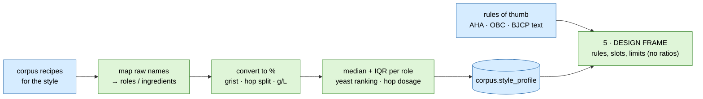
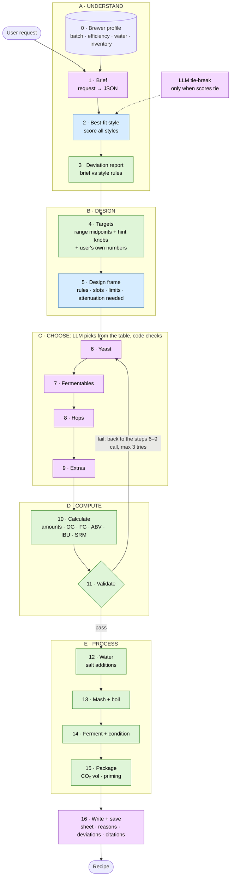
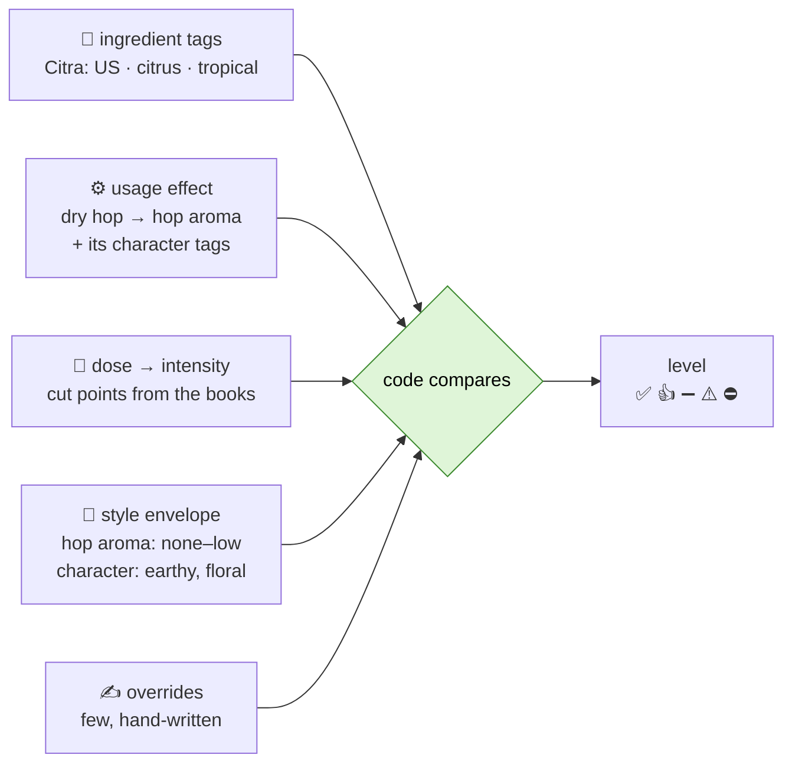
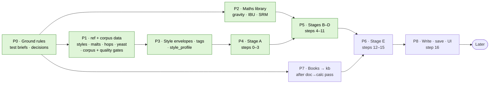

# Recipe creation: workflow + roadmap

> **Status:** agreed in review on 2026-10-08, except the items in §9.
> Database design: [DATABASE.md](DATABASE.md). Example values are illustrative unless a source is given.

---

## TL;DR

- 🧭 **The style is a compass, not a cage.** The pipeline always picks the best-fit style. The
  user can override any ingredient or number, and every override is listed, never blocked.
- 🧮 **Compute first.** The LLM reads the request and writes the recipe sheet. Everything in
  between is SQL or code: about **2 LLM calls per recipe**, plus rare tie-breaks.
- 📊 **Ratios come from open data**: Brewer's Friend recipes (CC0, 35,620 kept from 179,455),
  filtered by code and turned into per-style statistics. Thin styles borrow from their family
  ([STYLE-PROFILES.md](STYLE-PROFILES.md)).
- 🎯 **Style rules = sensory envelope + ingredient tags + usage effects**, checked by code. This
  answers "Citra in a stout?" without a row for every hop × style pair.
- 🪜 **16 steps in 6 stages.** The MVP is done after stage D.

---

## 1. Review outcomes

| # | Topic | Decision |
|---|---|---|
| 1 | Where ratios come from | Open data + free method docs (§2). Details in D7. |
| 2 | Brief before style | ✅ agreed |
| 3 | 5-level rules | ✅ agreed, organised as envelope + tags + usage (§5) |
| 4 | Style strictness | ✅ guidance only, on by default, user can override anything (§4) |
| 5 | Ingredient order | yeast → fermentables → hops → extras |
| 6 | Missing steps | ✅ added: brewer profile, water, mash + boil, fermentation, packaging, validate loop |
| 7 | Calculation first | ✅ design principle + a "doc → calculation" pass for every source (§6) |
| 8 | Curated reference, not "absolute truth" | ✅ every row has a source + version ([DATABASE.md](DATABASE.md)) |

---

## 2. Where the ratios come from

### What's out there (free)

| Tier | Source | What it gives | Licence | Use it for |
|---|---|---|---|---|
| 📊 **A: data** | [Brewer's Friend recipes, Kaggle](https://www.kaggle.com/datasets/angeredsquid/brewers-friend-beer-recipes) | 179,455 recipes (pre-2020): grist, hops with timing, yeast, misc. Archive keeps 35,620 (views > 500) | **CC0** | ⭐ **Main ratio source**, through quality gates ([STYLE-PROFILES.md](STYLE-PROFILES.md)) |
| 📊 A | [Beer Analytics](https://www.beer-analytics.com/) ([code](https://github.com/scheb/beer-analytics)) | 1.15M recipes. Per-style pages: most-used malts, hops by use, hop dosage, yeasts (e.g. American IPA: 95k recipes, avg OG 1.062, IBU 57) | site CC BY-SA 4.0 · code GPL-3 · **no data download, no API** | Hand cross-check for the test styles. Don't scrape. |
| 📊 A | [BrewDog DIY Dog as JSON](https://github.com/alxiw/punkapi) | 415 complete commercial recipes | free, **non-commercial** | Test fixtures, sanity checks |
| 📘 **B: method** | [AHA: Crash Course in Recipe Design](https://homebrewersassociation.org/how-to-brew/crash-course-beer-recipe-design/) | Method: collect ~10 recipes → convert to % → find the key ingredients → fit to the style. "85 to 100 percent base malt" | © AHA, free to read | The algorithm we automate (below) |
| 📘 B | [Oregon Brew Crew: Recipe Formulation](https://shrubbery.net/~heas/brewing/bjcp/Techniques_and_Ingredients/Recipe_Formulation.pdf) (2009) | Worked examples (Dubbel, Bohemian Pils), extract points per malt, %-based grist | free PDF, no licence stated | Rules of thumb + maths test cases |
| 📘 B | [BJCP Beer Exam Study Guide](https://legacy.bjcp.org/docs/BJCP_Study_Guide.pdf) (2017) | What a complete recipe must contain (exam question T14) | © BJCP, free | Output checklist for step 16 |
| 📘 B | [BeerSmith: Designing with percentages](https://beersmith.com/blog/2024/10/30/designing-beer-recipes-using-percentages/) | %-first grist design | ©, free to read | Background |
| 📘 B | Your *How to Brew* PDF, Section 4 / Ch. 19 | Per-style recipes for a dozen or so styles | © | kb + cross-check |
| 🧪 **C: ingredients** | [hopline.hu dry](https://www.hopline.hu/alapanyagok/elesztok/szaraz-eleszto) and [liquid](https://www.hopline.hu/alapanyagok/elesztok/folyekony-eleszto) yeast pages, attenuation from the makers' catalogues and data sheets (YeastFlow, Lallemand, Fermentis, Mangrove Jack's) and Brewfather | **119 beer yeasts**: temperature, flocculation, alcohol tolerance; attenuation for 93 | shop and maker pages, facts copied | ⭐ The yeast catalogue, `ref.yeast` (D8 decided 2026-10-11) |
| 🧪 C | [Brewtarget default data](https://github.com/Brewtarget/brewtarget/tree/develop/data) | 571 yeast entries (attenuation + temperature ranges), 282 hops, BJCP 2021 styles, in BeerJSON | **GPL-3** | Not used: yeasts come from hopline (D8) |
| 🧪 C | [BeerJSON](https://github.com/beerjson/beerjson) | Open recipe format standard | MIT | Import/export format |

> ⚖️ GPL-3 data is fine for a private, self-hosted project. The licence obligations only apply
> if the database is redistributed.

### The AHA method, automated (all code, no LLM)

Example output for 21A: *base 88–95 %, crystal 0–6 %, sugar 0–5 %; ~25 % of hop mass in the
boil, ~75 % in whirlpool + dry hop; top yeasts …* (the real numbers come from the corpus).

---

## 3. The flow

**Legend:** 🟪 LLM · 🟦 SQL · 🟩 deterministic code

### Step by step, with a running example

**"A really bitter American IPA with a hint of cinnamon, 20 L"**

| # | Step | Example output | How |
|---|---|---|---|
| 0 | Profile | 20 L · 72 % efficiency · tap water profile · inventory | 🟦 stored |
| 1 | Brief | `{style:"American IPA", hints:["bitter"], extras:["cinnamon"]}` | 🟪 |
| 2 | Style | **21A American IPA**: OG 1.056–1.070 · IBU 40–70 · SRM 6–14 *(styles.json)* | 🟦 score: name + numbers + sensory words |
| 3 | Deviations | cinnamon: ⚠️ not part of 21A → listed; closest category 30A (info only) | 🟩 |
| 4 | Targets | "bitter" → IBU 66.25 (87.5 % of 21A 40–70) · OG 1.0613 · FG 1.011 · ABV from `app.abv`; built in `db/039_step4.sql`, measured G4 2026-10-17 | 🟩 |
| 5 | Design frame | rules and limits · one slot per wanted item with its `ref` products (role, `max_pct`) · excluded and inventory words · hint intents · attenuation the targets need; no ratio numbers (D7); built in `db/041_step5.sql`, measured G4 2026-10-17 | 🟦 |
| 6 | Yeast | one main yeast (and a souring culture where the style is sour) picked from the code-built table; code checks it is in the table, not excluded, in style, of the right type (lager, required family, not lacto) and overlaps the yeast attenuation band; built in `db/042`-`044`, measured G5 2026-10-19 | 🟪 pick, 🟩 check |
| 7 | Fermentables | grist picked from the table (usage, percent, purpose); code checks inventory used, one pick per slot, percents sum to 100 and stay under `max_pct` | 🟪 pick, 🟩 check |
| 8 | Hops | hops picked from the table (usage, minutes, share, purpose); the prompt asks for a boil bittering hop plus one or two aroma hops where the style has aroma, code does not count varieties; code checks excluded hops and siblings (LUPOMAX), shares sum to 100, minutes per usage and a boil hop for the IBU target | 🟪 pick, 🟩 check |
| 9 | Extras | coffee: usage (secondary) + dose (3.0 g/L, 2880 min) from the `ref.misc` row, sourced (Janish); step 5 already gives the slot these fields (`misc`: purpose, category, usages, time, dose range, `because`); the amount in grams is step 10's job (dose × batch L) and never enters OG/IBU/SRM. Built so far: the rows, the slot fields and step 3's rating ([`s9-misc-extras`](finished/s9-misc-extras/plan.md)); the choice is one of the four picks of the single LLM call for steps 6-9 (`num_ctx` 32768), checked by code; the LLM never writes a dose: code sets it by role (`background` the low end of the sourced range, `feature` the high end) | 🟪 pick, 🟩 check |
| 10 | Calculate | amounts and OG, FG, ABV, IBU, SRM from s1's functions only (`app.step10_compute`, `db/046_compute.sql`). Value picks: colour = middle of the EBC range, hop alpha = middle of its range, attenuation from `app.mash_attenuation`, extract from `extract_dbfg_pct`. Boil time = the largest of 60, the grist's longest `min_boil_min` and the longest boil addition, and the bittering hop is set to it. Grist from `app.solve_grist`; colour solver `app.solve_colour` moves only the darkest non-crystal malt and the base (a second pass when a limit stops the first, capped by rules 3 and 5); the mash is raised inside 68.3–69 °C for an FG below rule 10's range (never a hint's); the OG moves inside its tolerance; misc grams = dose × batch L (never enter OG/IBU/SRM). **Rounding to weighing steps** (Task 10b): every malt and flaked grain 50 g steps with a 50 g floor, sugars, honey and lactose, hops and extras 1 g; each fermentable goes down or up, the nearest-to-exact grist that adds no failure the exact amounts did not have (else the nearest step, flagged in `rounding`); the numbers are computed from the rounded amounts. Each adjustment is reported with a `because` | 🟩 |
| 11 | Validate | `app.step11_validate` (`db/047_validate.sql`) runs `app.check_recipe` and `app.style_fit_recipe` and checks targets, stated numbers, ids and exclusions. Tolerances: ABV ± 0.2, IBU ± 2, OG ± 0.002, SRM ± 2, batch exact (`app.recipe_tolerances()`). Failure kinds: `numbers`, `rule`, `pick`; a failed try's lines end with a computed `To fix:` where one applies. Only a self-pick is banned (never a wanted pick, never for a user's IBU); a failure caused by rounding says so. Fail: back to the steps 6–9 call with the lines and bans, max 3 tries; three failed tries finish the run with `failed_step` 11 and save nothing. Pass: `app.save_recipe` writes the rows | 🟩 |
| 12 | Water | `app.step12_water` (`db/050`): the style's *Water* Table 18/19 row (`target.row`, with a basis label), sulfate and chloride aimed by the hints (87.5 % / 12.5 % of the row's ranges, *Water* ch. 7), gypsum and calcium chloride grams for strike and sparge water (HTB ion caps), baking soda and slaked lime in the strike water until the mash pH estimate (HTB ch. 21 zero-sum method, Table 21.4) reaches HTB's colour target. The acid line says "acid would be needed" when the estimate stays above the target, with no acid amount. A style with no row gets no salts | 🟩 |
| 13 | Mash + boil | `app.step13_mash_boil` (`db/051`): step 10's mash temperature and boil copied unchanged, neutral rests only below the starch range (ferulic 40 °C for 10A-10C, beta-glucan 45 °C above 20 % flaked adjuncts, mash-out 77 °C; HTB ch. 16-17), strike water temperature from HTB ch. 17's infusion equation, strike and sparge volumes (the ones step 12 doses for), boil and whirlpool additions in time order | 🟩 |
| 14 | Ferment | `app.step14_ferment` (`db/052`): ramp inside the yeast's range (ale start below, lager start at the main temperature), maturation rest (diacetyl rest for lagers, at most the yeast's upper bound), dry hops after fermentation, cold conditioning or lagering, souring first for a `lacto` culture; days are minimums with a gravity `move_on` trigger (HTB Table 6.2). Pitch rate from HTB ch. 7 (cells = rate × litres × °P) in grams of dry yeast or packs; the cell counts per gram and per pack are HTB's generic figures and labelled as estimates | 🟩 |
| 15 | Package | `app.step15_package` (`db/053`): CO₂ volumes from the style's HTB p. 159 family (2.5 when the style has none), table sugar grams from HTB Table 10.3 at the highest beer temperature after fermentation, packaging extras | 🟩 |
| 16 | Write + save | sheet + "why" per choice + book citations + Deviations box | 🟪🟦 |

Each step has a JSON contract that code checks, with a legal "none / unknown / conflict" slot
(PROJECT.md §6.3).

---

## 4. Style = guidance, not law

| | Guidance **ON** *(default)* | Guidance **OFF** |
|---|---|---|
| The pipeline's own choices | stay inside the style | free (the style is only a reference) |
| What **you** ask for (ingredients **or** numbers) | ✅ accepted, listed under Deviations | ✅ accepted, listed |
| Recipe sheet shows | "Deviations from 21A" + closest category (info) | comparison with the style only |

- **A style is always picked**: the one that best fits the request, so there is always a
  reference to design against and compare with.
- **Best fit can disagree with the name you used.** *"4 % imperial stout"* → *"15B Irish Stout fits
  4 % better. Keep 20C?"* Your choice wins, and the 4 % is listed as a deviation.
- **No blocking questions** for deviations. Only ask when the request is genuinely ambiguous.

---

## 5. Style rules: how they are organised

The problem: you can't write a row for every hop × style pair (**~300 hops × 285 styles**).
The fix is to describe each **style** as a sensory envelope and each **ingredient** with tags,
and let code compare the two.

| Piece | Lives in | Written | Example |
|---|---|---|---|
| **Style envelope** | `ref.style_sensory` | once per style: BJCP and BA prose extracted by the LLM, **you review** | 15B: hop aroma *none–low*, character *earthy, floral* |
| **Ingredient tags** | `ref.ingredient_tag` | from the hop's hopline page (description, origin), malt role, yeast family | Citra: *US, citrus, tropical* |
| **Usage effects** | code (a dict next to its tests) | once, ~20 entries | bittering → bitterness only (character doesn't carry) · late / dry hop → aroma + character |
| **Dose check** | code (`db/033_style_fit_effects.sql`) | cut points from the books, or set by you | dry hop oil dose above the envelope's max level → "above typical" |
| **Overrides** | `ref.style_rule` | by hand, only where the envelope and the adjunct/sugar rule can't say it | (rare; 16A lactose is no longer one: the rule says it) |

### Worked example: Citra in two stouts

BJCP text: 15B Irish Stout *"Low earthy or floral hop aroma optional"* · 20B American Stout
*"Medium to very low hop aroma, often with a citrusy or resiny character"*.

| Citra used as | 15B Irish Stout | 20B American Stout |
|---|---|---|
| 60-min bittering | ➖ allowed: bitterness only, character doesn't carry | ➖ allowed |
| Whirlpool, normal dose | ⚠️ citrus ≠ earthy / floral | 👍 citrus matches "citrusy" |
| Heavy dry hop | ⚠️ character **and** intensity above "low" | ⚠️ intensity above "medium" |

### Where each level comes from

| Level | Triggered when |
|---|---|
| ✅ required | named in the style's characteristic ingredients ("Pale base malt") |
| 👍 typical | its tags match the envelope's character words; or, for a fermentable, `ref.fermentable_style` lists it for the style; or it is an adjunct or sugar the style's characteristic ingredients name |
| ➖ allowed | no conflict found |
| ⚠️ out of style | character mismatch, intensity/dose above the envelope, or an adjunct or sugar the style doesn't name |
| ⛔ changes style | drives a dimension the style rules out (sourness in an IPA) |

At runtime this is **pure SQL/code**. The LLM is used once, offline, to extract BJCP and BA envelopes.

➡️ **Full algorithm**, including automatic tagging so new hops, malts and yeasts need no rules:
[STYLE-FIT.md](STYLE-FIT.md).

---

## 6. Calculation first

> **Gate for every step:** *can this be SQL or code?* If yes, it must be. The LLM is only for
> free text in (step 1) and prose out (step 16), plus tie-breaks.

**Doc → calculation pass.** Every new source is read for tables, formulas and rules of thumb
first. Those become data or code. Only the remaining prose goes to RAG.

| Knowledge | Source | Becomes |
|---|---|---|
| Extract potential per malt and adjunct | maltster catalogues and hopline pages (malts); Palmer Tables 18.5 and 24.1 (flakes, sugars, honey); OBC table | `ref.fermentable` |
| IBU (Tinseth), colour (Morey), gravity, ABV | Palmer | maths functions |
| Mash temperature ↔ body / FG | Palmer ch. 14 | hint-knob dict in code |
| Carbonation volumes per style, priming sugar | *How to Brew* ch. 10 (Tables 10.1-10.3, p. 159 families) | `ref.beer_style.co2_vol` + `app.step15_package` |
| Residual alkalinity, salt additions, style water rows | *Water* ch. 4-7 (Tables 17-19) | `ref.water_profile` + water functions (`db/050`) |
| Mash pH | *How to Brew* ch. 21 (zero-sum method, Table 21.4) | `app.mash_ph_estimate` |
| Pitch rate | *How to Brew* ch. 7 (Table 7.1); *Yeast* where it is silent | `app.pitch_rate` |
| Yeast attenuation, temperature | hopline yeast pages (temperature); makers' catalogues and data sheets, Brewfather (attenuation) | `ref.yeast` |
| Grist %, hop split, dosage, yeast ranking per style | Brewer's Friend corpus | `corpus.style_profile` |
| Sensory envelope | BJCP / BA text | `ref.style_sensory` |
| Faults → causes | BJCP fault list (2012) + study guide *Beer Characteristics* (`shared/rag-files/sensory/`, [SOURCES.md](SOURCES.md)); `beer_faults.json` was lost in the reset | `ref.fault` (later) |

---

## 7. Hints → knobs

The LLM only maps words to knob names in the brief. Code applies them. With guidance on,
model-chosen values stay inside the style range. Your explicit numbers always win.

| Hint | Knobs |
|---|---|
| bitter | IBU → middle of the top quarter of the range (87.5 %) · BU:GU ↑ |
| hoppy / juicy | late + dry hop share ↑ (not IBU) |
| dry / crisp | mash 64.5 °C (middle of 64–65; rule 10 predicts the same FG for any mash 64–68.3 °C, so this does not lower it; doc-calc §7) · high-attenuation yeast · sugar ≤ 10 % |
| full / chewy | mash 68.5 °C (middle of 68–69) · lower-attenuation yeast · oats or dextrin malt |
| malty | IBU → middle of the bottom quarter (12.5 %) · Munich / Vienna share ↑ · BU:GU ↓ |
| darker | SRM → 87.5 % of the range, via crystal / roast |
| stronger / session | OG → 87.5 % / 12.5 % of the range |
| *flavour words* (citrus, coffee…) | tag match in steps 7–9 |

*Starter table. Rows with a book passage are sourced, the others are used marked `unsourced` and sourced before G6; every row's source is in [`hint-sources.md`](finished/m4-targets-blueprint/hint-sources.md). Positions and mash values are the user's decision (2026-10-17).*

---

## 8. Roadmap

🟩 = MVP: a numerically correct, style-checked recipe without process text.

| Phase | Do | ✅ Done when |
|---|---|---|
| **P0** | 20 test briefs (varied styles, deviations, overrides, not just stouts) in [`evals/recipe_briefs.toml`](../evals/recipe_briefs.toml), reviewed by you. D7 and D9 moved to P3; D8 decided. | ✅ done 2026-10-11: 20 briefs in the repo, 16 BJCP categories, all six adjuncts needed, `tests/test_recipe_briefs.py` 10 passed |
| **P1** | `ref` + `corpus` schemas ([DATABASE.md](DATABASE.md)). Load styles (116 + 169), malts, adjuncts, hops, hopline yeasts, water salts, the corpus with quality gates ([STYLE-PROFILES.md](STYLE-PROFILES.md) §2). | row counts match sources · 10 rows spot-checked per table. **P1a (`ref`) ✅ done 2026-10-11:** 285 styles, 298 ingredients, spot-checked ([PROJECT.md](../PROJECT.md) §4). **P1b (`corpus`)** not started |
| **P2** | Maths library with unit tests | tests pass against Palmer's and OBC's worked examples. **✅ done 2026-10-14** ([`s1-maths`](finished/s1-maths/plan.md)): 19 functions in `db/030_maths.sql`, `tests/test_maths.py` 79 passed (full suite 331). Palmer: all 160 Tinseth cells and 140 ABV cells, 7 FG cells, OG, colour and IBU examples. OBC: OG and MCU of both beers; its SRM and IBU are Daniels' model and not tested |
| **P3** | Tag vocabulary · ingredient tags · usage effects · envelopes for the test styles · `style_profile`. D9 decided 2026-10-15 (D7 settled 2026-10-14, [`s2-formulation-rules`](finished/s2-formulation-rules/brief.md)). | the Citra table (§5) reproduces from SQL |
| **P4** | Steps 0–3. Step 2 picks the style from BJCP 2021 or BA 2026 per D1 (§9): BJCP preferred, BA where it describes the beer better or the user is asked, and one guide only when the user sets BJCP only or BA only | ≥ 18/20 briefs: right style, right deviations. **✅ done 2026-10-17** ([`m3-deviations`](finished/m3-deviations/plan.md)): 20/20 of b01-b20 with step 2 and step 3 passing, b21 and b22 pass too (`evals/results/2026-10-17-m3.json`) |
| **P5** | Steps 4–11 | ≥ 16/20 validate · **0 invented ingredients** · LLM calls ≤ 2 + tie-breaks. **Stage D built, 2026-10-27** ([`m6-compute-validate`](finished/m6-compute-validate/plan.md)); bar met exactly. Real-pipeline re-measure (`evals.run --save --label m6-9b`, before rounding): 17/20 of b01-b20 validate, 20/24 overall, 0 invented, 2 first-try LLM calls on every brief, held-out 5/6. After rounding to weighing steps and SRM ± 2, re-validating those saved picks through steps 10-11 (SQL only, retries not replayed, so *unverified* on the real pipeline): 16/20 of b01-b20 and 19/24 (b15 newly fails), A11's five recipes still pass. Known failures accepted by the user: b12, b18, b19, b23 |
| **P7** | Doc → calc pass per book, then ingest the rest into `kb`, retrieval eval | recall@5 measured, above an agreed bar |
| **P6** | Steps 12–15, with the water functions (moved from P2, 2026-10-14, [`s1-maths`](finished/s1-maths/brief.md)) | every recipe has water, mash, ferment, package. **✅ built 2026-10-29** ([`m7-process`](finished/m7-process/plan.md), not yet merged): `db/048`-`053`, sub-workflow `Steps 12–15 · process`. Measured on b01-b24 (`evals/results/2026-10-28-m7.json`): 19/24 validated and each has rows 12-15 ok (76 of 76) and a saved `process`; the 5 that fail (b12, b15, b18, b19, b23) fail at step 11, so they have no process. Process expectations: 7/9 in that run, 8/9 after the b13 fix (re-run of 8 briefs, not saved; b23 has no process). Mash, boil and `fg` equal step 10's on all 19. Unverified: the mash pH model against Bru'n Water; a step failing inside the sub-workflow (no test) |
| **P8** | Step 16 + interface: n8n chat trigger (D5, decided) | you can brew from the sheet |
| **Later** | - inventory-first mode - substitutions - batch log → feedback - whirlpool and dry-hop IBU from a cited model (they count as 0 IBU until then; [`s1-maths`](finished/s1-maths/brief.md), 2026-10-14) - an enzyme rule using `enzyme_activity` - the ratio corpus (old s2), revisited only if test-brief results show generic or off recipes - TODO: tune retrieval (`candidates`, `rrf_k`, `MAX_TOKENS`, `MIN_WORDS` in `app.kb_search` and `loaders/books.py`): the first run ([`s4-books-kb`](finished/s4-books-kb/plan.md), recall@5 0.422) showed chunks from other books outranking the expected one; re-run `python -m evals.retrieval`, then raise `RECALL_AT_5_BAR` (now 0.40) in a Deviation. The vector arm returns at most `hnsw.ef_search` rows (default 40), so raising `candidates` above 40 needs `ef_search` raised in the same session too (user request 2026-10-16) - TODO: multi-step mash profiles (several rests, decoction) and their effect on predicted FG, replacing the single mash temperature in rule 10 and s1's FG ([`s2-formulation-rules`](finished/s2-formulation-rules/brief.md), user request 2026-10-15) - TODO: fruit as a fermentable is decided with M6 (s9, decision 2): s9 treats all fruit as flavour misc and loads a fruit file with a sourced sugar content as "waits for maths"; M6 decides whether such fruit becomes a fermentable that enters OG - TODO: acid dosing: step 12 only says "acid would be needed" (*Water* ch. 6 and Appendix B give the acid amounts; the mash pH model is checked against the book's figures only, not Bru'n Water) - TODO: water rows and CO₂ families for the styles outside the reviewed tables (31 styles have them, the other 254 get no salts and 2.5 volumes; m7-process decision Q1) - TODO: let the user set their own water ions in the brewer profile (input path, form or command); until then the default profile uses distilled water (all six ions 0 mg/L, Bru'n Water §4.2.1; user request 2026-10-17) - TODO: crystal share runs high in pale hoppy styles (b01 15 %, b24 10 %, b03 8 % Caramel 150) because midpoint SRM targets let the LLM use crystal for colour (user request 2026-10-26, [`g6-recipes.md`](finished/m6-compute-validate/g6-recipes.md)) - TODO: hop schedules are thin: few additions, and aroma additions get identical weights (b01 27.382 g twice, b24 48.491 g twice); check whether step 10 splits aroma grams evenly; b24 has no flavour or whirlpool addition (user request 2026-10-26, [`g6-recipes.md`](finished/m6-compute-validate/g6-recipes.md)) - TODO: the orange peel dose in `ref.misc` (2.64 g/L, marked unverified in s9) is too high for "a hint"; find a sourced dose (witbier about 0.5-1.5 g/L) (user request 2026-10-26, [`g6-recipes.md`](finished/m6-compute-validate/g6-recipes.md)) - TODO: the `because` lines show the wrong usage or time level (b01 Columbus 60 min says "allowed at boil 30 min"; b24 60 min Cascade says "typical at dry hop") (user request 2026-10-26, [`g6-recipes.md`](finished/m6-compute-validate/g6-recipes.md)) - TODO: the colour solver can shrink the darkest malt to near zero (b03 Roasted Barley 0.35 %, 18 g) when crystal already supplies the colour (user request 2026-10-26, [`g6-recipes.md`](finished/m6-compute-validate/g6-recipes.md)) - TODO: dark candi sugar in b10 is 89 g (1.4 %), too little to taste; dubbels use about 5-10 % (roughly 250-450 g in 20 L) (user request 2026-10-26, [`g6-recipes.md`](finished/m6-compute-validate/g6-recipes.md)) | |

---

## 9. Still open

| # | Question | Recommendation |
|---|---|---|
| D7 | Ratio source | Decided 2026-10-14 (see [PROJECT.md](../PROJECT.md) §3): no ratio corpus; the LLM proposes, code scales and checks; revisit if test briefs show a need. Work: [`s2-formulation-rules`](finished/s2-formulation-rules/brief.md) |
| D9 | Who approves style envelopes | Decided 2026-10-15 (see [PROJECT.md](../PROJECT.md) §5): the LLM extracts BJCP and BA prose offline, you review every envelope |

D1 (style guide) is decided, 2026-10-11: both guides are used, BJCP 2021 preferred; BA where it
describes the beer better, or the user is asked; the user can set BJCP only or BA only. Step 2
picks the base style by default, and the specialty code (base style as the alternative) when
the request makes an adjunct prominent ([PROJECT.md](../PROJECT.md) §5).

D8 (yeast data) is decided, 2026-10-11: hopline.hu's dry and liquid yeasts, with attenuation
from the makers' catalogues and data sheets and Brewfather. *Why: the user chose the shop's own
yeasts, as for malts and hops* ([PROJECT.md](../PROJECT.md) §5).
