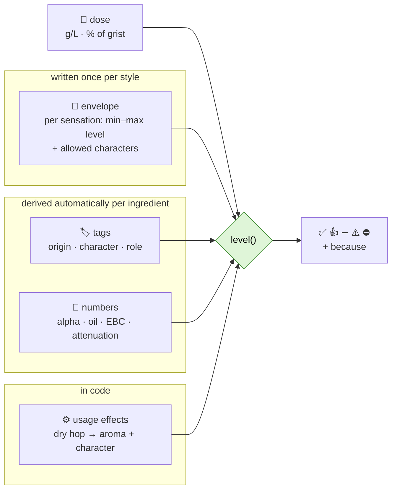

# Style fit: an algorithm for the 5 levels

> **Status:** design, 2026-10-08. Answers *"is ingredient X, used like this, in style Y:
> required, typical, allowed, out of style, or style-changing?"* deterministically, for any
> ingredient, including ones added later.
> Part of [RECIPE-ROADMAP.md](RECIPE-ROADMAP.md) steps 3, 7–9 and 11. Tables: [DATABASE.md](DATABASE.md) §2.

---

## TL;DR

- 🧩 **Nothing is written per ingredient × style.** A style is described once (sensory
  envelope) and an ingredient once (tags + numbers). A function compares them.
- ➕ **A new hop gets tagged automatically from its own data** and immediately has a level in
  all 285 styles. Zero rule rows to write.
- 🔍 **Every verdict carries a "because"**: which sensation, which quote, which number. The
  recipe sheet reuses it.
- 🧪 **A golden test set** (~50 cases you approve, Citra × stouts included) runs on every change.

---

## 1. The idea in one picture



---

## 2. Ingredient → tags (automatic, so it scales)

| Kind | Uses | Rule (code) | Example |
|---|---|---|---|
| Hop | origins, purpose, page description, alpha, oil | origin → origin tag · descriptor dictionary (*grapefruit → citrus*, *mango → tropical*, *pine → resin*) · purpose as loaded (`ref.hop.purpose`, from hopline) | Citra → `US` `citrus` `tropical` |
| Fermentable | EBC, name keywords | role from **colour (EBC) + name keywords** (`ref.fermentable.role`): base · kilned · crystal · roast · adjunct · sugar | Carafa III → `roast` |
| Yeast | type, notes, attenuation, temperature | family from type (`lager`, `american-ale`, `belgian`, `wheat`, `kveik`, `brett`, `lacto`) · character from notes (*banana, clove, clean, fruity*) | SafAle US-05 → `american-ale` `clean` |
| Misc · flavour | category, descriptors | category → one **family tag** named after it (`spice`, `herb`, `fruit`, `wood`, `coffee`, `cacao`, `vanilla`, `smoke`, `other`); each descriptor word → a **character tag** (`coffee`, `vanilla`, `citrus`, `orange`, …) | orange peel (`spice`; descriptors citrus, orange) → family `spice`, characters `citrus` `orange` |
| Misc · process aid | category | **none**: no tags and no `ingredient_review` row (fining, nutrient, enzyme, acid, other-process) | Irish moss → no tags |

- **The descriptor dictionary is the only hand-made part** (~150 words → tags, in
  `ref.tag_synonym`). A new hop that uses known words needs no work.
- **Three layers for a flavour misc** (your model, 2026-10-18; [`s9-misc-extras`](finished/s9-misc-extras/brief.md)).
  The *category* is the cause and drives step 2: it picks the specialty style (fruit → 29A;
  spice, herb, coffee, cacao, vanilla → 30A; wood → 33A; smoke → 32A; BA equivalents), with the
  base style kept first among the alternatives. The *added-character dimension* is the effect and
  is the only thing scored, in step 3: each category maps to exactly one of the four specialty
  dimensions (§3), so coffee and cacao never drive `roast` and vanilla never drives `sweetness`.
  The *tags* describe the taste, explain a choice and help match brief words; **they are never
  scored**: two spices with different character tags and the same dose get the same level. One tag
  can sit on products of different categories (`vanilla` on a pod and on oak chips).
- **Unknown words never get guessed** (PROJECT.md §6.3). The ingredient is flagged
  `needs_review`. Optionally the LLM proposes tags once, and you approve them.
- **The tag tree gives partial matches:** grapefruit ⊂ citrus ⊂ fruity. Exact = 1.0, parent =
  0.5, unrelated = 0.

---

## 3. Usage effects (in code, ~35 entries)

They say how the algorithm behaves, so they are a dict next to their tests, not a table
(PROJECT.md §6.8).

| Kind / role | Usage | Drives sensation | Carries character? |
|---|---|---|---|
| hop | boil ≥ 30 min | bitterness | ❌ |
| hop | boil 5–29 min | bitterness, hop flavour | ✅ |
| hop | whirlpool / flameout | hop flavour, hop aroma | ✅ |
| hop | dry hop | hop aroma | ✅ |
| roast malt | mash | roast, colour | ✅ (coffee, chocolate, acrid) |
| crystal malt | mash | caramel, sweetness, colour, body | ✅ |
| yeast | ferment | esters, phenols, dryness | ✅ |
| lacto / kettle sour | ferment / boil | sourness | — |
| any · tag `smoke` (smoked malt) | any | smoke | ❌ |
| misc · spice, herb, coffee, cacao, vanilla | any usage of its row | `spice` (BJCP's spice, herb or vegetable) | ❌ |
| misc · fruit · wood · smoke | any usage of its row | `fruit` · `wood` · `smoke` | ❌ |
| misc · `other` | any | none: not rated ("no added-character dimension") | — |
| misc · process aid | any | none: `allowed` in every style, "no flavour effect" | — |

The 8 `kind = 'misc'` rows are keyed by **category** (`app.usage_effects()` in
`db/033_style_fit_effects.sql`), and a misc never carries its tags into the character match.

---

## 4. Dose → intensity (0 none … 7 very high)

| Sensation | How it's computed |
|---|---|
| colour | exact: SRM (Morey) vs the style range |
| bitterness | exact: IBU (Tinseth) vs the range, plus BU:GU |
| hop aroma / flavour | **oil dose** = late + dry hop g/L × total oil (mL/100 g) → level |
| roast | roast index = Σ % of grist × EBC → level |
| esters / phenols | yeast family and character tags + fermentation temperature: esters lager 0 · no ester character 1 · an ester character (a tag under *fruity* or *estery*) 3; phenols 4 for a phenolic character (*clove, pepper, phenolic, spicy*), else 0; each +1 when fermented above 21 °C (*How to Brew* p. 443) |
| sourness, smoke | present / absent |
| spice, fruit, wood, smoke from a **misc** | the dose against the **row's own sourced dose** (below) |

**Level cut points come from the books, not from a corpus.** They are the figures cited in
*How to Brew* and the OBC *Recipe Formulation* PDF (a doc → calc pass: book figure, page,
arithmetic). Where the books give none, the user sets the cut point. Each cut point lives in
code next to its tests with its basis (book and page, or "set by the user"), and is checked
against the 22 reference recipes.

**A flavour misc is read against its own sourced dose** (`s9-misc-extras`, your decision
2026-10-18), so a new spice needs only its file and no cut point of its own. In
`app.style_level`, in this order:

1. process aid → `allowed`, "no flavour effect", in any style, before the envelope is looked at;
2. no reviewed envelope → not rated; an explicit `style_rule` still wins;
3. category `other` → no level, "no added-character dimension";
4. the style's envelope has no row for the category's dimension → `out_of_style`, "specialty
   <dimension> on <style>";
5. the row has no sourced dose → "no sourced dose", intensity not checked; the dose has no `g_per_l`
   (step 3 rates without a dose) → "dose not given", intensity not checked;
6. otherwise the dose is compared with the sourced range: below **M1** (0.5) × its lower end →
   *subtle*; above **M2** (2.0) × its upper end → *aggressive*; else *noticeable*. **M3** maps
   the word to a 0–7 level: 2, 4, 6 (low, medium, high). Above the envelope's `max_level` →
   `out_of_style`, "too much";
7. within range: `typical` when the envelope's `min_level` is at least 1, else `allowed`.

M1, M2 and M3 live in `app.style_fit_cut_points()` under `misc_dose` with their basis ("set by
the user, 2026-10-18"; M2 is checked against *How to Brew* p. 225, whose top coffee dose is 1.98
times Janish's cold-brew dose). Doses and sources: [doc-calc.md](finished/s9-misc-extras/doc-calc.md).
The dimension for BJCP's coffee, cacao and vanilla is `spice`, because BJCP states no rule for
them; filing them under 30A is also set by the user.

Colour and bitterness are not levels: the recipe's SRM and IBU (s1's `app.srm` and `app.ibu`,
via `app.check_recipe`) are compared with the style's `srm` and `ibu` ranges in
`ref.beer_style`. Above the upper bound → ⚠️ "too much". A style with no range skips the check.

Colour is a lower bound where a fermentable has no sourced colour (Honey, Lactose, Enzyme Malt):
`app.style_fit_recipe` counts it as 0 EBC, so the SRM is a floor. "Too much" fires only when that
floor is already above the style's maximum, and the because names the fermentables without colour.
`app.check_recipe` is unchanged and still returns SRM null for such a recipe.

---

## 5. The decision

```
level(style, ingredient, usage, dose):
    0. style has no reviewed envelope (no reviewed style_sensory row
       and no reviewed characteristic-ingredient row)                 → not rated (no level)
    1. explicit override in style_rule (most specific: ingredient > tag > kind)?  → return it
   1b. ingredient is a fermentable with role adjunct or sugar:
         named in the style's reviewed characteristic ingredients     → 👍
         not named                                                    → ⚠️  "not a usual ingredient of <style>"
         (return; the usage effects below do not apply)
   1c. ingredient is a misc: a process aid → allowed (before step 0); otherwise its category's one
         dimension, scored by dose against the row's sourced dose (§4); tags are not read
         (return; the usage effects below do not apply)
    2. for each sensation the usage drives:
         env = envelope[style][sensation]
         if style is silent on it:
             "transforming" sensation (sourness, brett funk)          → ⛔
             "specialty" sensation (spice, fruit, wood, smoke)        → ⚠️  + "specialty on <base>"
             core sensation (bitterness, aroma, malt…)                → no conflict
         dose missing → the dose check is skipped and the because says so
         intensity(dose) > env.max                                    → ⚠️  "too much"
         yeast only (esters, phenols): intensity < env.min − 1        → ⚠️  "too little"
             (skipped for a needs-review yeast, and the because says so)
         if it carries character and env lists characters:
             match ≥ 0.8 → 👍   ·   0.3–0.8 → ➖   ·   < 0.3 → ⚠️  "wrong character"
    3. combine: any ⛔ → ⛔ · else any ⚠️ → ⚠️ · else any 👍 → 👍 · else ➖
    4. ➖, a fermentable, listed for the style in ref.fermentable_style → 👍
       (no bump for hops or yeasts)
```

**Min check: one-level tolerance.** A level more than one step below the envelope's min is
⚠️ "too little". Per ingredient this applies to yeasts only, because the yeast is the only source
of esters and phenols. Hop aroma/flavour and roast are checked against the min only on the whole
recipe (the recipe's late-hop oil dose and roast index, in `app.style_fit_recipe`), never per
hop or malt line: one small addition is not "too little" on its own.

A style whose reviewed envelope has characteristic-ingredient rows but no sensory rows (31B, BA
Specialty Honey Beer: "same as the base beer") is rated: its adjuncts and sugars go through
step 1b, and every other sensation is silent.

**Character match = the best pair.** For each (ingredient tag, style character) pair: 1.0 if
they are the same tag, 0.5 if one is the other's parent, else 0. The match is the highest.

**✅ required** is checked on the whole recipe, not per ingredient: the style's characteristic
ingredients become role requirements (15B: *roast present*; 21A: *pale base ≥ 70 % of grist*).

**Sensation classes** live in a tiny table (`ref.sensory_dimension`: name and class; no
specialty category, no cut points), so "silence means ⛔ / ⚠️ / fine" is data, not code.

### Worked example

| Candidate | Trace | Level |
|---|---|---|
| Citra, 60 min, 15B | bitterness only, no character · IBU in range | ➖ |
| Citra, whirlpool, 15B | aroma: citrus vs *earthy, floral* → match 0 | ⚠️ wrong character |
| Citra, whirlpool, 20B | aroma: citrus vs *citrusy, resiny* → match 1.0 | 👍 |
| Citra, dry hop 8 g/L, 20B | character ✓, oil dose above *medium* | ⚠️ too much |
| Cinnamon, 21A | spice: 21A silent, specialty sensation | ⚠️ specialty → 30A on 21A |
| Kettle sour, 21A | sourness: 21A silent, transforming sensation | ⛔ |
| A brand-new hop "X" (lime, pine) | tags auto: citrus, resin → same path as Citra | computed, no new rows |

---

## 6. Why it scales

| You add… | Work needed | Effect |
|---|---|---|
| a hop / malt / yeast | none (auto-tags), unless a word is unknown → one review | levels in all 285 styles at once |
| a style | one envelope (BJCP and BA: LLM extract + your review (BA parser later)) | levels for every ingredient |
| a new descriptor word | one row in `tag_synonym` | every ingredient using it gets re-tagged |
| an exception | one `style_rule` row | only where the envelope can't express it |

- **Speed:** a handful of lookups per candidate. All styles × ~1,000 ingredients × 4 usages ≈
  1.1M combinations, which can be precomputed in a materialized view and refreshed when
  ingredients change. In practice it's computed on demand.
- **Guard:** `tests/style_fit_golden` holds ~50 (style, ingredient, usage, dose → level)
  cases that you approve. Any change to tags, cut points or envelopes must keep them green.
