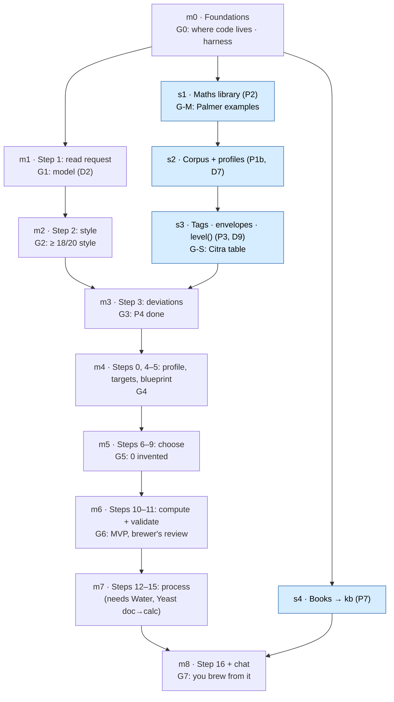

# Building the recipe workflow in n8n: roadmap and checkpoints

> **Status:** proposal, 2026-10-12. Nothing in it is built or decided yet. Every work item has a
> draft brief in `docs/work/` (§1 table). It orders the work
> of [RECIPE-ROADMAP.md](RECIPE-ROADMAP.md) §8 (P2–P8) into milestones for n8n, and marks the
> points where we stop, measure and decide whether we are still going the right way.
> Linked from [PROJECT.md](../PROJECT.md) §3.

---

## TL;DR

- 🧪 **Test first, per step.** Every pipeline step is its own n8n sub-workflow with a JSON
  contract. A failing test (pytest against the 20 briefs, or against Palmer's worked examples
  for maths) is written before the step.
- 🚦 **8 checkpoints (G0–G7).** Each one has a measurable bar, a decision, and what to do on a
  "no". We don't move on past a red checkpoint without deciding why.
- 📋 **Brief checks at every milestone.** The 20 briefs are good for steps 1–3 now. Later steps
  need things the briefs don't have yet (§3); each is added when its milestone reaches it, not
  before.
- 🪜 **Start with what needs no new data:** the harness, step 1 (the LLM step, which also
  benchmarks D2) and step 2. Maths, corpus and tags run alongside, because steps 3–11 need them.

---

## 1. The path

Blue = side tracks outside n8n's step order. s1 → s2 → s3 is a chain (the corpus gates recompute
OG/IBU with the maths; the style-fit cut points are calibrated on the corpus), so m3 waits for s3.
s4 can run any time after m0, once the doc → calc passes for its books are done.

**Work items.** Each row has a draft brief in `docs/work/<slug>/brief.md` (written 2026-10-12, not
approved). The slug carries the roadmap id as a prefix, `m<N>-` for milestones and `s<N>-` for
side tracks, so the folders sort in roadmap order in `docs/work/` and stay identifiable in
`docs/finished/`. The folders stay flat (no subfolder), because the dev-flow skills, branch
names and dev-ship's move to `docs/finished/` assume `<slug>` is one folder name.

| # | Slug (brief) | Builds | Needs first | Checkpoint |
|---|---|---|---|---|
| M0 | [`m0-harness`](work/m0-harness/brief.md) | G0 decisions; eval harness that sends each brief to the pipeline and scores the result (red at first); `app.run` / `app.run_step` logging; contracts for steps 0–3 and one stub step | — | **G0** |
| M1 | [`m1-read-request`](work/m1-read-request/brief.md) | Step 1: request → LLM → brief JSON, checked by code; D2 benchmark | m0 | **G1** |
| M2 | [`m2-best-fit-style`](work/m2-best-fit-style/brief.md) | Step 2: score all 285 styles (name, stated numbers, words), per D1 | m1 | **G2** |
| S1 | [`s1-maths`](work/s1-maths/brief.md) | Gravity, ABV, IBU (Tinseth), colour (Morey), solvers, from the doc→calc pass on *How to Brew* | m0 | **G-M** |
| S2 | [`s2-corpus`](work/s2-corpus/brief.md) | Corpus with quality gates, `fermentable.role`, name map → `style_profile` (D7) | s1 | **G-S** (profiles) |
| S3 | [`s3-style-fit`](work/s3-style-fit/brief.md) | Tags, envelopes for the briefs' 22 styles (20 + 2 alternates), `level()`, golden set (D9) | s2 | **G-S** |
| M3 | [`m3-deviations`](work/m3-deviations/brief.md) | Step 3: number, mismatch, conflict and ingredient deviations | m2, s3 | **G3** = RECIPE-ROADMAP P4 done |
| M4 | [`m4-targets-blueprint`](work/m4-targets-blueprint/brief.md) | Steps 0, 4, 5: brewer profile, targets (ranges + hint knobs + stated numbers), blueprint (ratios) | m3, s1, s2 | **G4** |
| M5 | [`m5-choose-ingredients`](work/m5-choose-ingredients/brief.md) | Steps 6–9: yeast, fermentables, hops, extras, scored by code; the resolver | m4, s3 | **G5** |
| M6 | [`m6-compute-validate`](work/m6-compute-validate/brief.md) | Steps 10–11: amounts, OG/FG/ABV/IBU/SRM, validate + retry ≤ 3×, save; held-out briefs | m5, s1 | **G6** = MVP |
| M7 | [`m7-process`](work/m7-process/brief.md) | Steps 12–15: water, mash + boil, ferment, package | m6; *Water* and *Yeast* PDFs | — (brief check only) |
| S4 | [`s4-books-kb`](work/s4-books-kb/brief.md) | Books → `kb`, hybrid retrieval, retrieval eval (P7) | m0; doc→calc passes | **G7** (retrieval) |
| M8 | [`m8-recipe-sheet-chat`](work/m8-recipe-sheet-chat/brief.md) | Step 16 recipe sheet with reasons, deviations, citations; n8n chat | m7, s4 | **G7** |

---

## 2. Checkpoints

Each checkpoint is a short stop: run the measurement, write the numbers into PROJECT.md §8, and
decide. "If no" lists what to look at, not a fix to apply automatically.

### G0 · Where code lives, how tests reach n8n (before any workflow)

PROJECT.md §4 leaves open how the pipeline is split inside n8n and where the maths runs. This
must be settled first, because it decides how every later step is tested.

| Option | Testable how | Readable how | Notes |
|---|---|---|---|
| **A. SQL functions** in `db/*.sql`, called from n8n's Postgres node | pytest calls them through `psycopg`, as the loader tests do today | one SQL file per step | Data is already in Postgres; fits "compute first" and the existing DB-change path |
| B. JavaScript in Code nodes | only by running the workflow with pinned data | logic sits inside workflow JSON | Hard to unit test; the first build's lesson (§6.8) argues against hidden logic |
| C. Python in Code nodes | same as B | same as B | n8n 2.23.4 runs Python only through an external task runner, which this stack doesn't have |

*Leaning, for you to decide:* **A** for maths and scoring, Code nodes only for glue (reshaping
JSON). Also decide here: how pytest triggers a run (webhook vs. `n8n execute`) and reads the
result back (`app.run_step` rows), and what a step contract looks like (JSON Schema per step,
with the "none / unknown / conflict" slot, PROJECT.md §6.3).

**Bar:** one dummy step runs end to end: pytest sends a brief, n8n logs a `run_step` row, pytest
reads and scores it.

### G1 · Step 1 reads requests well enough, and which model (D2)

Step 1's output is graded field by field against each brief's `stated`, `hints`, `wanted`,
`excluded`, `inventory` and `guidance`. The same run is the D2 benchmark: try `qwen3.8:27b`,
`gemma4:12b` and any other model that fits.

**Bar (proposed):** ≥ 19/20 briefs with every field right on the best model, stable over 3 runs.
**Decide:** D2. **If no:** is it the prompt, the contract (too many fields at once, §6.2), or a
brief that is genuinely ambiguous?

### G2 · Step 2 picks the right style

**Bar:** ≥ 18/20 briefs where the picked style is `style` or in `alt_styles` (RECIPE-ROADMAP P4),
b05 reports the 20C/15B mismatch, b12 picks 31B. **If no:** look at which signal misleads (name
vs. numbers vs. words) before adding signals; consider an LLM tie-break only for real ties.

### G3 · Step 3 finds the right deviations (P4 done)

**Bar:** every expected deviation found, no unexpected ones, on ≥ 18/20 briefs. The ingredient
kind (b16 rice, b19 honey, b20 lactose) needs s3's tags and envelopes, so m3 starts after s3.
**Decide:** start stage B now, or improve stage A first.

### G-M · Maths matches the books

**Bar:** every function reproduces Palmer's and OBC's worked examples within a stated tolerance
(e.g. OG ±0.001, IBU ±1, SRM ±1). **If no:** the formula or the unit is wrong; never tune
constants to fit.

### G-S · Style fit works from data

**Bar:** RECIPE-ROADMAP §5's Citra table reproduces from SQL; envelopes for the 22 brief styles
reviewed by you (D9). D7 settled with measured profile counts. **If no:** revisit the tag
vocabulary before adding override rows.

### G4 · Targets follow the brief

**Bar:** for all 20 briefs, every target is inside the style range unless a stated number or
guidance-off says otherwise; each hint moves its knob as the §7 table says (b01 IBU in the top
25 %, b11's conflict leaves body at the midpoint and is reported). Checked by code against
`ref.beer_style`, so the briefs don't need target numbers.

### G5 · Choices are real and honour the user

**Bar:** 0 invented ingredients (every item is a `ref` id); 0 excluded items used (b08 Saaz,
b16 Citra and Mosaic); inventory items used where they fit (b10, b15); each brief's `needs`
class covered or reported as absent. **Decide:** is "popularity in the corpus" giving recipes a
brewer would choose? Look at 3 recipes by hand before going on.

### G6 · MVP: numerically correct, style-checked recipes

**Bar:** ≥ 16/20 validate (RECIPE-ROADMAP P5), stated numbers met within tolerance, ≤ 2 LLM calls
per recipe plus tie-breaks. **Direction check, the big one:** you read 5 full recipes as a
brewer. If they pass the numbers but you wouldn't brew them, the scoring (G5) is what to fix,
not the validator.

### G7 · You can brew from the sheet

**Bar:** every recipe has water, mash, ferment and package (P6); citations resolve to `kb`
chunks; you brew one. Retrieval recall@5 measured against an agreed bar (P7).

---

## 3. Brief checks: are the 20 briefs enough at this point?

The briefs were written for steps 1–3 (P0). Measured 2026-10-12: they cover style,
alternatives (b05, b12), 8 deviations of all 4 kinds, stated numbers in 9 briefs, hints from
every §7 row, exclusions (b08, b16), inventories (b10, b15), guidance off (b18). They are
**enough for M0–M2 as they are.** For later milestones, these gaps are known; each is fixed in
the milestone that first needs it, as its own small work item with your review.

| When | Gap | Why it matters | Proposed fix |
|---|---|---|---|
| M1 | Names are generic (`candi sugar`, `abbey ale yeast`) while `ref` names products (Brown Candi Sugar, specific strains) | Step 1 or a resolver must map words to `ref` ids; the grader must know what counts as a match | Decide at G1 whether step 1 outputs words (a code resolver maps them) or ids; grade words against the brief, ids at M5 |
| M2 | No brief exercises BA 2026 or a "BJCP only / BA only" preference (D1) | D1's BA path would go untested | Add 1–2 briefs where BA describes the beer better, if D1's BA path is built in M2 |
| M2 | No genuinely ambiguous request where asking back is right | RECIPE-ROADMAP §4: "only ask when genuinely ambiguous" is untested | Optional: one brief that should produce a question |
| M3 | `deviations[].what` is free text | The grader needs a rule for "same deviation" | Grade on `kind` + the ingredient or number named; write that rule into the harness, not the briefs |
| M4, M6 | Only 5 briefs state a batch size (b01, b08, b13, b15, b19); none states efficiency or water | Steps 0, 4, 10 and 12 need a brewer profile | One test brewer profile as a fixture (e.g. 20 L, 72 %, a stated tap water), used where a brief states nothing |
| M5 | `needs` names 2 items not in `ref`: Special B (b10) and Lactobacillus (b14) | b14 can't be a Berliner Weisse without a souring agent | Decide: add a souring culture to `ref`, or expect the "absent" slot and a note; mark `needs` as classes to cover, not exact items |
| M6 | No tolerance for stated numbers (b01 6.5 % ABV, b08 50 IBU, b14 3 %, b17 7 %, b18 20 SRM) | "Met" is undefined | Put tolerances in the harness, next to the maths tolerances of G-M |
| M6 | All 20 briefs are used while building | The pipeline can be tuned to these 20 without getting better in general | Write 5–10 held-out briefs before G6, scored only at checkpoints |
| M7 | No process expectations (e.g. b13 weizen ferment temperature, b14 souring, lager schedules) | Steps 12–15 have nothing to be graded against | Add a small `process` expectation to the briefs that need one, once P6's contracts exist |
| any | The file header still points to `docs/work/test-briefs/brief.md`; it is in `docs/finished/` now | Dead link | Fix with the first brief change |

---

## 4. Working rhythm per milestone

Each milestone (and each side track) is one or more `dev-flow` work items in `docs/work/<slug>/`:

1. **Brief check** (§3): does the milestone need a brief change? If yes, that is the first work
   item, reviewed by you.
2. **Red:** write the step contract and the failing tests (pytest over the briefs, or unit tests
   for SQL functions).
3. **Green:** build the sub-workflow and its SQL; keep each sub-workflow readable on its own
   (PROJECT.md §6.8).
4. **Checkpoint:** run the full brief set, write the measured numbers into PROJECT.md §8, decide
   at the gate.

Earlier steps' tests keep running at every milestone, so a later change that breaks step 2
shows up at once.
