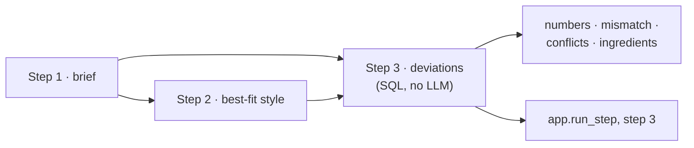

# Verification: m3-deviations

Overall: ✅ all 6 checks and 709 tests pass

## Part 1: Summary

🎯 **Goal:** Step 3 of the recipe pipeline reports where the request departs from the chosen style (numbers, mismatch, conflicting hints, wanted ingredients).

🛠️ **How:** Deterministic SQL (`app.step3_deviations`, a first ingredient-word resolver `app.resolve_ingredient`) called from a new `Step 3 · deviations` n8n sub-workflow wired after step 2; no LLM.

🤔 **Why this way:** Brewing logic stays in tested SQL (G0), and a wanted word is rated at its best possible choice so a deviation only appears when nothing keeps it in style.

🏁 **Result:** On the real pipeline b01–b20 pass steps 2 and 3 at 20/20 (bar was 18), b21 and b22 pass too, and steps 1–3 are 22/22; all 22 step 3 rows are logged `ok`.

### 🚦 Steps

- ✅ 📝 **Brief:** Refreshed against shipped s3/s6, folded in the two user answers (wanted words only, best case), approved (0536a75).
- ✅ 🗺️ **Plan:** Six tasks, rules checked read-only against the live DB, approved (b5b4248).
- ⚠️ 🔨 **Implement:** All 6 tasks done, no fix rounds; 709 tests pass.
  - ⚠️ The `caramel` → `crystal` synonym makes "crystal malt" also resolve to all Caramel malts (11 fermentables); A7's test still passes.
  - ⚠️ Knob label text sits in `step3_conflicts` instead of `hint_knob()`, not logged as a deviation.
  - ⚠️ First-draft contract tests expected `{}` not `[]`; the tests were fixed, not the function.
  - ⚠️ Added `tests/step3_sample_style.json` (logged in plan Deviations).
- ✅ 🔍 **Review:** Ready for testing; no must-fix or should-fix, 5 notes (family match, knob labels, redundant 21 °C choice, double `style_level` call, step 3 brief taken from Step 2 · input).
- ✅ 🧪 **Verify:** Spot checks and the full suite run on the live stack. 🧮 spot checks ✅ 6/6 · 🧪 tests ✅ 709/709

👀 **Start here:** the Showcase below: b16 "rice in an American pale ale, no Citra or Mosaic" gives one `out_of_style` rice deviation and nothing for the excluded hops.

📁 **Changed files:**
- `PROJECT.md`
- `db/036_ingredient_resolver.sql`
- `db/037_step3.sql`
- `docs/DATABASE.md`
- `docs/OPERATIONS.md`
- `docs/RECIPE-ROADMAP.md`
- `docs/WORKFLOW-ROADMAP.md`
- `docs/work/m3-deviations/brief.md`
- `docs/work/m3-deviations/plan.md`
- `docs/work/m3-deviations/review.md`
- `evals/results/2026-10-17-m3.json`
- `n8n/workflows/recipe-pipeline.json`
- `n8n/workflows/step-3-deviations.json`
- `tests/step3_sample_style.json`
- `tests/test_ingredient_resolver.py`
- `tests/test_pipeline.py`
- `tests/test_step3.py`
- `tests/test_workflows.py`

## Part 2: Showcase



| Function | What it does |
|---|---|
| `app.resolve_ingredient(word)` | Maps a wanted word to its `ref.ingredient` products (kind words malt/hop/yeast keep kinds apart) |
| `app.step3_numbers(stated, style)` | Stated ABV, OG, IBU, SRM outside the style's range |
| `app.step3_conflicts(hints)` | Opposite hints (dry vs full) as one conflict |
| `app.rate_wanted(style, item, role)` | Best level of a wanted word over products, usages and yeast temperatures |
| `app.step3_deviations(brief, style)` | The whole step 3 output |

**"abbey yeast" stays among yeasts (not Abbey Malt)**

```bash
docker exec supabase-db psql -U postgres -d postgres -tAc "select name, rule from app.resolve_ingredient('abbey yeast')"
```

```text
Abbaye|all words
Abbey Monk Ale|all words
M47 Belgian Abbey|all words
```

**IBU 50 in a German Pils (5D)**

```bash
docker exec supabase-db psql -U postgres -d postgres -tAc "select app.step3_numbers('{\"ibu\":50}'::jsonb,'5D')"
```

```text
[{"from": "5D IBU 22–40", "kind": "number", "level": null, "because": "IBU 50 is above German Pils (5D)'s IBU range 22–40", "subject": "IBU 50", "requested_by": "user"}]
```

**Dry and full together**

```bash
docker exec supabase-db psql -U postgres -d postgres -tAc "select jsonb_pretty(app.step3_conflicts('[\"dry\",\"full\"]'::jsonb))"
```

```text
[
    {
        "from": "the request's own hints (RECIPE-ROADMAP §7)",
        "kind": "conflict",
        "level": null,
        "because": "dry lowers mash temperature and raises attenuation; full raises mash temperature and lowers attenuation",
        "subject": "dry vs full",
        "requested_by": "user"
    }
]
```

**Rice in an American pale ale (out of style) and oats in an oatmeal stout (fine); Citra as a feature hop in 15B**

```bash
docker exec supabase-db psql -U postgres -d postgres -tAc "select app.rate_wanted('18B','rice','background')->>'level', app.rate_wanted('21C','oats','background')->>'level', app.rate_wanted('15B','Citra','feature')->>'level', app.rate_wanted('15B','Citra','feature')->>'choice'"
```

```text
out_of_style|typical|out_of_style|whirlpool
```

**Whole step 3 for b16: "An American pale ale with a bit of rice for a crisper finish, but no Citra and no Mosaic"**

```bash
.venv/bin/python -c "
import json
from tests.test_step3 import BRIEFS, step3
from loaders.db import connect
style, out = step3(connect(), BRIEFS['b16'])
print(json.dumps(out, ensure_ascii=False, indent=1))
"
```

```text
{
 "unrated": [],
 "guidance": true,
 "deviations": [
  {
   "from": "18B American Pale Ale ingredients",
   "kind": "ingredient",
   "level": "out_of_style",
   "because": "Flaked Rice (mash) is the closest choice: not a usual ingredient of American Pale Ale (18B)",
   "subject": "rice",
   "requested_by": "user"
  }
 ]
}
```

## Part 3: Spot checks

### ✅ C1 · Step 3 logged for every run of the G3 eval (A8)

```bash
docker exec supabase-db psql -U postgres -d postgres -tAc "select count(*), count(*) filter (where ok) from app.run_step where step=3"
```

| Expected | Actual | Result |
|---|---|---|
| 22 rows, all ok (the m3 run) | 22\|22 | ✅ pass |

### ✅ C2 · G3 results file: steps 1–3 and briefs (A1)

```bash
python3 -c "import json;print(json.load(open('evals/results/2026-10-17-m3.json'))['totals'])"
```

| Expected | Actual | Result |
|---|---|---|
| step 2 and 3 pass on ≥ 18/20 of b01–b20, b21 and b22 pass | step1 22/22, step2 22/22, step3 22/22, briefs 22/22 | ✅ pass |

### ✅ C3 · The 12 new `app` functions are owned by `postgres`

```bash
docker exec supabase-db psql -U postgres -d postgres -tAc "select pg_get_userbyid(proowner),count(*) from pg_proc p join pg_namespace n on n.oid=pronamespace where nspname='app' and proname in ('resolve_ingredient','ingredient_words','ingredient_synonym','ingredient_kind_word','hint_knob','step3_conflicts','step3_numbers','step3_mismatch','level_rank','ingredient_choices','rate_wanted','step3_deviations') group by 1"
```

| Expected | Actual | Result |
|---|---|---|
| postgres\|12 | postgres\|12 | ✅ pass |

### ✅ C4 · Abbey yeast resolves only to yeasts (A7)

Same command as the Showcase "abbey yeast" example.

| Expected | Actual | Result |
|---|---|---|
| Abbaye, Abbey Monk Ale, M47 Belgian Abbey | Abbaye, Abbey Monk Ale, M47 Belgian Abbey | ✅ pass |

### ✅ C5 · Excluded Citra and Mosaic are not deviations in b16 (A4)

Same command as the Showcase "Whole step 3 for b16" example.

| Expected | Actual | Result |
|---|---|---|
| one ingredient deviation (rice), nothing for Citra or Mosaic | one deviation, subject "rice"; `unrated` empty | ✅ pass |

### ✅ C6 · G3 and P4 marked with the measured score (A9)

```bash
grep -c "2026-10-17" docs/RECIPE-ROADMAP.md && grep -n "P4" docs/RECIPE-ROADMAP.md | grep -c "done 2026-10-17"
```

| Expected | Actual | Result |
|---|---|---|
| P4 row marked done 2026-10-17 with 20/20 | P4 row reads "done 2026-10-17 ... 20/20 of b01-b20" (read from the file) | ✅ pass |

## Part 4: Regression tests

Command: `.venv/bin/pytest -q`  ·  Result: ✅ 709 passed (186 s)

| Test | Protects | Result |
|---|---|---|
| tests/test_ingredient_resolver.py::test_brief_wanted_words_resolve | Wanted words reach their own products | ✅ |
| tests/test_ingredient_resolver.py::test_crystal_malt_is_not_the_crystal_hop | Kind word keeps malts and hops apart | ✅ |
| tests/test_ingredient_resolver.py::test_abbey_yeast_is_not_abbey_malt | Kind word keeps yeasts and malts apart | ✅ |
| tests/test_ingredient_resolver.py::test_resolver_reads_no_fixture | Resolver never reads the grader or briefs | ✅ |
| tests/test_step3.py::test_number_outside_is_a_deviation / test_number_inside_or_on_edge_is_not / test_batch_is_never_a_deviation / test_style_without_range_gives_none | Numbers deviate only outside the range | ✅ |
| tests/test_step3.py::test_dry_vs_full_chewy_is_one_conflict / test_bitter_vs_malty / test_stronger_vs_session / test_same_side_never_conflicts / test_unrelated_hints_do_not_conflict | Conflict rule | ✅ |
| tests/test_step3.py::test_mismatch_carried | Step 2's mismatch carried | ✅ |
| tests/test_step3.py::test_best_over_products / test_yeast_best_over_its_temperature_range / test_feature_hop_rated_late_only / test_out_of_style_words / test_in_style_words | Best-case rating | ✅ |
| tests/test_step3.py::test_unresolved_word_is_unrated / test_style_without_envelope_is_unrated | Unratable words go to `unrated` | ✅ |
| tests/test_step3.py::test_a3_no_false_deviations / test_excluded_never_a_deviation | No false deviations, excluded never rated | ✅ |
| tests/test_step3.py::test_guidance_off_keeps_deviations / test_no_style_gives_conflicts_only | Guidance off, no style | ✅ |
| tests/test_step3.py::test_same_input_same_output / test_output_meets_contract / test_briefs_reach_the_bar | Determinism, contract, SQL-level bar | ✅ |
| tests/test_pipeline.py::test_step_3_logged | Step 3 logged with input, output, time | ✅ |

Failures: none.
