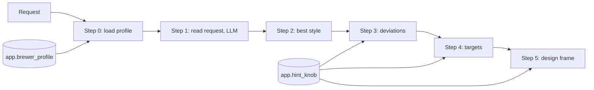

# Verification: m4-targets-blueprint

Overall: ✅ all 14 checks and 849 tests pass

## Part 1: Summary

🎯 **Goal:** Steps 0, 4 and 5 of the recipe pipeline: brewer profile, targets and design frame, all by code.

🛠️ **How:** Three SQL files (`db/038`, `db/039`, `db/041`), one hint table with positions and sources, rule 9 aligned with step 4, graders for steps 4–5, three n8n sub-workflows logged in `Recipe pipeline`.

🤔 **Why this way:** Targets follow the style range, the hints and the user's numbers, with ABV always derived by s1's `app.abv`, so no step contradicts another; step 5 holds no ratio numbers (D7).

🏁 **Result:** On the real pipeline steps 1–5 each pass 22/22 (b01–b20 20/20, b21, b22); 66 step rows (steps 0, 4, 5) all `ok`, 132 contract checks with 0 errors; full suite 849 passed.

### 🚦 Steps

- ✅ 📝 **Brief:** Rewritten against shipped deps (corpus empty, so step 5 became a design frame; 22 briefs), then the user's 5 answers applied. Approved, 1cae787.
- ✅ 🗺️ **Plan:** 9 tasks; 3 user answers applied (A4, solved OG counts as derived, reference recipes retargeted). Approved, 6561964.
- ⚠️ 🔨 **Implement:** 9 tasks done (d08c299 to 9e358fe), 4 recorded deviations. One interrupted dispatch left nothing on disk and was re-run.
  - ⚠️ Task 1: Bru'n Water quote not found in the repo (review later found it in the source and `kb.chunk`)
  - ⚠️ Task 2: full suite not run in the task
  - ⚠️ Task 3: new tests not seen failing first
  - ⚠️ Task 5: new A11 cases not run against the old rule 9 (review confirmed the old rule fails them)
  - ⚠️ Task 7: derived-OG skip break not caught by the grader tests (fixed in 3ed0c71)
  - ⚠️ Task 8: new pipeline tests not seen failing against the old pipeline (review: they call steps that did not exist)
- ❌ 🔍 **Review:** Ready for testing, 0 must-fix, 2 should-fix (4 grader checks breakable with tests still green; PROJECT.md "18 recipes" should be 17), 5 notes. 🔧 fixed in 3ed0c71; re-review (6686840) closed both.
  - ⚠️ One ABV-in-range grader check is redundant with the per-target loop (accepted)
- ✅ 🧪 **Verify:** All 14 spot checks pass and the whole suite passes; G4 re-measured on the real pipeline. 🧮 spot checks ✅ 14/14 · 🧪 tests ✅ 849/849

👀 **Start here:** the Showcase below, then `evals/results/2026-10-18-m4-verify.json` for the 22 × 5 pass table. G4's "Decided:" line in `docs/WORKFLOW-ROADMAP.md` is left for you.

📁 **Changed files:**
- `PROJECT.md`
- `db/031_formulation_rules.sql`
- `db/032_formulation_check.sql`
- `db/037_step3.sql`
- `db/038_step0.sql`
- `db/039_step4.sql`
- `db/041_step5.sql`
- `docs/DATABASE.md`
- `docs/OPERATIONS.md`
- `docs/RECIPE-ROADMAP.md`
- `docs/SOURCES.md`
- `docs/WORKFLOW-ROADMAP.md`
- `docs/work/m4-targets-blueprint/brief.md`
- `docs/work/m4-targets-blueprint/hint-sources.md`
- `docs/work/m4-targets-blueprint/plan.md`
- `docs/work/m4-targets-blueprint/review.md`
- `evals/grade.py`
- `evals/results/2026-10-17-m4.json`
- `evals/run.py`
- `n8n/workflows/recipe-pipeline.json`
- `n8n/workflows/step-0-load-profile.json`
- `n8n/workflows/step-4-targets.json`
- `n8n/workflows/step-5-design-frame.json`
- `shared/contracts/formulation_check.input.schema.json`
- `shared/contracts/step4.input.schema.json`
- `shared/contracts/step4.output.schema.json`
- `shared/contracts/step5.input.schema.json`
- `shared/contracts/step5.output.schema.json`
- `tests/fixtures/reference_recipes.toml`
- `tests/step45_sample.json`
- `tests/test_contracts.py`
- `tests/test_formulation_check.py`
- `tests/test_grade.py`
- `tests/test_pipeline.py`
- `tests/test_reference_recipes.py`
- `tests/test_run.py`
- `tests/test_step0.py`
- `tests/test_step4.py`
- `tests/test_step5.py`
- `tests/test_workflows.py`
- `docs/work/m4-targets-blueprint/verification.md`
- `evals/results/2026-10-18-m4-verify.json`

## Part 2: Showcase



| Function | What it does |
|---|---|
| `app.step0_profile(id)` | The brewer profile (the `default` row when no id) in the `step0.output` shape |
| `app.hint_knob()` | One hint table: knob, direction, position or mash °C, intent, book source or `unsourced` |
| `app.step4_numbers(style, stated, hints)` | OG, FG, ABV, IBU, SRM: stated, else hint position, else midpoint; ABV from `app.abv`; OG moved only as far as needed |
| `app.step4_targets(...)` | Whole step 4 output: batch, mash target, targets, knobs, conflicts, each value with `from` and `because` |
| `app.step5_frame(...)` | Design frame: rules and limits, ingredient slots with `max_pct`, excluded and inventory words, hint intents, needed attenuation |

**The default brewer profile (distilled-water ions are a placeholder)**

```bash
docker exec supabase-db psql -U postgres -d postgres -tAc "select name,batch_l,efficiency_pct,boil_off_l_h,losses_l,grain_abs_l_kg,ca_mg_l,mg_mg_l,na_mg_l,so4_mg_l,cl_mg_l,hco3_mg_l from app.brewer_profile where name='default'"
```

```text
default|20.0|72.0|4.00|2.00|1.00|0.0|0.0|0.0|0.0|0.0|0.0
```

**A `bitter` hint on an American IPA (21A, IBU 40–70) moves IBU to the middle of the top quarter**

```bash
docker exec supabase-db psql -U postgres -d postgres -tAc "select app.step4_numbers('21A','{}'::jsonb,'[\"bitter\"]'::jsonb)->'ibu'"
```

```text
{"from": "hint", "value": 66.250, "because": "bitter: 87.5 % of 21A IBU 40–70"}
```

**A stated 6.5 % ABV keeps FG and solves OG**

```bash
docker exec supabase-db psql -U postgres -d postgres -tAc "select app.step4_numbers('21A','{\"abv\":6.5}'::jsonb,'[]'::jsonb)->'og'"
```

```text
{"from": "derived", "value": 1.0613, "because": "solved so app.abv gives the stated ABV 6.5 at FG 1.011"}
```

**A `stronger` Imperial Stout (17C, ABV 6.5–10): OG up would give 12 % ABV, so it moves back just inside the range**

```bash
docker exec supabase-db psql -U postgres -d postgres -tAc "select app.step4_numbers('17C','{}'::jsonb,'[\"stronger\"]'::jsonb)->'og'"
```

```text
{"from": "derived", "value": 1.1064, "because": "moved from 1.1225 so app.abv falls inside 17C ABV 6.5–10 (nearest end 10) at FG 1.029"}
```

**Midpoint ABV and `app.abv` disagree for a Standard Bitter (15A): OG moves just far enough to reach 3.8 %**

```bash
docker exec supabase-db psql -U postgres -d postgres -tAc "select app.step4_numbers('15A','{}'::jsonb,'[]'::jsonb)->'og', app.step4_numbers('15A','{}'::jsonb,'[]'::jsonb)->'abv'"
```

```text
{"from": "derived", "value": 1.0417, "because": "moved from 1.041 so app.abv falls inside 15A ABV 3.8–5 (nearest end 3.8) at FG 1.012"}|{"from": "derived", "value": 3.81, "because": "app.abv of OG 1.0417 and FG 1.012"}
```

<details><summary>The hint table (18 rows; 3 unsourced)</summary>

```bash
docker exec supabase-db psql -U postgres -d postgres -tAc "select hint, side, knob, direction, position, mash_c, source from app.hint_knob() order by 1,3"
```

```text
bitter|bitter|bu_gu|1|||bjcp-exam-study-guide-2017, p60
bitter|bitter|ibu|1|0.875||unsourced
chewy|full/chewy|attenuation|-1|||bjcp-exam-study-guide-2017, p77
chewy|full/chewy|mash_temp|1||68.5|palmer-how-to-brew, p277
crisp|dry/crisp|attenuation|1|||palmer-how-to-brew, p134
crisp|dry/crisp|mash_temp|-1||64.5|palmer-how-to-brew, p277
darker|darker|srm|1|0.875||mallett-malt, p143
dry|dry/crisp|attenuation|1|||palmer-how-to-brew, p134
dry|dry/crisp|mash_temp|-1||64.5|palmer-how-to-brew, p277
full|full/chewy|attenuation|-1|||bjcp-exam-study-guide-2017, p77
full|full/chewy|mash_temp|1||68.5|palmer-how-to-brew, p277
hoppy|hoppy/juicy|late_hop_share|1|||janish-survivables-hot-side, Unpacking Hot-Side Hop Flavor
juicy|hoppy/juicy|late_hop_share|1|||janish-survivables-hot-side, Unpacking Hot-Side Hop Flavor
malty|malty|bu_gu|-1|||palmer-how-to-brew, p447
malty|malty|ibu|-1|0.125||palmer-how-to-brew, p447
malty|malty|munich_share|1|||palmer-how-to-brew, p255
session|session|og|-1|0.125||unsourced
stronger|stronger|og|1|0.875||unsourced
```

</details>

**Step 5 for b06 (a dry rice lager): slot with `max_pct`, hint intent, needed attenuation and yeast band**

```bash
PYTHONPATH=tests:. .venv/bin/python -c "
import test_step5 as t
from loaders.db import connect
f=t.step5(connect(),t.BRIEFS['b06'])
print([(s['item'],[(r['name'],r['role'],r['max_pct']) for r in s['refs']][:1]) for s in f['slots']])
print([i['intent'] for i in f['intents']])
a=f['attenuation']; print(a['needed_pct'],a['low_pct'],a['high_pct'],a['mash_c'])"
```

```text
[('rice', [('Flaked Rice', 'adjunct', 40.0)])]
['a high-attenuation yeast; sugar at most 10 % of the grist']
84.44 77.78 91.11 64.5
```

## Part 3: Spot checks

### ✅ C1 · Default profile row (A7, R2)

```bash
docker exec supabase-db psql -U postgres -d postgres -tAc "select batch_l,efficiency_pct,boil_off_l_h,losses_l,grain_abs_l_kg,ca_mg_l,mg_mg_l,na_mg_l,so4_mg_l,cl_mg_l,hco3_mg_l from app.brewer_profile where name='default'"
```

| Expected | Actual | Result |
|---|---|---|
| 20 · 72 · 4 · 2 · 1.0 · six 0 ions | `20.0\|72.0\|4.00\|2.00\|1.00\|0.0\|0.0\|0.0\|0.0\|0.0\|0.0` | ✅ pass |

### ✅ C2 · `.sql` cites Bru'n Water §4.2.1; Later TODO for user-set ions (A7)

```bash
grep -c "4.2.1" db/038_step0.sql; grep -c "TODO: let the user set their own water ions" docs/RECIPE-ROADMAP.md
```

| Expected | Actual | Result |
|---|---|---|
| 1 (or more) and 1 | `1`, `1` | ✅ pass |

(Run earlier as two separate greps: the source slug and §4.2.1 appear in lines 9–10 of `db/038_step0.sql`; the TODO is in RECIPE-ROADMAP §8 Later.)

### ✅ C3 · The A2 numbers (A2, R5, R8)

```bash
PYTHONPATH=tests:. .venv/bin/python -c "
import test_step4 as t
from loaders.db import connect
c=connect(); v=t.value
o={b:t.step4(c,x) for b,x in t.BRIEFS.items()}
print('b01 ibu',v(o['b01']['targets']['ibu']),'| b09 ibu',v(o['b09']['targets']['ibu']),'| b06 mash',v(o['b06']['mash_c']),'| b03 mash',v(o['b03']['mash_c']),'| b19 og>1.100',v(o['b19']['targets']['og'])>1.100,'abv',v(o['b19']['targets']['abv']))"
```

| Expected | Actual | Result |
|---|---|---|
| 66.25 · 18.75 · 64.5 · 68.5 · OG above 1.100, ABV at most 10.0 | `b01 ibu 66.25 \| b09 ibu 18.75 \| b06 mash 64.5 \| b03 mash 68.5 \| b19 og>1.100 True abv 9.99` | ✅ pass |

### ✅ C4 · b11's conflict leaves mash and attenuation at default (A3, R7)

```bash
PYTHONPATH=tests:. .venv/bin/python -c "
import test_step4 as t
from loaders.db import connect
c=connect(); v=t.value; o=t.step4(c,t.BRIEFS['b11'])
print('b11 mash',v(o['mash_c']),o['mash_c']['from'],'knobs',[k['knob'] for k in o['knobs']],'conflicts',len(o['conflicts']))"
```

| Expected | Actual | Result |
|---|---|---|
| mash 66.5 midpoint, no knobs, 1 conflict | `b11 mash 66.5 midpoint knobs [] conflicts 1` | ✅ pass |

### ✅ C5 · Batch sizes and stated numbers (A4, R3, R4)

```bash
PYTHONPATH=tests:. .venv/bin/python -c "
import test_step4 as t
from loaders.db import connect
c=connect(); v=t.value
o={b:t.step4(c,x) for b,x in t.BRIEFS.items()}
print('b08',v(o['b08']['targets']['ibu']),v(o['b08']['batch_l']),'b13',v(o['b13']['batch_l']),'b15',v(o['b15']['batch_l']),'b01',v(o['b01']['batch_l']),o['b01']['batch_l']['from'],'b19',v(o['b19']['batch_l']),o['b19']['batch_l']['from'],'b17 abv',v(o['b17']['targets']['abv']),'b18 srm',v(o['b18']['targets']['srm']),o['b18']['guidance'])
print('others 20 L profile',sorted(b for b,x in o.items() if x['batch_l']['from']=='profile' and v(x['batch_l'])==20)==sorted(set(o)-{'b08','b13','b15','b01','b19'}))"
```

| Expected | Actual | Result |
|---|---|---|
| b08 IBU 50, 10 L; b13 15; b15 23; b01 20 stated; b19 10 stated; b17 ABV 7; b18 SRM 20, guidance off; the other 17 briefs 20 L profile | `b08 50.0 10.0 b13 15.0 b15 23.0 b01 20.0 stated b19 10.0 stated b17 abv 7.0 b18 srm 20.0 False` / `others 20 L profile True` | ✅ pass |

### ✅ C6 · ABV equals `app.abv(OG, FG)` within 0.1 and is in range unless stated (A5, R8)

```bash
PYTHONPATH=tests:. .venv/bin/python -c "
import test_step4 as t
from loaders.db import connect
c=connect(); v=t.value; bad=[]
for b,x in t.BRIEFS.items():
    o=t.step4(c,x); tg=o['targets']
    if tg['og']['value'] is None: continue
    a=float(c.execute('select app.abv(%s::numeric,%s::numeric)',[tg['og']['value'],tg['fg']['value']]).fetchone()[0])
    if abs(a-v(tg['abv']))>0.1: bad.append((b,'abv-mismatch'))
    if 'abv' not in x['stated'] and not c.execute('select abv @> %s::numeric from ref.beer_style where code=%s',[tg['abv']['value'],o['style']['code']]).fetchone()[0]: bad.append((b,'abv-out-of-range'))
print('violations',bad)
o={b:t.step4(c,x) for b,x in t.BRIEFS.items()}
print({b:(v(o[b]['targets']['abv']),v(o[b]['targets']['fg'])) for b in ('b01','b14','b17','b21')})"
```

| Expected | Actual | Result |
|---|---|---|
| no violations; ABV b01 6.5, b14 3, b17 7, b21 4 | `violations []` / `{'b01': (6.5, 1.011), 'b14': (3.0, 1.0045), 'b17': (7.0, 1.013), 'b21': (4.0, 1.0095)}` | ✅ pass |

### ✅ C7 · Every target inside the style range except stated or ABV-solved, guidance on and off (A1)

```bash
PYTHONPATH=tests:. .venv/bin/python -c "
import test_step4 as t
from loaders.db import connect
c=connect(); bad=[]
for g in (True,False):
  for b,x in t.BRIEFS.items():
    br=dict(x); br['guidance']=g; o=t.step4(c,br)
    for k in ('og','fg','abv','ibu','srm'):
        it=o['targets'][k]
        if it['value'] is None or it['from']=='stated': continue
        if k in ('og','fg') and it['from']=='derived' and 'abv' in x['stated']: continue
        if not c.execute(f'select {k} @> %s::numeric from ref.beer_style where code=%s order by id limit 1',[it['value'],o['style']['code']]).fetchone()[0]: bad.append((g,b,k))
print('outside range',bad)"
```

| Expected | Actual | Result |
|---|---|---|
| `outside range []` | `outside range []` | ✅ pass |

### ✅ C8 · b12 takes its ranges from base style 18A (A6, R9)

```bash
PYTHONPATH=tests:. .venv/bin/python -c "
import test_step4 as t
from loaders.db import connect
o=t.step4(connect(),t.BRIEFS['b12'])
print(o['style']['code'], o['style'].get('from'), '|', o['targets']['og']['because'][:80])"
```

| Expected | Actual | Result |
|---|---|---|
| 18A, marked as base style | `18A base_style \| midpoint of 18A OG 1.038–1.054` | ✅ pass |

### ✅ C9 · Step 5 frame: slots, excluded, inventory, intents, rules, no ratio numbers, needed attenuation (A8, A9, R10)

```bash
.venv/bin/pytest -q -p no:cacheprovider tests/test_step5.py
```

| Expected | Actual | Result |
|---|---|---|
| all 11 pass | `11 passed in 58.16s` | ✅ pass |

Direct view (b06 slot and attenuation) is in Part 2; over all 22 briefs the keys holding a number outside the allowed list: `{}`; b08 excluded `['Saaz']`, b16 `['Citra', 'Mosaic']`, b10 inventory `['dark candi sugar', 'Munich malt', 'abbey yeast']`, b15 `['Maris Otter', 'crystal malt', 'East Kent Goldings']`.

### ✅ C10 · Every value in steps 4 and 5 has a non-empty `from` (A10, R12)

```bash
PYTHONPATH=tests:. .venv/bin/python -c "
import test_step5 as t5, test_step4 as t4
from loaders.db import connect
c=connect()
def walk(n,p=''):
    m=[]
    if isinstance(n,dict):
        if 'value' in n and 'from' in n and not n['from']: m.append(p)
        for k,v in n.items(): m+=walk(v,p+'/'+k)
    elif isinstance(n,list):
        for i,v in enumerate(n): m+=walk(v,p+f'[{i}]')
    return m
miss=[]; cnt=0
for b,x in t4.BRIEFS.items():
    s4=t4.step4(c,x); s5=t5.step5(c,x)
    miss+=[(b,'s4',m) for m in walk(s4)]+[(b,'s5',m) for m in walk(s5)]
    for it in s4['targets'].values(): cnt+=1; assert it['from'] and it['because'], (b,it)
print('target items with from+because checked',cnt,'empty from',miss)"
```

| Expected | Actual | Result |
|---|---|---|
| 110 target items (22 × 5), no empty `from` | `target items with from+because checked 110 empty from []` | ✅ pass |

### ✅ C11 · Rule 9 and the 22 reference recipes (A11, R11)

```bash
.venv/bin/pytest -q -p no:cacheprovider tests/test_formulation_check.py::test_rule_9 tests/test_reference_recipes.py
```

| Expected | Actual | Result |
|---|---|---|
| all pass (rule 9 accepts b01's hinted IBU 66.25 and a derived ABV, rejects unhinted/misplaced IBU; 22 recipes pass every rule) | `27 passed in 0.45s` | ✅ pass |

### ✅ C12 · Every hint row sourced or marked; unsourced rows listed (A12, R6)

```bash
.venv/bin/pytest -q -p no:cacheprovider tests/test_step4.py::test_hint_rows_sourced_or_marked tests/test_step4.py::test_hint_positions; grep -c unsourced docs/work/m4-targets-blueprint/hint-sources.md; docker exec supabase-db psql -U postgres -d postgres -tAc "select string_agg(hint||'·'||knob, ', ') from app.hint_knob() where source='unsourced'"
```

| Expected | Actual | Result |
|---|---|---|
| 2 tests pass; the 3 unsourced rows (bitter·ibu, stronger·og, session·og) are in `hint-sources.md` | `2 passed`; `5` mentions of "unsourced" in the file; `bitter·ibu, stronger·og, session·og` | ✅ pass |

### ✅ C13 · G4 on the real pipeline (A13, G4)

```bash
.venv/bin/python -m evals.run --save --label m4-verify
```

| Expected | Actual | Result |
|---|---|---|
| steps 4 and 5 pass b01–b20 (20/20) plus b21, b22; steps 1–3 no worse than G3 (22/22) | `step 1 22/22 (0 not run); step 2 22/22 (0 not run); step 3 22/22 (0 not run); step 4 22/22 (0 not run); step 5 22/22 (0 not run); briefs 22/22`; saved `evals/results/2026-10-18-m4-verify.json` | ✅ pass |

### ✅ C14 · Steps 0, 4, 5 logged and valid against their contracts (A13, R13)

```bash
docker exec supabase-db psql -U postgres -d postgres -tAc "select step, count(*), count(*) filter (where ok) from app.run_step where run_id in (select distinct run_id from app.run_step order by run_id desc limit 22) and step in (0,4,5) group by step order by step"
```

| Expected | Actual | Result |
|---|---|---|
| 22 rows, 22 ok, for each of steps 0, 4, 5 | `0\|22\|22`, `4\|22\|22`, `5\|22\|22`; input and output of those 66 rows validated against `step{0,4,5}.{input,output}.schema.json` with `jsonschema_validation_errors`: 132 checks, 0 errors | ✅ pass |

## Part 4: Regression tests

All tests the plan's *Critical behaviour and its tests* table names exist (checked by name); none had to be added.

Command: `.venv/bin/pytest -q -p no:cacheprovider`  ·  Result: ✅ 849 passed (257.91 s)

| Test | Protects | Result |
|---|---|---|
| tests/test_step0.py::test_default_profile, ::test_rerun_keeps_user_values | Agreed default numbers and ions; a re-run never overwrites user values | ✅ |
| tests/test_step4.py::test_hint_positions, ::test_hint_rows_sourced_or_marked | Each hint moves its knob the agreed amount; every row sourced or marked | ✅ |
| tests/test_step3.py (unchanged) | Step 3 conflicts still work on the extended hint table | ✅ |
| tests/test_step4.py::test_hint_moves_ibu, ::test_stated_wins, ::test_conflicting_hints_leave_default | Hint to quarter middle; stated number wins; opposite hints leave the default | ✅ |
| tests/test_step4.py::test_og_for_abv_inverts_abv, ::test_stated_abv_solves_og, ::test_abv_out_of_range_moves_og, ::test_derived_abv_inside_range | ABV from `app.abv`; OG moves just far enough; stated ABV solves OG | ✅ |
| tests/test_step4.py::test_a2_cases, ::test_b11_conflict, ::test_batch_and_stated, ::test_b12_base_style, ::test_targets_inside_range | A1–A4, A6 on the step 4 output | ✅ |
| tests/test_step4.py::test_every_value_has_from, tests/test_step5.py::test_every_value_has_from | Every value says where it came from | ✅ |
| tests/test_formulation_check.py::test_rule_9 | Rule 9 accepts step 4's targets, rejects unstated, unhinted or misplaced ones | ✅ |
| tests/test_reference_recipes.py | The 22 reference recipes pass every rule | ✅ |
| tests/test_step5.py::test_slots, ::test_excluded_and_inventory, ::test_no_ratio_numbers, ::test_needed_attenuation | Frame content, no ratio numbers, attenuation agrees with `app.mash_attenuation` | ✅ |
| test_output_meets_contract, test_same_input_same_output in tests/test_step0.py, test_step4.py, test_step5.py | Contracts met; deterministic | ✅ |
| tests/test_step5.py::test_briefs_reach_the_bar | G4 bar at SQL level | ✅ |
| tests/test_pipeline.py::test_step_0_logged, ::test_step_4_logged, ::test_step_5_logged | Steps 0, 4, 5 logged with input, output and time | ✅ |
| tests/test_grade.py (38) | Graders for steps 4–5 fail when made laxer (mutation-checked in review) | ✅ |

Failures: none.
