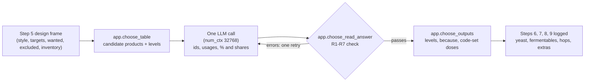

# Verification: m5-choose-ingredients

Overall: ✅ 20 of 21 checks and all 1049 tests pass; C19 fails (b10's Special B need is a gap, Cause: decision) and is accepted by the user (2026-10-23)

## Part 1: Summary

🎯 **Goal:** Steps 6-9 of the recipe pipeline choose the yeast, fermentables, hops and extras from real catalogue products, honouring the brewer's wishes, exclusions and inventory.

🛠️ **How:** Code builds a candidate table with each product's level in the style, one LLM call proposes ids, usages and percentages, code checks the proposal (R1-R7) and sets every dose.

🤔 **Why this way:** The model never invents a product or a dose, and the fit test showed one call at `num_ctx` 32768 fits all 24 briefs, so no per-step calls were needed.

🏁 **Result:** G5 on the 24 briefs: 0 invented, 0 excluded items used, steps 6-9 graded 24/24 with 96/96 `ok` rows and 56 LLM calls, needs 14/24 briefs (13 gap words); 1049 tests pass.

### 🚦 Steps

- ✅ 📝 **Brief:** Rewritten from the 2026-10-12 draft to D7, 5 questions answered, approved (f6d00d9).
- ✅ 🗺️ **Plan:** 10 tasks, 3 questions answered (yeast band, type word rule, gap fails), approved (288f86d).
  - ⚠️ Context7 failed with "Invalid API key", so Ollama behaviour was unverified at plan time and measured in Task 5.
- ⚠️ 🔨 **Implement:** All 10 tasks done, then fix rounds after review.
  - ⚠️ Task 2: reloading the adjunct loader nulls `max_pct`, so `loaders.fermentable_facts` must be re-run.
  - ❌ Task 5: first fit-test subagent was cut off by a session end and resumed; 8192 and 16384 fit 0 of 24, only 32768 fits. 🔧 one prompt revision (24/24).
  - ❌ Task 7a: two live-run bugs (swapped `choose_outputs` arguments, empty table for unrated styles) 🔧 fixed in 81c9f63; the full `test_pipeline.py` had 2 failures, fixed and re-run alone.
  - ⚠️ A temporary debug workflow was deleted straight from n8n's own database (the MCP cannot archive it).
  - ❌ Task 9: G5 needs started at 1/24, then 4/24 after prompt revision 2 (the last allowed), then 18/24 only after widening the class map and adding the `substituted` verdict (user decisions) 🔧 07006e0.
- ❌ 🔍 **Review:** Three rounds. Round 0: 6 findings (2 must-fix: unrated lager styles lost the lager rule, a bittering hop stood in for an aroma hop) 🔧 fixed in 555dcb7, 5a5e12b, e411c39; G5 needs fell to 15/24. Round 1: must-fix #11 (non-brewing yeast the brewer asked for was refused) 🔧 bf37033, 068030a, c5069b9; needs 14/24. Round 2: ready for testing.
  - ⚠️ Note #15: `evals/run.py` has no re-grade command; the re-grades used scratch scripts.
- ⚠️ 🧪 **Verify:** Docker stack ready (9 workflows incl. the new one active, 129 `app` functions all owned by postgres, Ollama on the RX 9070 XT, model loads); one live b10 run passed steps 1-9. 🧮 spot checks ⚠️ 20/21 (C19 accepted) · 🧪 tests ✅ 1049/1049
  - ❌ C19: b10's Special B need is a gap (Caraamber chosen); Cause: decision. Accepted by the user ("Accept, then ship", 2026-10-23), A16's clause recorded as unmet in brief.md Deviations.
  - ⚠️ G5 needs is 14/24 against a first 18/24, accepted by the user ("Re-record at new count"), not an unconditional pass.

👀 **Start here:** Part 2 below, then `evals/results/2026-10-19-m5.json` (per-brief step grades and needs verdicts); the b10 run shows a dubbel with Munich malt, abbey yeast and Brown Candi Sugar all from the inventory.

📁 **Changed files:**
- `.claude/skills/dev-flow/SKILL.md`
- `.claude/skills/dev-flow/conventions.md`
- `CLAUDE.md`
- `PROJECT.md`
- `db/036_ingredient_resolver.sql`
- `db/042_choose_table.sql`
- `db/043_choose_check.sql`
- `db/044_choose_outputs.sql`
- `docs/DATABASE.md`
- `docs/OPERATIONS.md`
- `docs/RECIPE-ROADMAP.md`
- `docs/WORKFLOW-ROADMAP.md`
- `docs/work/m5-choose-ingredients/brief.md`
- `docs/work/m5-choose-ingredients/fit-test.md`
- `docs/work/m5-choose-ingredients/plan.md`
- `docs/work/m5-choose-ingredients/review.md`
- `evals/fit_test.py`
- `evals/grade.py`
- `evals/needs_classes.toml`
- `evals/results/2026-10-19-m5-fit.json`
- `evals/results/2026-10-19-m5-prompt-rev1.json`
- `evals/results/2026-10-19-m5.json`
- `evals/run.py`
- `loaders/adjunct_products.py`
- `loaders/adjuncts.py`
- `loaders/yeast_products.py`
- `loaders/yeasts.py`
- `n8n/workflows/recipe-pipeline.json`
- `n8n/workflows/steps-6-9-choose-ingredients.json`
- `shared/contracts/choose.input.schema.json`
- `shared/contracts/choose.proposal.schema.json`
- `shared/contracts/step6.input.schema.json`
- `shared/contracts/step6.output.schema.json`
- `shared/contracts/step7.input.schema.json`
- `shared/contracts/step7.output.schema.json`
- `shared/contracts/step8.input.schema.json`
- `shared/contracts/step8.output.schema.json`
- `shared/contracts/step9.input.schema.json`
- `shared/contracts/step9.output.schema.json`
- `shared/prompts/choose.system.md`
- `tests/fixtures/choose_samples.json`
- `tests/step69_sample.json`
- `tests/test_adjuncts.py`
- `tests/test_choose_check.py`
- `tests/test_choose_outputs.py`
- `tests/test_choose_table.py`
- `tests/test_contracts.py`
- `tests/test_fit_test.py`
- `tests/test_grade.py`
- `tests/test_ingredient_resolver.py`
- `tests/test_pipeline.py`
- `tests/test_run.py`
- `tests/test_step5.py`
- `tests/test_workflows.py`
- `tests/test_yeasts.py`

## Part 2: Showcase

Steps 6-9 turn the recipe request's design frame into the actual ingredient list: code builds a candidate table of real products with each one's level in the style, **one** LLM call proposes ids, usages and percentages, and code checks the proposal (R1-R7), then adds levels, reasons and misc doses.



| Added | What it does |
|---|---|
| `app.yeast_type_word()` and the resolver's third rule | "Lactobacillus" finds every `lacto` yeast (YF-998, YF-999) |
| `ALIASES` in the adjunct loader | "dark candi sugar" finds Brown Candi Sugar |
| `app.choose_table(brief, style, targets, frame)` | Candidate products per kind with level, fit reasons, wanted and inventory marks; excluded products and siblings never listed |
| `app.choose_read_answer` / `app.choose_check` | Checks the LLM's proposal against the table (R1-R7) and returns `step 6:` ... `step 9:` errors |
| `app.choose_outputs`, `app.misc_dose` | Turns a passed proposal into the four step outputs; code sets every misc dose |
| `evals/fit_test.py`, `evals/grade.py`, `evals/needs_classes.toml` | The fit test, the step 6-9 graders and the `needs` class map |
| `Steps 6-9 - choose ingredients` workflow | One Ollama call, logged as four `app.run_step` rows |

**Resolver: a culture word and a brewer's name**

```bash
docker exec supabase-db psql -U postgres -d postgres -tAc "select name, rule from app.resolve_ingredient('Lactobacillus') order by name"
docker exec supabase-db psql -U postgres -d postgres -tAc "select name, rule from app.resolve_ingredient('dark candi sugar')"
```

```text
YF-998 Sour, yes sour!|yeast type
YF-999 Sourprise|yeast type
Brown Candi Sugar|alias
```

**Code-set dose of a misc product by role**

```bash
docker exec supabase-db psql -U postgres -d postgres -tAc "select i.name, app.misc_dose(i.id, 'background') ->> 'g_per_l' as background, app.misc_dose(i.id, 'feature') ->> 'g_per_l' as feature from ref.ingredient i where i.name in ('Coffee, whole beans', 'Vanilla bean', 'Orange peel') order by 1"
```

```text
Coffee, whole beans|3.0|3.0
Orange peel|2.64|2.64
Vanilla bean|0.05|0.53
```

**A real run: the Belgian dubbel from inventory (b10), steps 6-8 as logged (run 4278)**

```bash
docker exec supabase-db psql -U postgres -d postgres -tAc "select s.step, e->>'name' as pick, coalesce(e->>'pct', e->>'share_pct', '-') as pct_or_share, e->>'usage' as usage, e->>'level' as level, e->>'inventory' as from_inventory from app.run_step s, lateral (select jsonb_build_object('name', s.output->'yeast'->>'name', 'level', s.output->'yeast'->>'level', 'inventory', s.output->'yeast'->>'inventory') e where s.step = 6 union all select x from jsonb_array_elements(s.output->'fermentables') x where s.step = 7 union all select x from jsonb_array_elements(s.output->'hops') x where s.step = 8) l(e) where s.run_id = 4278 and s.step in (6, 7, 8) order by 1"
```

```text
6|Abbaye|-||typical|abbey yeast
7|Munich Malt Type 1|50|mash|allowed|Munich malt
7|Abbey Malt|20|mash|typical|
7|Caraamber|10|mash|typical|
7|Brown Candi Sugar|20|boil|typical|dark candi sugar
8|Saaz|100|boil|allowed|
```

**Tests: a dose given by the LLM is refused, a made-up word is absent and the rest is chosen**

```bash
PYTHONPATH=. .venv/bin/pytest -q -p no:cacheprovider tests/test_choose_outputs.py::test_dose_is_the_codes_not_the_proposals tests/test_choose_outputs.py::test_made_up_word_absent_rest_chosen tests/test_choose_check.py::test_misc_dose_rule 2>&1 | tail -3
```

```text
...                                                                      [100%]
3 passed in 3.51s
```

**One real run** (b10, a Belgian dubbel; the request names Munich malt, abbey yeast, dark candi sugar and more in the inventory). Command used: `.venv/bin/python -m evals.run --brief b10` (2026-10-23, about 2 minutes, run 4278: step 6 `tokens` 19,795, 2 calls including step 1). It printed: all steps 1-9 pass, `needs 3/6 GAP: pilsner malt, Special B, Styrian Golding`, the same gaps as the stored G5 run. E3 above is that run's output.

## Part 3: Spot checks

Checks C1-C21 run on 2026-10-23 against the live stack. The 24 G5 runs are `app.run` ids 4174-4197 with b14 replaced by 4246 (the re-run after review fix 4). A12 (direction check) is the user's recorded decision "Approve all three" (b03, b10, b16), not a command; A8 is covered by the tests in Part 4 and Part 2 E4.

### ✅ C1 · YF-998 and YF-999 are lacto cultures (A15)

```bash
docker exec supabase-db psql -U postgres -d postgres -tAc "select string_agg(i.name || ' : ' || y.type, ', ' order by i.name) from ref.yeast y join ref.ingredient i on i.id = y.ingredient_id where y.type = 'lacto'"
```

| Expected | Actual | Result |
|---|---|---|
| YF-998 Sour, yes sour! : lacto, YF-999 Sourprise : lacto | YF-998 Sour, yes sour! : lacto, YF-999 Sourprise : lacto | ✅ pass |

### ✅ C2 · "Lactobacillus" resolves to them by the culture-type word rule (A15, R5)

```bash
docker exec supabase-db psql -U postgres -d postgres -tAc "select string_agg(name || ' / ' || rule, ', ' order by name) from app.resolve_ingredient('Lactobacillus')"
```

| Expected | Actual | Result |
|---|---|---|
| YF-998 Sour, yes sour! / yeast type, YF-999 Sourprise / yeast type | YF-998 Sour, yes sour! / yeast type, YF-999 Sourprise / yeast type | ✅ pass |

### ✅ C3 · "dark candi sugar" resolves to Brown Candi Sugar (A16, R3)

```bash
docker exec supabase-db psql -U postgres -d postgres -tAc "select string_agg(name || ' / ' || rule, ', ') from app.resolve_ingredient('dark candi sugar')"
```

| Expected | Actual | Result |
|---|---|---|
| Brown Candi Sugar / alias | Brown Candi Sugar / alias | ✅ pass |

### ✅ C4 · Aliases: 10 intake aliases plus the adjunct loader's one (Task 2)

```bash
docker exec supabase-db psql -U postgres -d postgres -tAc "select count(*) from ref.ingredient_alias"
```

| Expected | Actual | Result |
|---|---|---|
| 11 | 11 | ✅ pass |

### ✅ C5 · The 12 new or changed choose functions exist, all owned by postgres (Tasks 1, 3, 4, 6)

```bash
docker exec supabase-db psql -U postgres -d postgres -tAc "select count(*) || ' of 12 present, ' || count(*) filter (where pg_get_userbyid(proowner) <> 'postgres') || ' not owned by postgres' from pg_proc where pronamespace = 'app'::regnamespace and proname in ('yeast_type_word','hop_form_word','choose_excluded','choose_table','choose_prompt','choose_check','choose_read_answer','choose_outputs','step6_errors','step9_errors','step6_output','step9_output')"
```

| Expected | Actual | Result |
|---|---|---|
| 12 of 12 present, 0 not owned by postgres | 12 of 12 present, 0 not owned by postgres | ✅ pass |

### ✅ C6 · No `app` function owned by anyone but postgres (129 functions) (OPERATIONS §4)

```bash
docker exec supabase-db psql -U postgres -d postgres -tAc "select count(*) || ' functions, ' || count(*) filter (where pg_get_userbyid(proowner) <> 'postgres') || ' not postgres' from pg_proc where pronamespace = 'app'::regnamespace"
```

| Expected | Actual | Result |
|---|---|---|
| 129 functions, 0 not postgres | 129 functions, 0 not postgres | ✅ pass |

### ✅ C7 · Every pick of the 24 G5 runs is a real catalogue product (0 invented) (A1, R1)

```bash
docker exec supabase-db psql -U postgres -d postgres -tAc "with r as (select id, eval_id from app.run r where (r.id between 4174 and 4197 and r.id <> 4187) or r.id = 4246), p as (select r.eval_id b, jsonb_path_query(s.output, '$.yeast') x, 6 st from r join app.run_step s on s.run_id = r.id and s.step = 6 union all select r.eval_id, jsonb_path_query(s.output, '$.fermentables[*]'), 7 from r join app.run_step s on s.run_id = r.id and s.step = 7 union all select r.eval_id, jsonb_path_query(s.output, '$.hops[*]'), 8 from r join app.run_step s on s.run_id = r.id and s.step = 8 union all select r.eval_id, jsonb_path_query(s.output, '$.extras[*]'), 9 from r join app.run_step s on s.run_id = r.id and s.step = 9) select count(*) || ' picks, ' || count(*) filter (where not exists (select 1 from ref.ingredient i where i.id = (x->>'ingredient_id')::bigint and i.name = x->>'name')) || ' invented' from p"
```

| Expected | Actual | Result |
|---|---|---|
| 138 picks, 0 invented | 138 picks, 0 invented | ✅ pass |

### ✅ C8 · Excluded items are not used: b08 no Saaz; b16 no Citra, Mosaic or their LUPOMAX forms (A2, R2)

```bash
docker exec supabase-db psql -U postgres -d postgres -tAc "with r as (select id, eval_id from app.run r where (r.id between 4174 and 4197 and r.id <> 4187) or r.id = 4246), p as (select r.eval_id b, jsonb_path_query(s.output, '$.yeast') x, 6 st from r join app.run_step s on s.run_id = r.id and s.step = 6 union all select r.eval_id, jsonb_path_query(s.output, '$.fermentables[*]'), 7 from r join app.run_step s on s.run_id = r.id and s.step = 7 union all select r.eval_id, jsonb_path_query(s.output, '$.hops[*]'), 8 from r join app.run_step s on s.run_id = r.id and s.step = 8 union all select r.eval_id, jsonb_path_query(s.output, '$.extras[*]'), 9 from r join app.run_step s on s.run_id = r.id and s.step = 9) select count(*) from p where ((b = 'b08' and x->>'name' ilike '%saaz%') or (b = 'b16' and (x->>'name' ilike '%citra%' or x->>'name' ilike '%mosaic%'))) and st = 8"
```

| Expected | Actual | Result |
|---|---|---|
| 0 | 0 | ✅ pass |

### ✅ C9 · b10 and b15 use the inventory items that fit (A3, R3)

```bash
docker exec supabase-db psql -U postgres -d postgres -tAc "with r as (select id, eval_id from app.run r where (r.id between 4174 and 4197 and r.id <> 4187) or r.id = 4246), p as (select r.eval_id b, jsonb_path_query(s.output, '$.yeast') x, 6 st from r join app.run_step s on s.run_id = r.id and s.step = 6 union all select r.eval_id, jsonb_path_query(s.output, '$.fermentables[*]'), 7 from r join app.run_step s on s.run_id = r.id and s.step = 7 union all select r.eval_id, jsonb_path_query(s.output, '$.hops[*]'), 8 from r join app.run_step s on s.run_id = r.id and s.step = 8 union all select r.eval_id, jsonb_path_query(s.output, '$.extras[*]'), 9 from r join app.run_step s on s.run_id = r.id and s.step = 9) select string_agg(distinct b || ': ' || (x->>'name') || ' (' || (x->>'inventory') || ')', '; ' order by b || ': ' || (x->>'name') || ' (' || (x->>'inventory') || ')') from p where b in ('b10','b15') and x->>'inventory' is not null"
```

| Expected | Actual | Result |
|---|---|---|
| b10: Abbaye (abbey yeast); b10: Brown Candi Sugar (dark candi sugar); b10: Munich Malt Type 1 (Munich malt); b15: Crystal T50 (crystal malt); b15: East Kent Golding (East Kent Goldings); b15: Finest Pale Ale Maris Otter (Maris Otter) | b10: Abbaye (abbey yeast); b10: Brown Candi Sugar (dark candi sugar); b10: Munich Malt Type 1 (Munich malt); b15: Crystal T50 (crystal malt); b15: East Kent Golding (East Kent Goldings); b15: Finest Pale Ale Maris Otter (Maris Otter) | ✅ pass |

### ✅ C10 · With guidance on (all but b18), every pipeline-made pick is required, typical or allowed (A4, R4)

```bash
docker exec supabase-db psql -U postgres -d postgres -tAc "with r as (select id, eval_id from app.run r where (r.id between 4174 and 4197 and r.id <> 4187) or r.id = 4246), p as (select r.eval_id b, jsonb_path_query(s.output, '$.yeast') x, 6 st from r join app.run_step s on s.run_id = r.id and s.step = 6 union all select r.eval_id, jsonb_path_query(s.output, '$.fermentables[*]'), 7 from r join app.run_step s on s.run_id = r.id and s.step = 7 union all select r.eval_id, jsonb_path_query(s.output, '$.hops[*]'), 8 from r join app.run_step s on s.run_id = r.id and s.step = 8 union all select r.eval_id, jsonb_path_query(s.output, '$.extras[*]'), 9 from r join app.run_step s on s.run_id = r.id and s.step = 9) select count(*) || ' picks, ' || count(*) filter (where x->>'level' not in ('required','typical','allowed')) || ' outside the style' from p where b <> 'b18' and x->'wanted' = 'null'::jsonb"
```

| Expected | Actual | Result |
|---|---|---|
| 123 picks, 0 outside the style | 123 picks, 0 outside the style | ✅ pass |

### ✅ C11 · Lager briefs get lager yeasts, b13 a weizen-family yeast, b14 its ale yeast and one lacto culture (A5, A15, R5)

```bash
docker exec supabase-db psql -U postgres -d postgres -tAc "with r as (select id, eval_id from app.run r where (r.id between 4174 and 4197 and r.id <> 4187) or r.id = 4246), p as (select r.eval_id b, jsonb_path_query(s.output, '$.yeast') x, 6 st from r join app.run_step s on s.run_id = r.id and s.step = 6 union all select r.eval_id, jsonb_path_query(s.output, '$.fermentables[*]'), 7 from r join app.run_step s on s.run_id = r.id and s.step = 7 union all select r.eval_id, jsonb_path_query(s.output, '$.hops[*]'), 8 from r join app.run_step s on s.run_id = r.id and s.step = 8 union all select r.eval_id, jsonb_path_query(s.output, '$.extras[*]'), 9 from r join app.run_step s on s.run_id = r.id and s.step = 9) select string_agg(b || ' ' || (x->>'name') || ' ' || (x->>'type') || ' ' || (x->'family')::text, '; ' order by b) from p where st = 6 and b in ('b06','b08','b09','b13','b14','b17','b22')"; docker exec supabase-db psql -U postgres -d postgres -tAc "select string_agg(r.eval_id || ' ' || (s.output->'souring'->>'name'), '; ') from app.run r join app.run_step s on s.run_id = r.id and s.step = 6 where r.id = 4246"
```

| Expected | Actual | Result |
|---|---|---|
| b06, b08, b09, b17, b22 lager; b13 family has wheat; b14 non-lacto ale yeast and one lacto culture (YF-998 or YF-999) | b06 SafLager S-189 lager ["lager"]; b08 German Lager lager ["lager"]; b09 SafLager S-189 lager ["lager"]; b13 YF-401 Mr. Weizen ale ["ale", "belgian", "wheat"]; b14 Munich Classic ale ["ale", "belgian", "wheat"]; b17 German Lager lager ["lager"]; b22 Diamond lager ["lager"]<br>b14 YF-998 Sour, yes sour! | ✅ pass |

### ✅ C12 · Every yeast overlaps step 5's yeast band (or reports why not) (A5, R5)

```bash
docker exec supabase-db psql -U postgres -d postgres -tAc "with r as (select id, eval_id from app.run r where (r.id between 4174 and 4197 and r.id <> 4187) or r.id = 4246), p as (select r.eval_id b, jsonb_path_query(s.output, '$.yeast') x, 6 st from r join app.run_step s on s.run_id = r.id and s.step = 6 union all select r.eval_id, jsonb_path_query(s.output, '$.fermentables[*]'), 7 from r join app.run_step s on s.run_id = r.id and s.step = 7 union all select r.eval_id, jsonb_path_query(s.output, '$.hops[*]'), 8 from r join app.run_step s on s.run_id = r.id and s.step = 8 union all select r.eval_id, jsonb_path_query(s.output, '$.extras[*]'), 9 from r join app.run_step s on s.run_id = r.id and s.step = 9) select count(*) || ' yeasts, ' || count(*) filter (where s.output->'attenuation'->>'overlaps' = 'true') || ' overlap the band' from r join app.run_step s on s.run_id = r.id and s.step = 6"
```

| Expected | Actual | Result |
|---|---|---|
| 24 yeasts, 24 overlap the band | 24 yeasts, 24 overlap the band | ✅ pass |

### ✅ C13 · Fermentable shares add up to 100 and stay within max_pct; hop shares add up to 100, each with usage and minutes (A6, R6)

```bash
docker exec supabase-db psql -U postgres -d postgres -tAc "select count(*) || ' briefs, ' || count(*) filter (where abs(f.sum - 100) > 0.01 or f.n_over > 0 or abs(h.sum - 100) > 0.01 or h.bad > 0) || ' failing' from app.run r join lateral (select sum((e->>'pct')::numeric) sum, count(*) filter (where (e->>'pct')::numeric > (e->>'max_pct')::numeric) n_over from app.run_step s, jsonb_array_elements(s.output->'fermentables') e where s.run_id = r.id and s.step = 7) f on true join lateral (select sum((e->>'share_pct')::numeric) sum, count(*) filter (where e->>'usage' is null or e->>'minutes' is null) bad from app.run_step s, jsonb_array_elements(s.output->'hops') e where s.run_id = r.id and s.step = 8) h on true where (r.id between 4174 and 4197 and r.id <> 4187) or r.id = 4246"
```

| Expected | Actual | Result |
|---|---|---|
| 24 briefs, 0 failing | 24 briefs, 0 failing | ✅ pass |

### ✅ C14 · b08's late hop is not Saaz and rated allowed or better in 5D (A6)

```bash
docker exec supabase-db psql -U postgres -d postgres -tAc "select string_agg(e->>'name' || ' ' || (e->>'usage') || ' ' || (e->>'minutes') || ' min ' || (e->>'level'), '; ') from app.run_step s, jsonb_array_elements(s.output->'hops') e where s.run_id = 4181 and s.step = 8"
```

| Expected | Actual | Result |
|---|---|---|
| late hop not Saaz, level allowed or better (b08 has Magnum 60 min and one late hop) | Magnum boil 60 min allowed; Tettnanger boil 15 min typical | ✅ pass |

### ✅ C15 · b23 coffee and vanilla and b24 orange peel have a misc product, a usage and the code-set dose (A7, R7, A16)

```bash
docker exec supabase-db psql -U postgres -d postgres -tAc "select string_agg(r.eval_id || ' ' || (e->>'name') || ' ' || (e->>'usage') || ' ' || (e->>'dose_g_per_l') || ' g/L', '; ' order by r.eval_id, e->>'name') from app.run r join app.run_step s on s.run_id = r.id and s.step = 9, jsonb_array_elements(s.output->'extras') e where r.id in (4196, 4197)"
```

| Expected | Actual | Result |
|---|---|---|
| b23 Coffee, whole beans secondary 3 g/L; b23 Vanilla bean secondary 0.05 g/L; b24 Orange peel whirlpool 2.64 g/L | b23 Coffee, whole beans secondary 3 g/L; b23 Vanilla bean secondary 0.05 g/L; b24 Orange peel whirlpool 2.64 g/L | ✅ pass |

### ✅ C16 · Every pick carries a `because` (A9, R9)

```bash
docker exec supabase-db psql -U postgres -d postgres -tAc "with r as (select id, eval_id from app.run r where (r.id between 4174 and 4197 and r.id <> 4187) or r.id = 4246), p as (select r.eval_id b, jsonb_path_query(s.output, '$.yeast') x, 6 st from r join app.run_step s on s.run_id = r.id and s.step = 6 union all select r.eval_id, jsonb_path_query(s.output, '$.fermentables[*]'), 7 from r join app.run_step s on s.run_id = r.id and s.step = 7 union all select r.eval_id, jsonb_path_query(s.output, '$.hops[*]'), 8 from r join app.run_step s on s.run_id = r.id and s.step = 8 union all select r.eval_id, jsonb_path_query(s.output, '$.extras[*]'), 9 from r join app.run_step s on s.run_id = r.id and s.step = 9) select count(*) || ' picks, ' || count(*) filter (where coalesce(x->>'because', '') = '') || ' without because' from p"
```

| Expected | Actual | Result |
|---|---|---|
| 138 picks, 0 without because | 138 picks, 0 without because | ✅ pass |

### ✅ C17 · Steps 6-9 logged `ok` for all 24 G5 runs, and the runner counts 56 LLM calls (A11, R11)

```bash
docker exec supabase-db psql -U postgres -d postgres -tAc "select count(*) || ' rows, ' || count(*) filter (where s.ok) || ' ok' from app.run r join app.run_step s on s.run_id = r.id and s.step between 6 and 9 where (r.id between 4174 and 4197 and r.id <> 4187) or r.id = 4246"; .venv/bin/python -c "import json; t=json.load(open('evals/results/2026-10-19-m5.json'))['totals']; print(t['calls'])"
```

| Expected | Actual | Result |
|---|---|---|
| 96 rows, 96 ok<br>{'total': 56, 'runs': 24} | 96 rows, 96 ok<br>{'total': 56, 'runs': 24} | ✅ pass |

### ✅ C18 · Every needs word has a verdict; a gap fails the brief (G5 count as recorded) (A10, R10)

```bash
.venv/bin/python -c "import json; d=json.load(open('evals/results/2026-10-19-m5.json')); v=[x for r in d['results'] for g in r['needs'].values() for x in g.values()]; k=lambda s: 'substituted' if s.startswith('substituted') else ('absent' if s.startswith('absent') else s); import collections; print(dict(collections.Counter(map(k,v))), d['totals']['needs'])"
```

| Expected | Actual | Result |
|---|---|---|
| every word covered, substituted or absent, else gap; G5 count as recorded by the user (14/24, 13 gaps) | {'covered': 105, 'substituted': 14, 'gap': 13} {'passed': 14, 'total': 24, 'gaps': 13} | ✅ pass |

### ❌ C19 · b10's Special B need is covered by Special W or Caraaroma (A16, R10)

```bash
.venv/bin/python -c "import json; d=json.load(open('evals/results/2026-10-19-m5.json')); print([r['needs']['fermentables']['Special B'] for r in d['results'] if r['id']=='b10'][0])"
```

| Expected | Actual | Result |
|---|---|---|
| covered | gap | ❌ fail |

Cause: decision. **Accepted by user decision ("Accept, then ship", 2026-10-23): A16's Special B clause is recorded as unmet; brief.md Deviations updated.** The model picked Caraamber (60-80 EBC) for b10, and review fix 3 correctly stopped it standing in for the dark-crystal Special B class (Special W 280-320, Caraaroma 350-450). Brief A16 still says "covered by Special W or Caraaroma"; b10 fails needs anyway, and the user's G5 decision ("Re-record at new count", 2026-10-21 and 2026-10-23) accepted these gaps at 14/24 (`docs/WORKFLOW-ROADMAP.md:187`).

### ✅ C20 · The roadmaps no longer say "corpus popularity" for stage C (A13, R12)

```bash
grep -c 'corpus popularity' docs/RECIPE-ROADMAP.md docs/WORKFLOW-ROADMAP.md
```

| Expected | Actual | Result |
|---|---|---|
| docs/RECIPE-ROADMAP.md:0<br>docs/WORKFLOW-ROADMAP.md:0 | docs/RECIPE-ROADMAP.md:0<br>docs/WORKFLOW-ROADMAP.md:0 | ✅ pass |

### ✅ C21 · Fit test recorded: at num_ctx 32768 all 24 briefs fit and pass; 8192 and 16384 fit none (A14, R13)

```bash
.venv/bin/python -c "import json; o=json.load(open('evals/results/2026-10-19-m5-fit.json'))['options']; print({k:(v['summary']['fit_all'], v['summary']['passed']) for k,v in o.items()})"
```

| Expected | Actual | Result |
|---|---|---|
| 8192 and 16384 fit 0 of 24; 32768 fits 24 of 24 and the final prompt passes 24 of 24 | {'8192-rev0': (0, 0), '16384-rev0': (0, 0), '32768-rev0': (24, 22), '32768-rev1': (24, 24), '32768rev2': (24, 24)} | ✅ pass |

## Part 4: Regression tests

Command: `.venv/bin/pytest -q` (whole suite, 2026-10-23, 36 min 55 s, stack up)  ·  Result: ✅ 1049 passed, 0 failed

Every critical test the plan's table names exists (checked by name) and ran in that suite. No test was missing, so none was added.

| Test | Protects | Result |
|---|---|---|
| tests/test_yeasts.py::test_lacto_cultures | YF-998 and YF-999 load as `lacto` | ✅ |
| tests/test_ingredient_resolver.py::test_lactobacillus_finds_lacto_cultures | "Lactobacillus" finds the two cultures, "lactose" still finds Lactose | ✅ |
| tests/test_ingredient_resolver.py::test_type_words_change_no_brief_word | The type-word rule changes no word of b01-b24 | ✅ |
| tests/test_adjuncts.py::test_dark_candi_sugar_alias | "dark candi sugar" finds Brown Candi Sugar | ✅ |
| tests/test_choose_table.py::test_b16_excludes_siblings, ::test_b08_has_no_saaz | Excluded products and their siblings never reach the table | ✅ |
| tests/test_choose_table.py::test_made_up_word_is_absent, tests/test_choose_outputs.py::test_made_up_word_absent_rest_chosen | A word with no product is absent with a reason, the rest is chosen | ✅ |
| tests/test_choose_table.py::test_unrated_lager_style_keeps_the_yeast_rules | Lager rule stays on for a style without reviewed levels (review fix 1) | ✅ |
| tests/test_choose_check.py (one test per rule, `test_misc_dose_rule`) | Each check rule refuses its bad proposal; dose follows the role rule | ✅ |
| tests/test_choose_outputs.py::test_dose_set_by_code, ::test_dose_is_the_codes_not_the_proposals | The LLM cannot set a dose; code does | ✅ |
| tests/test_choose_outputs.py::test_outputs_use_table_rows_only | Outputs carry only table rows (no invented ingredient) | ✅ |
| tests/test_fit_test.py | Fit rule: prompt + 4096 within num_ctx, no truncation | ✅ |
| tests/test_pipeline.py::test_steps_6_to_9_logged | Steps 6-9 logged with valid contracts on the real pipeline | ✅ |
| tests/test_grade.py (step 6-9, needs, stand-in tests) | Graders catch each A-criterion; stand-ins stay tight | ✅ |

Failures: none.
