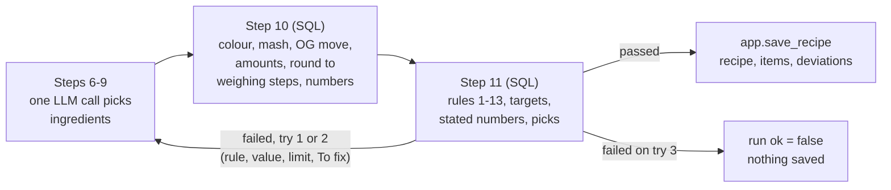

# Verification: m6-compute-validate

Overall: ❌ 10 of 11 checks and all 1223 tests pass; failed: C4 (A3: b18's stated SRM and b19's stated batch are not met; Cause: decision, both briefs are known failures the user accepted on 2026-10-26)

Run 2026-10-27 on branch `m6-compute-validate` at d6f9965, stack up. G6 was not re-run (hours, LLM): Parts 3 and 4 use the saved results files, `evals.revalidate` and the full suite.

## Part 1: Summary

🎯 **Goal:** Turn the steps 6–9 picks into amounts and numbers, validate them, retry within limits and save a recipe: the MVP (G6).

🛠️ **How:** Step 10 (`app.step10_compute`, `db/046`) and step 11 (`app.step11_validate`, `db/047`) are SQL on s1's maths and s2's rules; `app.save_recipe` (`db/048`) writes the rows; the n8n pipeline runs up to 3 tries of steps 6–11.

🤔 **Why this way:** Brewing maths stays deterministic, tested SQL (CLAUDE.md); the one LLM call is only told what failed and what to change, with every number computed in SQL.

🏁 **Result:** 17 of b01–b20 validated on the real pipeline (bar 16; 20 of 24 overall, 5 of 6 held-out), 0 invented ingredients, 2 LLM calls on every first try. After the later rounding to weighing steps the saved picks re-validate to 16 of b01–b20 (19 of 24), exactly on the bar and not replayed with retries.

### 🚦 Steps

- ✅ 📝 **Brief:** Draft from an earlier session revised (two open questions answered), approved in 749606e; four later Deviations (OG nudge, mash and colour reach, LLM feedback, rounding with SRM ± 2) were approved by the user.
- ✅ 🗺️ **Plan:** Q1–Q4 answered with the recommended option (0ffc8af); revised twice (7ece4a3 for Tasks 9b and 9c, 05105b7 for Task 10b).
- ⚠️ 🔨 **Implement:** Tasks 1–11 plus 9b, 9c and 10b, then review fixes.
  - ⚠️ Tasks 3 and 5 wrote code before tests (checked by breaking the code).
  - ⚠️ Task 4 set `recipe.targets.og` to the moved OG, which made rule 9's OG and ABV lines unusable; step 11 skips them (user answer for the OG line, ABV line is the implementer's extension).
  - ❌ Task 8 found two earlier-task bugs (yeast with no `choice` raised in step 10; unrated-style lines banned every pick in step 11) 🔧 fixed in the same task with a test each.
  - ⚠️ Task 8 relaxed two whole-run `ok` assertions in `tests/test_pipeline.py` and Task 11 a third (`test_webhook_ignores_pin`); several pipeline `ok is True` assertions depend on the LLM's recipe validating and may be flaky.
  - ⚠️ Task 8 and Task 10 runs were interrupted by session ends and restarted; Task 10's main run had HTTP 500 for b22–b24 (rerun one by one); Task 11's agent hit an API auth error and was resumed.
  - ⚠️ Task 10b's tests were lost from `tests/test_compute.py` in 9f8b4cc (found by review) 🔧 fixed in c12c97b.
  - ⚠️ G6's first run validated 13 of b01–b20 (bar 16); Tasks 9b and 9c fixed that (17 on re-measure). b12, b18, b19, b23 are accepted known failures.
- ⚠️ 🔍 **Review:** Round 1 "fixes needed" (must-fix 1 lost rounding tests; should-fix 2 step11_fix colour advice; should-fix 3 records) 🔧 fixed in c12c97b, 90536eb, e7888d6; round 2 "ready for testing" (d6f9965) with notes 4 (too-light rule 3 sentence prints the solver's crystal shares, not the rounded ones) and 5 (plan task text still says `step11_fix` unchanged).
- ⚠️ 🧪 **Verify:** The whole suite passes in one run (1223 passed, 55 min), which had not happened before; one check fails because of a known, accepted miss. 🧮 spot checks ✅ 10/11 · 🧪 tests ✅ 1223/1223
  - ⚠️ A1 and A12 after rounding are 16 of b01–b20, no margin, measured by re-validating saved picks, not on a pipeline run (unverified on real retries); b15 newly fails (Black Malt's 50 g floor).
  - ❌ A3: b18's stated SRM and b19's stated batch are not met (C4), accepted by the user on 2026-10-26.

👀 **Start here:** Part 2's last example, `python -m evals.revalidate`: 16 of 20 for b01–b20 after rounding, and the b15 line showing why the retry would be told it is rounding, not the crystal.

📁 **Changed files:**
- `PROJECT.md`
- `db/031_formulation_rules.sql`
- `db/032_formulation_check.sql`
- `db/034_style_level.sql`
- `db/042_choose_table.sql`
- `db/045_recipe_deviation_kind.sql`
- `db/046_compute.sql`
- `db/047_validate.sql`
- `db/048_save_recipe.sql`
- `docs/DATABASE.md`
- `docs/OPERATIONS.md`
- `docs/RECIPE-ROADMAP.md`
- `docs/WORKFLOW-ROADMAP.md`
- `docs/work/m6-compute-validate/brief.md`
- `docs/work/m6-compute-validate/g6-recipes.md`
- `docs/work/m6-compute-validate/plan.md`
- `docs/work/m6-compute-validate/review.md`
- `docs/work/m7-process/brief.md`
- `evals/grade.py`
- `evals/heldout_briefs.toml`
- `evals/results/2026-10-25-m6.json`
- `evals/results/2026-10-26-m6-9b.json`
- `evals/results/2026-10-26-m6-b22.json`
- `evals/results/2026-10-26-m6-b23.json`
- `evals/results/2026-10-26-m6-b24.json`
- `evals/results/2026-10-26-m6-heldout.json`
- `evals/results/2026-10-27-m6-10b-revalidate.json`
- `evals/revalidate.py`
- `evals/run.py`
- `evals/show_recipe.py`
- `n8n/workflows/recipe-pipeline.json`
- `n8n/workflows/steps-10-11-compute-and-validate.json`
- `n8n/workflows/steps-6-11-one-try.json`
- `n8n/workflows/steps-6-9-choose-ingredients.json`
- `shared/contracts/choose.input.schema.json`
- `shared/contracts/formulation_check.input.schema.json`
- `shared/contracts/step10.input.schema.json`
- `shared/contracts/step10.output.schema.json`
- `shared/contracts/step11.input.schema.json`
- `shared/contracts/step11.output.schema.json`
- `shared/contracts/try.input.schema.json`
- `shared/contracts/try.output.schema.json`
- `tests/fixtures/reference_recipes.toml`
- `tests/step1011_sample.json`
- `tests/step611_sample.json`
- `tests/step69_sample.json`
- `tests/test_choose_table.py`
- `tests/test_compute.py`
- `tests/test_contracts.py`
- `tests/test_formulation_check.py`
- `tests/test_grade.py`
- `tests/test_pipeline.py`
- `tests/test_recipe_briefs.py`
- `tests/test_recipe_tables.py`
- `tests/test_reference_recipes.py`
- `tests/test_run.py`
- `tests/test_save_recipe.py`
- `tests/test_style_fit_recipe.py`
- `tests/test_validate.py`
- `tests/test_workflows.py`

## Part 2: Showcase



| Function | What it does |
|---|---|
| `app.step10_compute` | Amounts (kg, g) and OG/FG/ABV/IBU/SRM from the picks, targets and profile, through s1's functions |
| `app.solve_colour` | Rule 7 colour solver: darkest non-crystal first, then a second share; crystals never move |
| `app.step10_round_grist`, `app.step10_round_hops` | Round to weighing steps (malts 50 g, sugars, hops, extras 1 g) without adding a failure where avoidable |
| `app.step11_validate`, `app.step11_fix` | Pass or fail a recipe, with the retry's feedback and a `To fix:` sentence |
| `app.save_recipe` | Writes a passed recipe, its items and every step 3 deviation as rows |
| `app.recipe_tolerances()`, `app.weighing_steps()` | The tolerances and weighing steps in one place |

**The tolerances and the weighing steps the code uses**

```bash
docker exec supabase-db psql -U postgres -d postgres -tAc "select app.recipe_tolerances(), app.weighing_steps()"
```

```text
{"og": 0.002, "abv": 0.2, "ibu": 2, "srm": 2, "batch_l": 0} | {"hop_g": 1, "extra_g": 1, "malt_kg": 0.05, "sugar_kg": 0.001}
```

**A saved pale ale with orange peel (b24, run 4526, saved before the rounding task)**

Request: "An American pale ale with a little orange peel for a hint of citrus."

```bash
.venv/bin/python -m evals.show_recipe 4526 | sed -n 1,16p
```

```text
Request: An American pale ale with a little orange peel for a hint of citrus.

Style: American Pale Ale (18B)
Batch: 20 l
Mash: 66.5 °C (66.5 C stays: the predicted FG 1.0101 is inside the range 1.0100 to 1.0150)

Numbers against targets:
  OG   1.0505   (target 1.0525)
  FG   1.0101   (target 1.0125)
  ABV  5.2 %   (target 5.15)
  IBU  40   (target 40)
  SRM  7.1   (target 7.5)

Fermentables:
  4.183 kg  90 %  Pale Ale Malt  (mash)
      because: Pale Ale Malt: Provides a clean, neutral base for the American Pale Ale. (typical at mash in 18B)
```

<details><summary>The rest of that recipe: caramel malts, hops, yeast, extras, deviation</summary>

```bash
.venv/bin/python -m evals.show_recipe 4526 | sed -n 17,50p
```

```text
  0.232 kg  5 %  Caramel 30 Malt  (mash)
  0.232 kg  5 %  Caramel 50 Malt  (mash)
Hops:
  48.491 g  Cascade  boil 60 min
  48.491 g  Cascade  dry_hop 0 min
Yeast:
  1 pack  SafAle US-05
Extras:
  52.8 g  Orange peel  whirlpool 15 min
Deviations:
  orange peel: out_of_style (asked by user) Orange peel (whirlpool) is the closest choice: specialty spice on American Pale Ale (18B).
```
(because-lines trimmed here.)
</details>

**The same picks through today's rounded steps 10-11 (b01 and b08, SQL only, no LLM)**

```bash
.venv/bin/python -m evals.revalidate evals/results/2026-10-26-m6-9b.json | grep -A2 "^b0[18] "
```

```text
b01 try 2: before pass, after pass
    Pale Ale Malt 4.8 kg, Caramel 50 Malt 0.55 kg, Caramel 30 Malt 0.3 kg
    Columbus 36 g, Citra 27 g, Mosaic 27 g
--
b08 try 1: before pass, after pass
    Pilsner Malt 1.95 kg, Carapils 0.1 kg
    Magnum 13 g, Tettnanger 8 g
```

Amounts are now on 50 g and 1 g steps (b01 was 4.808, 0.566, 0.283 kg before).

**A recipe the rounding pushes off a target (b15): the retry is told rounding is the cause**

```bash
.venv/bin/python -m evals.revalidate evals/results/2026-10-26-m6-9b.json | grep -A2 "^b15 "
```

```text
b15 try 1: before pass, after fail
    Step 11: the SRM is 15.15 and the target is 12 (limit +- 2). It comes from rounding to weighing steps: Malts and flaked grains are weighed in 50 g steps, sugars in 1 g steps, and no grist on those steps avoids what the exact amounts did not have: numbers srm (SRM 15.15 against 12 (limit +- 2)). Hops are weighed to the gram, at least 1 g.
    Finest Pale Ale Maris Otter 4.2 kg, Crystal T50 0.45 kg, Black Malt 0.05 kg
```

**The bar after rounding (all briefs)**

```bash
.venv/bin/python -m evals.revalidate evals/results/2026-10-26-m6-9b.json | tail -1
```

```text
b01-b20 before 17 after 16; all before 20 after 19
```

## Part 3: Spot checks

### ✅ C1 · At least 16 of b01-b20 validate on the real pipeline (A1)

```bash
.venv/bin/python -c "import json; d=json.load(open('evals/results/2026-10-26-m6-9b.json')); print(d['totals']['validated'])"
```

| Expected | Actual | Result |
|---|---|---|
| b01_b20 >= 16 | {'b01_b20': 17, 'all': 20} | ✅ pass |

(First run, `2026-10-25-m6.json`: 13 of b01-b20, before Tasks 9b and 9c. This 17 is before the rounding task.)

### ✅ C2 · The saved picks still validate >= 16 of b01-b20 through the rounding steps 10-11 (A12, A1)

```bash
.venv/bin/python -m evals.revalidate evals/results/2026-10-26-m6-9b.json | tail -1
```

| Expected | Actual | Result |
|---|---|---|
| after >= 16 | b01-b20 before 17 after 16; all before 20 after 19 | ✅ pass (no margin; b15 newly fails; retries not replayed) |

### ✅ C3 · 0 invented ingredients, at most 2 LLM calls on every first try (A2)

```bash
docker exec supabase-db psql -U postgres -d postgres -tAc "select count(*), count(*) filter (where ingredient_id is null), count(*) filter (where ingredient_id is not null and not exists (select 1 from ref.ingredient i where i.id=ri.ingredient_id)) from app.recipe_item ri"
.venv/bin/python -c "import json; d=json.load(open('evals/results/2026-10-26-m6-9b.json')); t=d['totals']; print(t['invented'], t['first_try_calls_max'], t['calls'], t['retry_calls'])"
```

| Expected | Actual | Result |
|---|---|---|
| 0 items without a `ref` id, invented 0, first-try calls max <= 2 | `232\|0\|0`; `0 2 {'total': 73, 'runs': 24} 25` | ✅ pass |

### ❌ C4 · Every stated number is met on the briefs that state one (A3)

```bash
.venv/bin/python -c "import json; d=json.load(open('evals/results/2026-10-26-m6-9b.json')); print(d['totals']['stated_met']); print([(r['id'],k,v['stated'],v['value']) for r in d['results'] for k,v in (r.get('stated') or {}).items() if not v['met']])"
```

| Expected | Actual | Result |
|---|---|---|
| 12 of 12 | {'met': 10, 'total': 12}; b18 srm stated 20 (no value), b19 batch_l stated 10 (no value) | ❌ fail |

Cause: decision. Both briefs did not validate (no dark malt left to reach b18's colour; b19 repeats the same failure over 3 tries), so no recipe was saved and no value exists. The user accepted b12, b18, b19 and b23 as known failures on 2026-10-26.

### ✅ C5 · An impossible target ends with `ok = false` after 3 tries, with each reason in `run_step.error`, and saves nothing (A4)

```bash
docker exec supabase-db psql -U postgres -d postgres -tAc "select u.id, u.ok, u.recipe_id is null, max(s.try), count(*) filter (where s.step=11 and s.error is not null) from app.run u join app.run_step s on s.run_id=u.id where u.id=(select max(run_id) from app.run_step where step=11 and try=3 and error is not null and run_id in (select id from app.run where ok=false and recipe_id is null)) group by u.id,u.ok,u.recipe_id"
```

| Expected | Actual | Result |
|---|---|---|
| ok f, no recipe (t), 3 tries, 3 step 11 errors | `4532\|f\|t\|3\|3` (each try: "Rule 10: the predicted FG 1.0208 ... To fix: ...") | ✅ pass |

### ✅ C6 · Orange peel grams equal the step 9 dose x batch L (A7)

```bash
docker exec supabase-db psql -U postgres -d postgres -tAc "select ri.raw_name, ri.amount, ri.unit from app.recipe_item ri join app.recipe r on r.id=ri.recipe_id join app.run u on u.recipe_id=r.id where u.id=4526 and ri.raw_name ilike '%orange%'"
docker exec supabase-db psql -U postgres -d postgres -tAc "select dose_g_per_l from ref.misc m join ref.ingredient i on i.id=m.ingredient_id where i.name ilike '%orange%' limit 1"
```

| Expected | Actual | Result |
|---|---|---|
| 2.64 g/L x 20 L = 52.8 g | `Orange peel\|52.800\|g`; dose 2.64 | ✅ pass |

(b23's coffee and vanilla never validated; their rounded grams are tested in `test_misc_grams_are_dose_times_batch`, Part 4. Today's rounding makes this peel 53 g.)

### ✅ C7 · Step 3 deviations are saved with `requested_by = user` for b05, b08, b11, b16 (A8)

```bash
docker exec supabase-db psql -U postgres -d postgres -tAc "select u.id, string_agg(distinct d.kind||'/'||d.requested_by, ', ') from app.run u join app.recipe_deviation d on d.recipe_id=u.recipe_id where u.id in (4507,4510,4513,4518) group by u.id order by u.id"
```

| Expected | Actual | Result |
|---|---|---|
| b05 mismatch, b08 number, b11 conflict, b16 ingredient, all user | `4507\|mismatch/user` `4510\|number/user` `4513\|conflict/user` `4518\|ingredient/user` | ✅ pass |

### ✅ C8 · Reference recipes for b01-b24 pass the formulation check (A9)

```bash
.venv/bin/python -m pytest -q -p no:cacheprovider tests/test_reference_recipes.py | tail -1
.venv/bin/python -c "import tomllib; print(len(tomllib.load(open('tests/fixtures/reference_recipes.toml','rb')).get('recipe', [])))"
```

| Expected | Actual | Result |
|---|---|---|
| tests pass; 24 recipes | `28 passed in 0.09s`; `24` | ✅ pass |

### ✅ C9 · The held-out file has 6 briefs, none in a b01-b24 style, and its score is recorded (A10)

```bash
.venv/bin/python -c "
import tomllib
h=tomllib.load(open('evals/heldout_briefs.toml','rb')); b=tomllib.load(open('evals/recipe_briefs.toml','rb'))
rows=lambda t:[v for v in t.values() if isinstance(v,list)][0]
used={x.get('style') for x in rows(b)}|{a for x in rows(b) for a in (x.get('alt_styles') or [])}
print(len(rows(h)), sorted({x['style'] for x in rows(h)}&used))"
grep -c "Held-out (\`--label m6-heldout\`): 5/6 validated" PROJECT.md
```

| Expected | Actual | Result |
|---|---|---|
| 6 briefs, overlap empty; score line in PROJECT.md | `6 []`; `1` | ✅ pass |

### ✅ C10 · Every amount from step 10 is on its weighing step and at least one step (A12, R11)

```bash
.venv/bin/python -c "
import json
d=json.load(open('evals/results/2026-10-27-m6-10b-revalidate.json'))
bad=[(r['id'],f['name'],f['kg']) for r in d['results'] for f in r['fermentables'] if f['kg']<0.001 or (round(f['kg']*1000)%50 and f['name'] not in ('Lactose','Honey','Brown Candi Sugar'))]
badh=[(r['id'],h) for r in d['results'] for h in r['hops'] if h['g']<1 or h['g']!=int(h['g'])]
print(sum(len(r['fermentables']) for r in d['results']), bad, badh)"
```

| Expected | Actual | Result |
|---|---|---|
| no malt off 50 g, no hop off 1 g, none below a step | `76 [] []` | ✅ pass |

### ✅ C11 · The A11 verdict is recorded in PROJECT.md (A11)

```bash
grep -o "A11: the user read b01, b03, b08, b10 and b24[^.]*\.[^.]*\." PROJECT.md | head -1
```

| Expected | Actual | Result |
|---|---|---|
| verdict recorded | A11: the user read b01, b03, b08, b10 and b24 (b24 for the non-validating b23): **would brew after the listed changes; the direction is right**. Their findings ... | ✅ pass |

## Part 4: Regression tests

Command: `.venv/bin/python -m pytest -q -p no:cacheprovider` (one run, stack up, 2026-10-27, 55 min)  ·  Result: ✅ 1223 passed

| Test | Protects | Result |
|---|---|---|
| tests/test_recipe_tables.py::test_deviation_takes_every_step3_kind | Every step 3 deviation fits a row, none dropped | ✅ |
| tests/test_formulation_check.py::test_extras_do_not_enter_the_numbers | Extras never enter OG/IBU/SRM | ✅ |
| tests/test_compute.py::test_misc_grams_are_dose_times_batch | Extras' grams = dose x batch, rounded to 1 g | ✅ |
| tests/test_compute.py::test_colour_moves_only_darkest_and_base, test_colour_never_moves_crystal | Colour moves only the darkest non-crystal and a base; crystals never | ✅ |
| tests/test_compute.py::test_colour_second_dark_grain, test_colour_keeps_rule_3, test_colour_keeps_rule_5, test_colour_never_more_than_two_passes | Second colour pass keeps rules 3 and 5, at most two passes | ✅ |
| tests/test_compute.py::test_numbers_are_what_check_recipe_computes | Step 10's numbers are what the check recomputes | ✅ |
| tests/test_compute.py::test_og_moves_only_inside_tolerance | OG moves only inside +-0.002 | ✅ |
| tests/test_compute.py::test_mash_moves_for_low_fg, test_mash_stays_in_range, test_mash_hint_stays, test_mash_cannot_raise_fg_above_range, test_mash_stops_at_69 | Mash only up, inside 68.3-69 C, never a hint's | ✅ |
| tests/test_formulation_check.py::test_rule10_fg_range, tests/test_validate.py::test_mash_move_lets_rule_10_pass | Step 10 and rule 10 read the same FG range | ✅ |
| tests/test_compute.py::test_amounts_on_weighing_steps, test_floor_is_one_step | Amounts on weighing steps, never 0 | ✅ |
| tests/test_compute.py::test_rounding_keeps_og, test_rounding_keeps_rule_4, test_rounding_reports_unreached, test_rounding_adds_no_failure_it_did_not_cause | Rounding adds no failure it can avoid, and says so when it cannot | ✅ |
| tests/test_validate.py::test_rounding_failure_says_rounding, test_fix_names_rounding_not_crystal, test_fix_crystal_only_when_the_movers_stopped | Retry feedback names rounding, not the crystal, when rounding caused the miss | ✅ |
| tests/test_validate.py::test_fix_numbers_come_from_sql, test_attenuation_for_fg_inverts_fg, tests/test_choose_table.py::test_feedback_prompt_lines | Every number in `To fix` comes from SQL | ✅ |
| tests/test_validate.py (one test per failure kind, test_wanted_pick_is_never_banned, test_user_ibu_does_not_ban_hops) | Each failure kind caught; only self-picks banned | ✅ |
| tests/test_validate.py::test_impossible_target_cannot_pass, tests/test_pipeline.py::test_impossible_target_fails_after_three_tries | An impossible target never passes | ✅ |
| tests/test_save_recipe.py::test_recompute_from_saved_rows, test_saved_amounts_on_steps, tests/test_pipeline.py::test_b01_validates_and_saves | A saved recipe recomputes to its saved (rounded) numbers | ✅ |
| tests/test_save_recipe.py::test_refuses_a_failed_validation | A failed validation saves nothing | ✅ |
| tests/test_choose_table.py::test_ban_removes_and_excludes | A banned pick cannot return on a retry | ✅ |
| tests/test_run.py::test_harness_tolerances_match_sql | Harness and SQL tolerances agree | ✅ |

Failures: none. Note: the three pipeline tests whose whole-run `ok` assertion was removed (`test_guide_setting_reaches_step_2`, `test_request_kept_verbatim`, `test_webhook_ignores_pin`) passed, but no longer prove a run validates; `test_b01_validates_and_saves` and the impossible-target test depend on the LLM and passed in this run.
