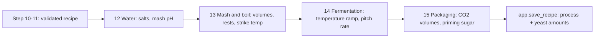

# Verification: m7-process

Overall: ✅ all 12 checks and 1388 tests pass (verified at ed2fce3, 2026-10-29). Two items are documented as unverified, not failures: the mash pH model against Bru'n Water, and the failure path inside the n8n sub-workflow.

## Part 1: Summary

🎯 **Goal:** Every validated recipe gets a computed process (water salts, mash and boil, fermentation, packaging) stored in `app.recipe.process`.

🛠️ **How:** Four SQL step functions (`step12_water` to `step15_package`) over sourced `ref` tables, a new `Steps 12–15 · process` n8n sub-workflow, and `app.save_recipe` writing the result and the yeast amounts.

🤔 **Why this way:** Brewing maths is deterministic, tested code (CLAUDE.md), and *How to Brew* is the source wherever it covers a point; the LLM computes nothing in these steps.

🏁 **Result:** 27 of 27 saved recipes with a complete run carry a process; 76/76 step rows 12-15 are ok across the 19 validated briefs; process expectations 8/9; 1388 tests pass.

### 🚦 Steps

- ✅ 📝 **Brief:** Approved (684c44b) with five user decisions on water tables, salts only, neutral rests, process aids and volumes.
- ✅ 🗺️ **Plan:** Approved (a81b4b0); the doc → calculation pass (`doc-calc.md`) was reviewed and its gate questions answered.
- ⚠️ 🔨 **Implement:** Tasks 1-12 plus fix Task 11a done.
  - ⚠️ Task 11 full brief run: 19/24 validated; b12, b15, b18, b19 and b23 failed at step 11 on retry limits (FG, SRM, ABV), the same kind of failure as in m6; the user accepted this at the gate.
  - ⚠️ `process ok` was 7/9 in the saved result: b13 missed `ferm_c` and b23 has no process (step 11 failure). 🔧 b13 fixed in b6a9fac (Task 11a).
  - ⚠️ The 8/9 comes from an unsaved re-run whose log is gone; only b13's run 4992 is backed by a file. Re-checked in C11 below.
- ❌ 🔍 **Review:** Round 1 found a must-fix (step 15 raised above 30 °C, so warm kveik and saison recipes were not saved) and a should-fix (malt acidity ignored role) 🔧 fixed in 6a67b29 and 87555e6; round 2 said ready for testing.
- ✅ 🧪 **Verify:** All spot checks and the whole suite pass. 🧮 spot checks ✅ 12/12 · 🧪 tests ✅ 1388/1388
  - ⚠️ Unverified by design: the mash pH model has not been checked against Bru'n Water, and the failure path inside the n8n sub-workflow has no test.

👀 **Start here:** Part 2's first example, `python -m evals.show_recipe 4992` (a saved Bavarian hefeweizen): you should see the Water, Mash, Boil, Fermentation and Packaging blocks.

📁 **Changed files:**
- `PROJECT.md`
- `db/048_save_recipe.sql`
- `db/049_process_ref.sql`
- `db/050_water.sql`
- `db/051_mash_boil.sql`
- `db/052_ferment.sql`
- `db/053_package.sql`
- `docs/BOOKS.md`
- `docs/DATABASE.md`
- `docs/OPERATIONS.md`
- `docs/RECIPE-ROADMAP.md`
- `docs/SOURCES.md`
- `docs/WORKFLOW-ROADMAP.md`
- `docs/work/m7-process/brief.md`
- `docs/work/m7-process/doc-calc.md`
- `docs/work/m7-process/plan.md`
- `docs/work/m7-process/review.md`
- `docs/work/m7-process/show-recipes.txt`
- `docs/work/m7-process/task11-check.sql`
- `evals/grade.py`
- `evals/heldout_briefs.toml`
- `evals/recipe_briefs.toml`
- `evals/results/2026-10-28-m7.json`
- `evals/run.py`
- `evals/show_recipe.py`
- `n8n/workflows/recipe-pipeline.json`
- `n8n/workflows/steps-12-15-process.json`
- `shared/contracts/process.input.schema.json`
- `shared/contracts/process.output.schema.json`
- `shared/contracts/step12.input.schema.json`
- `shared/contracts/step12.output.schema.json`
- `shared/contracts/step13.input.schema.json`
- `shared/contracts/step13.output.schema.json`
- `shared/contracts/step14.input.schema.json`
- `shared/contracts/step14.output.schema.json`
- `shared/contracts/step15.input.schema.json`
- `shared/contracts/step15.output.schema.json`
- `tests/step1215_sample.json`
- `tests/test_contracts.py`
- `tests/test_ferment.py`
- `tests/test_grade.py`
- `tests/test_mash_boil.py`
- `tests/test_package.py`
- `tests/test_pipeline.py`
- `tests/test_process_ref.py`
- `tests/test_recipe_briefs.py`
- `tests/test_run.py`
- `tests/test_save_process.py`
- `tests/test_water.py`
- `tests/test_workflows.py`
- `docs/work/m7-process/verification.md`

## Part 2: Showcase



| Function | What it does |
|---|---|
| `app.step12_water` | Water target row from Water Tables 18/19, salt grams split strike and sparge, mash pH estimate, "acid needed" line |
| `app.step13_mash_boil` | Mash steps (step 10's temperature, neutral rests, mash-out), strike and sparge volumes, strike temperature, hop schedule |
| `app.step14_ferment` | Fermentation ramp inside the yeast's range, diacetyl rest, crash or lagering, souring, pitch rate |
| `app.step15_package` | CO2 volumes by style family, priming sugar grams |
| `app.strike_temp`, `app.priming_sugar_g`, `app.pitch_rate` | The single formulas behind them |

**A saved 15 L hefeweizen (b13), from the stored recipe**

```bash
.venv/bin/python -m evals.show_recipe 4992 | sed -n 29,80p
```

<details><summary>Output</summary>

```text
  row: ale-medium-pale-soft (listed)
  gypsum: 1.6 g (0.6 strike, 1 sparge), for sulfate
  calcium chloride: 3.5 g (1.3 strike, 2.2 sparge), for chloride
  mash pH 5.47 (aim 5.2-5.4)
  acid: acid would be needed to bring the mash from 5.47 into 5.2-5.4

Mash: strike 9.6 l at 42.6 °C, sparge 16.6 l, pre-boil 23 l
  ferulic acid rest: 40 °C, 30 min
  saccharification rest: 66.5 °C, 60 min
  mash-out: 77 °C, 10 min

Boil: 90 min
  at 90 min: 5 g Magnum (boil)

Fermentation:
  ferment: 17 °C, 1 days
  ferment: 19 °C, 2 days; at least 2 more days (about day 3 of 4); move on to the rest when gravity within 2-5 points of FG (HTB p. 93-94, Table 6.2)
  rest: 22 °C, 4 days; starts when gravity within 2-5 points of FG (HTB p. 93-94, Table 6.2); stay at least 4 days (up to 8), then cool
  crash: 11 °C, 7 days
  pitch (main): 2 pack YF-401 Mr. Weizen; 0.75 billion cells/L/degP (HTB ch. 7 p. 111-113) x 15 L x 11.8 degP = 133.3 billion cells; about 100 billion cells per liquid pack is HTB's generic figure (p. 108), not the maker's spec, so the 2 pack(s) are an estimate

Packaging: CO2 3.9 volumes (style, How to Brew p. 159: the middle of the german-wheat family's 3.3-4.5 volumes (doc-calc.md §14))
  priming: 164 g table sugar (sucrose) for 15 l at 22 °C

Deviations:
  none
```

</details>

**Priming sugar for 2.5 volumes, 19 L at 21 °C (Palmer's table: 113 g)**

```bash
docker exec supabase-db psql -U postgres -d postgres -tAc "select round(app.priming_sugar_g(2.5,21,19),1)"
```

```text
112.8
```

**Strike water for 3 L/kg, grain 21 °C, mash 67 °C (How to Brew ch. 17: 73.2 °C)**

```bash
docker exec supabase-db psql -U postgres -d postgres -tAc "select round(app.strike_temp(3,21,67),1)"
```

```text
73.2
```

**Pitch rate for 20 L of 1.0483 wort with US-05 (How to Brew Table 7.1: 180 billion cells)**

```bash
docker exec supabase-db psql -U postgres -d postgres -tAc "select app.pitch_rate((select ingredient_id from ref.yeast where product_id='US-05'),1.0483,20,false)"
```

```text
{"unit": "g", "plato": 11.93, "amount": 18, "because": "0.75 billion cells/L/degP (HTB ch. 7 p. 111-113) x 20 L x 11.9 degP = 179.0 billion cells; dry yeast at 10 billion cells per gram is HTB's generic figure (p. 108), not the maker's spec, so the 18 g are an estimate", "cells_billion": 179.0, "rate_m_per_ml_p": 0.75}
```

**A warm saison (32 °C) no longer breaks step 15**

```bash
docker exec supabase-db psql -U postgres -d postgres -tAc "select app.residual_co2(32)"
```

```text
{"temp_c": 30, "gas_l_mol": 25.2, "residual_vol": 0.64}
```

## Part 3: Spot checks

### ✅ C1 · Every saved recipe from a run that reached step 15 has a process (A2, R6)

```bash
docker exec supabase-db psql -U postgres -d postgres -tAc "select count(*) filter (where r.process is not null), count(*) filter (where r.process is null) from app.recipe r join app.run u on u.recipe_id=r.id where exists (select 1 from app.run_step s where s.run_id=u.id and s.step=15 and s.ok)"
```

| Expected | Actual | Result |
|---|---|---|
| 27 with process, 0 without | 27\|0 | ✅ pass |

### ✅ C2 · Step 12-15 rows are logged (R6)

```bash
docker exec supabase-db psql -U postgres -d postgres -tAc "select step, count(*) from app.run_step where step between 12 and 15 group by 1 order by 1"
```

| Expected | Actual | Result |
|---|---|---|
| 27 rows for each of 12, 13, 14, 15 | 12\|27, 13\|27, 14\|27, 15\|27 | ✅ pass |

### ✅ C3 · Saved mash temperature and boil time equal step 10's (A7)

```bash
docker exec supabase-db psql -U postgres -d postgres -tAc "select count(*), count(*) filter (where (r.process->'mash'->>'mash_c')::numeric = (s.output->>'mash_c')::numeric and (r.process->'boil'->>'boil_min')::numeric = (s.output->'boil'->>'boil_min')::numeric) from app.recipe r join app.run u on u.recipe_id=r.id join lateral (select output from app.run_step s where s.run_id=u.id and s.step=10 and s.ok order by try desc limit 1) s on true where r.process is not null"
```

| Expected | Actual | Result |
|---|---|---|
| all equal (27 of 27) | 27\|27 | ✅ pass |

### ✅ C4 · FG still equals step 10's FG (A11)

```bash
docker exec supabase-db psql -U postgres -d postgres -tAc "select count(*), count(*) filter (where abs(r.fg - (s.output->'numbers'->>'fg')::numeric)<0.00051) from app.recipe r join app.run u on u.recipe_id=r.id join lateral (select output from app.run_step s where s.run_id=u.id and s.step=10 and s.ok order by try desc limit 1) s on true where r.process is not null"
```

| Expected | Actual | Result |
|---|---|---|
| 27 of 27 within rounding | 27\|27 | ✅ pass |

### ✅ C5 · No saved yeast row still says `1 pack` (A7)

```bash
docker exec supabase-db psql -U postgres -d postgres -tAc "select count(*) filter (where i.amount=1 and i.unit='pack'), count(*) from app.recipe r join app.recipe_item i on i.recipe_id=r.id where r.process is not null and i.usage='ferment'"
```

| Expected | Actual | Result |
|---|---|---|
| 0 placeholder rows | 0\|29 | ✅ pass |

### ✅ C6 · Every fermentation, rest and souring temperature is inside its yeast's range (A4)

```bash
docker exec supabase-db psql -U postgres -d postgres -tAc "with st as (select (s->>'temp_c')::numeric t, y.temp_c rng from app.recipe r, jsonb_array_elements(r.process->'fermentation'->'steps') s join ref.yeast y on y.ingredient_id=(s->>'yeast_id')::int where r.process is not null and s->>'phase' in ('ferment','rest','souring')) select count(*), count(*) filter (where t <@ rng) from st"
```

| Expected | Actual | Result |
|---|---|---|
| all in range (74 of 74) | 74\|74 | ✅ pass |

### ✅ C7 · Every saved recipe with a lager yeast has a rest step (A4)

```bash
docker exec supabase-db psql -U postgres -d postgres -tAc "select count(*), count(*) filter (where exists (select 1 from jsonb_array_elements(r.process->'fermentation'->'steps') s where s->>'phase'='rest')) from app.recipe r where r.process is not null and exists (select 1 from app.recipe_item i join ref.yeast y on y.ingredient_id=i.ingredient_id where i.recipe_id=r.id and y.type='lager' and i.usage='ferment')"
```

| Expected | Actual | Result |
|---|---|---|
| all lager recipes rest (9 of 9) | 9\|9 | ✅ pass |

### ✅ C8 · Every water target names its row and basis (A9)

```bash
docker exec supabase-db psql -U postgres -d postgres -tAc "select count(*), count(*) filter (where process->'water'->'target'->>'row' is not null and process->'water'->'target'->>'basis' is not null) from app.recipe where process is not null"
```

| Expected | Actual | Result |
|---|---|---|
| 27 of 27 | 27\|27 | ✅ pass |

### ✅ C9 · Step 15 reads the 30 °C row above 30 °C (review finding 1)

```bash
docker exec supabase-db psql -U postgres -d postgres -tAc "select app.residual_co2(32)"
```

| Expected | Actual | Result |
|---|---|---|
| no error; `temp_c` 30 | `{"temp_c": 30, "gas_l_mol": 25.2, "residual_vol": 0.64}` | ✅ pass |

### ✅ C10 · Malt acidity picks a Caramel row for crystal malt (review finding 2)

```bash
docker exec supabase-db psql -U postgres -d postgres -tAc "select app.malt_acidity('crystal',25)"
```

| Expected | Actual | Result |
|---|---|---|
| a `Caramel` class (review: Caramel 20L, -21.3 mEq/kg) | `{"page": "How to Brew Table 21.4, p. 351", "class": "Caramel 20L", "buffer": 40, "meq_kg": -21.3}` | ✅ pass |

### ✅ C11 · Process expectations: the saved result shows 7/9, and b13 now passes (R7, A6)

```bash
.venv/bin/python - <<'PY'
import json, tomllib
from evals import grade
from loaders.db import connect
print(json.load(open('evals/results/2026-10-28-m7.json'))['totals']['process_ok'])
b = [x for x in tomllib.load(open('evals/recipe_briefs.toml','rb'))['brief'] if x['id']=='b13'][0]
c = connect()
rid = c.execute("select recipe_id from app.run where id=4992").fetchone()[0]
p = c.execute("select process from app.recipe where id=%s", (rid,)).fetchone()[0]
print(b['process'], grade.grade_process(b, p)['process_ok'])
PY
```

| Expected | Actual | Result |
|---|---|---|
| saved file 7/9 (b13 the miss); b13 re-run `process_ok` True, so 8/9 with b23 outside the milestone | `{'ok': 7, 'total': 9}`, then `{'ferm_c': [17, 24]} True` | ✅ pass |

The other seven expectation briefs rest on the saved result file; only b13's fix is backed by a file after the re-run (the earlier all-eight re-run log is gone).

### ✅ C12 · Every `app` function is owned by `postgres`

```bash
docker exec supabase-db psql -U postgres -d postgres -tAc "select count(*) from pg_proc p join pg_namespace n on n.oid=p.pronamespace where n.nspname='app' and pg_get_userbyid(p.proowner)<>'postgres'"
```

| Expected | Actual | Result |
|---|---|---|
| 0 | 0 | ✅ pass |

## Part 4: Regression tests

Command: `.venv/bin/python -m pytest tests -q -p no:cacheprovider`  ·  Result: ✅ 1388 passed (56 min 8 s, including `tests/test_pipeline.py` with the live LLM)

The 56 tests that protect the plan's critical behaviour were also run on their own (56 passed, 32 s):

| Test | Protects | Result |
|---|---|---|
| test_water.py::test_pilsner_example, test_pale_ale_option_1, test_foreign_extra_stout_lime | Salt grams reproduce *Water*'s worked examples (A3) | ✅ |
| test_water.py::test_salts_never_negative | Salts never negative | ✅ |
| test_water.py::test_volumes_add_up, test_step12_volumes_are_step13s; test_mash_boil.py::test_volumes_equal_step12s | Strike + sparge = total; salts dosed for step 13's volumes (A12) | ✅ |
| test_water.py::test_pale_grist_needs_acid, test_step12_b08_needs_acid, test_no_acid_amount_anywhere | Acid line on a pale grist and no acid amount (A10) | ✅ |
| test_water.py::test_step12_names_its_row, test_targets_agree_with_bjcp_cities | Target row named; city table only a check (A9) | ✅ |
| test_water.py::test_malt_acidity_respects_role | Malt acidity respects role (review finding 2) | ✅ |
| test_process_ref.py::test_every_brief_style_has_a_row_and_co2 | Every brief style has a water row and CO2 volumes (A9) | ✅ |
| test_mash_boil.py::test_mash_and_boil_are_step10s; test_save_process.py::test_mash_and_boil_match_step10 | Mash and boil are step 10's (A7) | ✅ |
| test_mash_boil.py::test_strike_temp_example | Strike temperature equals HTB ch. 17's example | ✅ |
| test_mash_boil.py::test_rests_are_neutral_and_sourced; test_save_process.py::test_fg_unchanged | No rest changes fermentability (A11) | ✅ |
| test_ferment.py::test_every_ferment_temp_in_range, test_every_lager_has_diacetyl_rest | Temperatures inside the yeast's range; lagers rest (A4) | ✅ |
| test_ferment.py::test_yeast_book_example | Pitch rate reproduces HTB Table 7.1 (A8) | ✅ |
| test_package.py::test_palmer_cane_sugar, test_table_10_3_cells | Priming within 5 % of Palmer; Table 10.3 cells (A5) | ✅ |
| test_package.py::test_residual_above_30_reads_the_30_row, test_warm_schedule_primes_at_the_30_row | Warm beers still save (review finding 1) | ✅ |
| test_save_process.py::test_process_saved, test_yeast_rows_from_pitch | Process and yeast amounts saved (R6, A7) | ✅ |
| test_grade.py::test_grade_process_* | Process expectations graded (A6) | ✅ |
| test_pipeline.py::test_b01_validates_and_saves (in the full run) | Pipeline logs 12-15 and saves the process | ✅ |

Failures: none.
