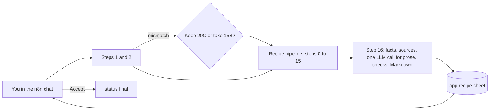

# Verification: m8-recipe-sheet-chat

Overall: ✅ all 14 checks and 1452 tests pass (verified 2026-10-31 at 0469040)

## Part 1: Summary

🎯 **Goal:** From the n8n chat, a request becomes a saved recipe and a recipe sheet you can brew from.

🛠️ **How:** Step 16 gathers the saved rows and sources with SQL, one LLM call writes only the prose, code checks its numbers and citations and writes every quantity as Markdown into `app.recipe.sheet`; a `Recipe chat` workflow asks the style question, runs the pipeline and offers to accept.

🤔 **Why this way:** Numbers stay in SQL (PROJECT.md §6.1, §6.7), and the LLM's answer is a small contract that a check can accept or reject.

🏁 **Result:** 19/19 saved recipes in the full brief run have a sheet that passes both checks (211 citations, at most 3 first-try LLM calls on every brief); 5 hand-tested chat runs (5708–5712) passed and recipe 1159 is `final`; the full suite is 1452 tests, all passing.

### 🚦 Steps

- ✅ 📝 **Brief:** Approved; revised against m5–m7, s4 and s7, with five questions answered and the brew day moved to `s11-brew-day`.
- ✅ 🗺️ **Plan:** Approved, 12 tasks.
- ⚠️ 🔨 **Implement:** Tasks 1–12 done; the fixes after review are in bd52825.
  - ⚠️ Task 3: the first import left two nodes on the old step 1 node; fixed.
  - ⚠️ Task 7: pipeline tests failed on a model-written BU:GU ratio; fixed with a prompt rule.
  - ⚠️ Task 9: 10/24 briefs passed, the same as m7, with the same 5 step 11 failures (b12, b15, b18, b19, b23); b05 kept in 20C fails step 11 and is accepted.
  - ⚠️ Task 9: n8n restarted on its own at 08:57 UTC on 2026-10-31, killing run 5706; it was deleted and repeated as 5707.
  - ⚠️ Task 10: the Send-and-Wait answer field `data.approved` was confirmed only by the hand test.
- ❌ 🔍 **Review:** 1 round, no must-fix, 5 should-fix: 1, 2, 3 and 5 fixed in bd52825; 4 (a `Co-Authored-By` trailer) fixed by rewriting the commits from Task 9 onwards, trees identical to the backup branch `m8-backup-before-reword` 🔧 fixed in bd52825 and 0469040
  - ❌ Finding 4: `review.md` still names the old hashes 4ec49fa and 0bdc04a, which no longer exist on the branch.
- ✅ 🧪 **Verify:** All 14 spot checks and the whole suite pass; the hand test (A4, A7, A8) was done by you. 🧮 spot checks ✅ 14/14 · 🧪 tests ✅ 1452/1452

👀 **Start here:** `app.recipe.sheet` of recipe 1159 (the accepted 15B Irish Stout): a Markdown sheet from Style to Sources, with `final` status.

📁 **Changed files:**
- `.claude/skills/dev-flow/SKILL.md`
- `.claude/skills/pause-work/SKILL.md`
- `PROJECT.md`
- `db/022_step2.sql`
- `db/054_recipe_sheet.sql`
- `db/055_sheet_facts.sql`
- `db/056_sheet_check.sql`
- `db/057_sheet_markdown.sql`
- `docs/DATABASE.md`
- `docs/OPERATIONS.md`
- `docs/RECIPE-ROADMAP.md`
- `docs/WORKFLOW-ROADMAP.md`
- `docs/work/m8-recipe-sheet-chat/brief.md`
- `docs/work/m8-recipe-sheet-chat/plan.md`
- `docs/work/m8-recipe-sheet-chat/review.md`
- `docs/work/s11-brew-day/brief.md`
- `evals/grade.py`
- `evals/results/2026-10-30-m8.json`
- `evals/run.py`
- `n8n/workflows/recipe-chat.json`
- `n8n/workflows/recipe-pipeline.json`
- `n8n/workflows/step-16-recipe-sheet.json`
- `n8n/workflows/step-2-best-fit-style.json`
- `shared/contracts/sheet.answer.schema.json`
- `shared/contracts/step16.input.schema.json`
- `shared/contracts/step16.output.schema.json`
- `shared/contracts/step2.input.schema.json`
- `shared/prompts/sheet.system.md`
- `tests/step16_sample.json`
- `tests/test_contracts.py`
- `tests/test_grade.py`
- `tests/test_pipeline.py`
- `tests/test_recipe_sheet.py`
- `tests/test_run.py`
- `tests/test_sheet_check.py`
- `tests/test_sheet_facts.py`
- `tests/test_sheet_markdown.py`
- `tests/test_step2_pick.py`
- `tests/test_step3.py`
- `tests/test_workflows.py`

Not part of this work and left alone: the uncommitted line 298 of `docs/RECIPE-ROADMAP.md` (six TODO items you asked for today; it is in the list above because the branch also changed that file earlier), the untracked `0`, `supabase/docker/volumes/snippets/`, and other uncommitted files that appeared during this run (`.claude/settings.json`, `.claude/skills/app-ticket/`, `app/`, `docs/app/`).

## Part 2: Showcase

What was added:

| Piece | What it does |
|---|---|
| `app.recipe.sheet`, `app.save_sheet`, `app.accept_recipe` | Store the sheet; accepting a recipe with a sheet sets `final` |
| `app.step2_best_style(..., style)` | Step 2 obeys a chosen style (the chat's answer) |
| `app.sheet_facts`, `sheet_queries`, `sheet_sources`, `sheet_prompt` | Gather the run's facts, find `kb` chunks (How to Brew first), build the prompt |
| `app.sheet_read_answer`, `prose_numbers`, `sheet_retry_text` | Check the LLM's prose: contract, keys, numbers, citations |
| `app.sheet_markdown` | Code writes every quantity section as Markdown |
| `Step 16 · recipe sheet`, `Recipe chat` (n8n) | The sheet step in the pipeline; the hosted chat with the style question and the accept step |



**Real input and output.** The chat run 5709: b05 asked "Take 15B". The pipeline saved recipe 1159 and the sheet starts like this:

```bash
docker exec supabase-db psql -U postgres -d postgres -tAc "select sheet from app.recipe where id = 1159" | head -24
```

<details><summary>Output (first 24 lines of the sheet)</summary>

```text
# Recipe sheet: 15B Irish Stout, 20.0 L

## Style

**15B Irish Stout** (BJCP guide)

This is a black beer with a pronounced roasted flavor, often similar to coffee. [...]

- Why this style: Picked 15B Irish Stout: the stated numbers fit (1.12).
  - Why: The stated numbers fit the 15B Irish Stout profile, [...] [1]
- Other styles considered: 16A Sweet Stout, 16B Oatmeal Stout
- Mismatch: you named 20C Imperial Stout (its range is ABV 8.0–12.0); 15B Irish Stout fits better and was chosen.

## Targets and results

| Quantity | Target | Result | Style range |
|---|---|---|---|
| Batch (L) | 20.0 (profile) | 20.0 | – |
| Efficiency (%) | – | 72.0 | – |
| OG | 1.040 (derived) | 1.040 | 1.036–1.044 |
| FG | 1.009 (midpoint) | 1.009 | 1.007–1.011 |
| ABV (%) | 4.0 (stated) | 4.0 | 3.8–5.0 |
| IBU | 35.0 (midpoint) | 35.2 | 25–45 |
| SRM | 32.5 (midpoint) | 31.0 | 25–40 |
```

</details>

**The sections of b10's sheet, in order**

```bash
docker exec supabase-db psql -U postgres -d postgres -tAc "select string_agg(l, ' | ' order by n) from (select row_number() over () n, l from regexp_split_to_table((select sheet from app.recipe where id = (select recipe_id from app.run where id = 5691)), E'\n') l where l ~ '^## ') x"
```

```text
## Style | ## Targets and results | ## Fermentables | ## Hops | ## Yeast | ## Extras | ## How the amounts were worked out | ## Water | ## Mash | ## Boil | ## Fermentation | ## Packaging | ## Deviations | ## Absent and unused items | ## Notes | ## Sources
```

**Special B is absent: the sheet says what to do** (recipe 1158, run 5707)

```bash
docker exec supabase-db psql -U postgres -d postgres -tAc "select sheet from app.recipe where id = 1158" | grep -i "special b"
```

```text
- "Special B": not in the catalogue. To use it, add it through `shared/ingredients/` and ask again, or brew without it.
```

**A tiny amount shows in grams, not as "0.00 kg"** (review finding 2, b10's saved sheet was written before the fix, so this re-renders it with the current function)

```bash
docker exec supabase-db psql -U postgres -d postgres -tAc "select l from regexp_split_to_table((select app.sheet_markdown(app.sheet_facts(5691), (select output->'sources' from app.run_step where run_id = 5691 and step = 16), (select output->'answer' from app.run_step where run_id = 5691 and step = 16))), E'\n') l where l ~ 'inventory'"
```

```text
- 2.20 kg Munich Malt Type 1, 35.2 % — from your inventory ("Munich malt")
- 1 g Brown Candi Sugar, 0.0 % — from your inventory ("dark candi sugar")
- 25 g Abbaye — from your inventory ("abbey yeast")
```

**Step 2 obeys the chosen style** (b05's brief with and without `style`)

```bash
docker exec supabase-db psql -U postgres -d postgres -tAc "select app.step2_best_style(output, 'x', null, '20C')->'style', app.step2_best_style(output, 'x', null, null)->'style' from app.run_step where run_id = 5708 and step = 1"
```

```text
{"id": 75, "code": "20C", "name": "Imperial Stout", "guide": "BJCP"}|{"id": 81, "code": "15B", "name": "Irish Stout", "guide": "BJCP"}
```

## Part 3: Spot checks

Read-only queries, run from the repo root on 2026-10-31. Run ids come from `evals/results/2026-10-30-m8.json` and the chat runs of the hand test.

### ✅ C1 · The sheet column exists, owned like the rest of `app` (A7)

```bash
docker exec supabase-db psql -U postgres -d postgres -tAc "select c.data_type || ' ' || t.tableowner from information_schema.columns c join pg_tables t on t.schemaname = c.table_schema and t.tablename = c.table_name where c.table_schema = 'app' and c.table_name = 'recipe' and c.column_name = 'sheet'"
```

| Expected | Actual | Result |
|---|---|---|
| `text postgres` | `text postgres` | ✅ pass |

### ✅ C2 · Every new function is owned by `postgres` (A7)

```bash
docker exec supabase-db psql -U postgres -d postgres -tAc "select count(*) from pg_proc where pronamespace = 'app'::regnamespace and pg_get_userbyid(proowner) = 'postgres' and proname in ('save_sheet','accept_recipe','sheet_facts','sheet_allowed_numbers','sheet_queries','sheet_sources','sheet_prompt','prose_numbers','sheet_read_answer','sheet_retry_text','sheet_markdown','step2_best_style')"
```

| Expected | Actual | Result |
|---|---|---|
| 12 | 12 | ✅ pass |

### ✅ C3 · One `step2_best_style` remains (no stale 3-argument copy)

```bash
docker exec supabase-db psql -U postgres -d postgres -tAc "select count(*) from pg_proc where pronamespace = 'app'::regnamespace and proname = 'step2_best_style'"
```

| Expected | Actual | Result |
|---|---|---|
| 1 | 1 | ✅ pass |

### ✅ C4 · Full brief run: every saved recipe has a sheet whose checks passed (A1, A5)

```bash
.venv/bin/python -c "import json; t = json.load(open('evals/results/2026-10-30-m8.json'))['totals']; print(t['sheets_saved'], t['number_check'], t['citation_check'], t['citations'], t['first_try_calls_max'], t['retry_calls'], t['validated'])"
```

| Expected | Actual | Result |
|---|---|---|
| sheets saved 19/19, number check 19/19, citation check 19/19, first-try max ≤ 3, retries reported | `{'saved': 19, 'total': 19} {'ok': 19, 'total': 19} {'ok': 19, 'total': 19} 211 3 23 {'b01_b20': 16, 'all': 19}` | ✅ pass |

Note: this is Task 9's recorded run (before the step 2 and sheet Markdown SQL changed); the brief-run harness was not re-run (instructed). The 19 validated is the same count as m7; only 10/24 briefs passed every step (Task 9's own count), the same 5 step 11 failures.

### ✅ C5 · b10's sheet has every R2 section in order, inventory named as used (A2)

```bash
docker exec supabase-db psql -U postgres -d postgres -tAc "select count(*) from regexp_split_to_table((select sheet from app.recipe where id = (select recipe_id from app.run where id = 5691)), E'\n') l where l ~ 'from your inventory'"
```

| Expected | Actual | Result |
|---|---|---|
| 3 inventory items marked (Munich malt, dark candi sugar, abbey yeast); section list as in Part 2 | 3; the 16 headings in R2's order (Part 2) | ✅ pass |

### ✅ C6 · Special B is listed as absent with what to do (A2)

```bash
docker exec supabase-db psql -U postgres -d postgres -tAc "select count(*) from regexp_split_to_table((select sheet from app.recipe where id = 1158), E'\n') l where l ~ 'Special B.*not in the catalogue.*brew without it'"
```

| Expected | Actual | Result |
|---|---|---|
| 1 | 1 | ✅ pass |

### ✅ C7 · b01, b05, b08, b13, b14: every cited chunk was retrieved and shows page or section (A3)

```bash
docker exec -i supabase-db psql -U postgres -d postgres -tA < /tmp/claude-1000/-home-gorenyember-AI-Homebrew-Assistant/6d75e274-04ea-4fea-9a6b-41ce427f5873/scratchpad/a3.sql
```

(The query is in the scratchpad file `a3.sql`: for each run it takes row 16's cited ids, tests `ids <@ sources`, counts chunks with a page or section, and counts article chunks with a URL.)

| Expected | Actual | Result |
|---|---|---|
| per brief: all cited ids retrieved, resolvable = cited, checks true | b01 12 cited, retrieved t, 12 resolvable; b05 10/t/10; b08 10/t/10; b13 13/t/13; b14 10/t/10 (3 article chunks with a URL); numbers_ok and citations_ok true on all five | ✅ pass |

### ✅ C8 · Chat run b05 "Keep 20C": fails at step 11, no sheet (A4)

```bash
docker exec supabase-db psql -U postgres -d postgres -tAc "select r.ok, (select max(step) from app.run_step s where s.run_id = r.id), r.recipe_id is null from app.run r where r.id = 5708"
```

| Expected | Actual | Result |
|---|---|---|
| `f`, last step 11, no recipe | `f|11|t` | ✅ pass |

### ✅ C9 · Chat runs "Take 15B" and the others: row 1 once with `llm.tries` 1 and `brief_given`, row 16 present, recipe and sheet saved (A4, R4, R6)

```bash
docker exec supabase-db psql -U postgres -d postgres -tAc "select run_id, count(*) filter (where step = 1), count(*) filter (where step = 16), bool_and(input->>'brief_given' = 'true') filter (where step = 1), max(llm->>'tries') filter (where step = 1) from app.run_step where run_id between 5709 and 5712 group by 1 order by 1"
```

| Expected | Actual | Result |
|---|---|---|
| one row 1, one row 16, `brief_given` true, tries 1, for 5709–5712 | `5709|1|1|t|1`, `5710|1|1|t|1`, `5711|1|1|t|1`, `5712|1|1|t|1` | ✅ pass |

### ✅ C10 · The accepted recipe is `final` with its sheet; the others stay `draft` (A7, R9)

```bash
docker exec supabase-db psql -U postgres -d postgres -tAc "select id, status, length(sheet) from app.recipe where id between 1159 and 1162 order by 1"
```

| Expected | Actual | Result |
|---|---|---|
| 1159 `final` with a sheet; 1160–1162 `draft` with a sheet | `1159|final|7915`, `1160|draft|7142`, `1161|draft|6963`, `1162|draft|6840` | ✅ pass |

### ✅ C11 · Chat and webhook runs have the same row shape plus row 16 (R4)

```bash
docker exec supabase-db psql -U postgres -d postgres -tAc "select run_id, count(distinct step), max(step) from app.run_step where run_id between 5709 and 5712 group by 1 order by 1"
```

| Expected | Actual | Result |
|---|---|---|
| 17 steps (0 to 16) per successful run | 17 / 16 for each of 5709–5712 | ✅ pass |

### ✅ C12 · The call bar wording is updated (A10)

```bash
grep -n "about 2\|≤ 2" docs/RECIPE-ROADMAP.md docs/WORKFLOW-ROADMAP.md; echo "exit $?"
```

| Expected | Actual | Result |
|---|---|---|
| no match, exit 1 | `exit 1` | ✅ pass |

### ✅ C13 · The failed-step-11 run was refused for `final`: the b05 20C step 11 error is plain (A4, R4)

```bash
docker exec supabase-db psql -U postgres -d postgres -tAc "select substr(error, 1, 120) from app.run_step where run_id = 5708 and ok is false order by try limit 1"
```

| Expected | Actual | Result |
|---|---|---|
| a step 11 message naming the ABV against the target | `step 11 (try 1): Step 11: the ABV is 4.52 and the target is 4 (limit +- 0.2). To fix: pick a yeast attenuating about 58.2 % (Windsor gives 65.6 %).` | ✅ pass |

### ✅ C14 · No stale `Co-Authored-By` trailer on the branch (review finding 4)

```bash
git log main..HEAD --format=%B | grep -c "Co-Authored-By"
```

| Expected | Actual | Result |
|---|---|---|
| 0 | 0 | ✅ pass |

Not checked here: A8 (the chat refuses a user who is not logged in) is a hand test; you reported it passed (Task 11).

## Part 4: Regression tests

Command: `.venv/bin/pytest tests -q -p no:cacheprovider` (stack up, 2026-10-31, 8518 s = 2 h 22 min)  ·  Result: ✅ 1452 passed

| Test | Protects | Result |
|---|---|---|
| tests/test_recipe_sheet.py (6) | A sheet is saved only through `app.save_sheet`; accept needs a sheet; `brewed` is not changed back | ✅ |
| tests/test_step2_pick.py::test_style_field_* (and 28 others) | Step 2 obeys `style`; equal to the pick changes nothing; an unknown code raises | ✅ |
| tests/test_step3.py::test_kept_style_lists_the_number | A kept style lists the stated number as a deviation | ✅ |
| tests/test_pipeline.py::test_given_brief_is_step_1 | A given brief is logged as step 1 with its own `llm` (one step 1 call per chat request) | ✅ |
| tests/test_pipeline.py::test_style_field_reaches_step_2 | The webhook's `style` reaches step 2 | ✅ |
| tests/test_sheet_facts.py (8) | Sources prefer How to Brew; facts carry every item and the allowed numbers | ✅ |
| tests/test_sheet_check.py (13) | A prose number not saved, an unknown chunk, no citation, a missing key fail the check | ✅ |
| tests/test_sheet_markdown.py (10) | Every quantity equals the saved rows; R2 order; labels; deviations; absent items; citation format | ✅ |
| tests/test_pipeline.py::test_b01_validates_and_saves | Step 16 is logged and counted; sheet saved; at most 3 first-try calls | ✅ |
| tests/test_pipeline.py::test_sheet_fails_twice_without_sources | Two failed checks give `failed_step` 16 and a draft without a sheet (A6) | ✅ |
| tests/test_run.py (26), tests/test_grade.py (92) | The harness reports sheets and checks | ✅ |
| tests/test_contracts.py (125), tests/test_workflows.py (32) | Contracts for steps 0–16 and the workflow files | ✅ |

Failures: none.

Note: the whole suite took 2 h 22 min, against 55 min in m7 (PROJECT.md §4). The pipeline tests dominate and the model ran at about 6 tokens/s.

## Human checks

Done by you on 2026-10-31 (Task 11): A4, A7 and A8 in the hosted chat, all passing; chat runs 5708–5712 and recipe 1159 accepted as final. A9 is not checked here (moved to `s11-brew-day`).
