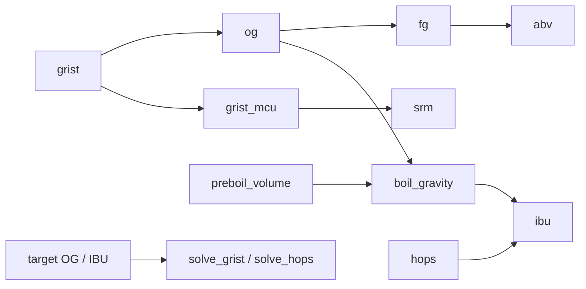

# Verification: s1-maths

Overall: ✅ all 9 checks and 333 tests pass

## Part 1: Summary

🎯 **Goal:** A tested brewing-maths library (OG, FG, ABV, IBU, colour, solvers) the recipe workflows can call.

🛠️ **How:** 19 small `app.*` SQL functions in `db/030_maths.sql`, one per formula with its book page cited, each driven by tests that reproduce Palmer's and OBC's worked examples.

🤔 **Why this way:** In-database functions give one deterministic source of numbers for n8n and psql, and keep brewing maths out of the LLM (CLAUDE.md).

🏁 **Result:** 19 functions owned by `postgres`, 81 maths tests, 333 in the full suite; the same IBU digits come back through n8n and psql.

### 🚦 Steps

- ✅ 📝 **Brief:** Written twice and approved (R1-R10, A1-A8), tolerances fixed by the user; committed 0b863b9.
- ✅ 🗺️ **Plan:** 8 tasks; the OBC check found only OG and MCU recomputable, so OBC SRM/IBU are documented but untested (user chose option a); committed bb2c974.
- ⚠️ 🔨 **Implement:** All 8 tasks done in 9 runs, plus one review-fix round.
  - ⚠️ Task 1: Palmer ABV form miss count corrected (56 to 65 of 140 cells) and `test_boil_gravity_book_example` added (deviation lines).
  - ⚠️ Task 5: `app.srm` takes an MCU number, not a grist; the plan text said otherwise and was corrected later in Task 8 (deviation line).
  - ⚠️ Task 7: `create_workflow_from_code` did not attach the credential; bound afterwards with `setNodeCredential`. Workflow archived, never published.
  - ⚠️ Table 4.3's ABV row is untested (it disagrees with table 9.1); OBC's book MCU 43 is a slip (recomputed 40.5).
  - ⚠️ The full suite takes about 128 s, above the 120 s foreground limit.
- ❌ 🔍 **Review:** Verdict ready for testing, with two should-fix findings: `boil_gravity` used batch instead of post-boil volume, and JSON `null` fields did not raise. 🔧 fixed in 9e5d0b9; re-review 6c6a6b9 resolved both.
  - ⚠️ Note: SQL `null` array is tested only for `og` and `ibu`, not the other four functions.
  - ⚠️ Note: `test_boil_gravity_joe_ale` calls `app.og`, not `app.boil_gravity`.
- ✅ 🧪 **Verify:** All spot checks and the full suite pass; no failures to hand back. 🧮 spot checks ✅ 9/9 · 🧪 tests ✅ 333/333

👀 **Start here:** `docs/work/s1-maths/doc-calc.md` (each formula and worked example with its page), then `db/030_maths.sql`.

📁 **Changed files:**
- `PROJECT.md`
- `db/030_maths.sql`
- `docs/RECIPE-ROADMAP.md`
- `docs/WORKFLOW-ROADMAP.md`
- `docs/work/s1-maths/brief.md`
- `docs/work/s1-maths/doc-calc.md`
- `docs/work/s1-maths/plan.md`
- `docs/work/s1-maths/review.md`
- `tests/test_maths.py`

## Part 2: Showcase

All functions live in `db/030_maths.sql` (schema `app`, one per formula, source page cited above each). Grists and hops are passed as jsonb arrays.

| Group | Functions | What they do |
|---|---|---|
| Gravity, volume, units | `og`, `gravity_points`, `preboil_volume`, `boil_gravity`, `sg_to_plato`, `plato_to_sg`, `srm_from_ebc`, `ebc_from_srm`, `calc_version` | OG from a grist, pre-boil volume and boil gravity, SG/Plato and EBC/SRM conversions, library version |
| FG and ABV | `fg`, `abv` | FG from attenuation and each fermentable's fermentability; ABV from OG and FG |
| IBU | `tinseth_utilisation`, `ibu_addition`, `ibu` | Tinseth utilisation, one addition, a whole hop schedule (whirlpool and dry hop count 0 for now) |
| Colour | `mcu`, `grist_mcu`, `srm` | Malt colour units per item and per grist, Morey SRM |
| Solvers | `solve_grist`, `solve_hops` | Grist kg for a target OG, hop grams for a target IBU |



**OG of a 20 L pale ale** (4.5 kg pale malt 80 %, 0.4 kg crystal 74 %, 75 % efficiency)

```bash
docker exec supabase-db psql -U postgres -d postgres -tAc "select round(app.og('[{\"kg\":4.5,\"extract_pct\":80,\"mashed\":true},{\"kg\":0.4,\"extract_pct\":74,\"mashed\":true}]'::jsonb,75,20),4)"
```

```text
1.0561
```

**ABV of a 1.052 to 1.012 beer**

```bash
docker exec supabase-db psql -U postgres -d postgres -tAc "select round(app.abv(1.052,1.012),2)"
```

```text
5.15
```

**IBU of the Joe Ale hop schedule** (28 g 8 % at 60 min, 42 g 4 % at 15 min, boil gravity 1.038, 19 L)

```bash
docker exec supabase-db psql -U postgres -d postgres -tAc "select round(app.ibu('[{\"g\":28,\"alpha_pct\":8,\"minutes\":60,\"usage\":\"boil\"},{\"g\":42,\"alpha_pct\":4,\"minutes\":15,\"usage\":\"boil\"}]'::jsonb,1.038,19),1)"
```

```text
41.6
```

**Boil gravity** (OG 1.060, 22 L post-boil, 25 L pre-boil: the gravity Tinseth needs)

```bash
docker exec supabase-db psql -U postgres -d postgres -tAc "select round(app.boil_gravity(1.060,22,25),4)"
```

```text
1.0528
```

**Colour of the same grist** (the pale ale above, with malt colours 6 and 120 EBC): MCU, then SRM

```bash
docker exec supabase-db psql -U postgres -d postgres -tAc "select round(app.grist_mcu('[{\"kg\":4.5,\"ebc\":6},{\"kg\":0.4,\"ebc\":120}]'::jsonb,20),1), round(app.srm(app.grist_mcu('[{\"kg\":4.5,\"ebc\":6},{\"kg\":0.4,\"ebc\":120}]'::jsonb,20)),1)"
```

```text
15.9|10.0
```

**How many kg for OG 1.060?** (90 % pale 80 %, 10 % crystal 74 %, 75 % efficiency, 20 L)

```bash
docker exec supabase-db psql -U postgres -d postgres -tAc "select round((e->>'kg')::numeric,2) from jsonb_array_elements(app.solve_grist(1.060,'[{\"pct\":90,\"extract_pct\":80,\"mashed\":true},{\"pct\":10,\"extract_pct\":74,\"mashed\":true}]'::jsonb,75,20)) e"
```

```text
4.72
0.52
```

## Part 3: Spot checks

### ✅ C1 · Maths functions exist and are owned by postgres (A5)

```bash
docker exec supabase-db psql -U postgres -d postgres -tAc "select count(*) from pg_proc p join pg_namespace n on n.oid=p.pronamespace where n.nspname='app' and pg_get_userbyid(p.proowner)='postgres' and proname in ('calc_version','sg_to_plato','plato_to_sg','srm_from_ebc','ebc_from_srm','gravity_points','og','preboil_volume','boil_gravity','fg','abv','tinseth_utilisation','ibu_addition','ibu','mcu','grist_mcu','srm','solve_grist','solve_hops')"
```

| Expected | Actual | Result |
|---|---|---|
| 19 | 19 | ✅ pass |

### ✅ C2 · No `app` function has the wrong owner (A5)

```bash
docker exec supabase-db psql -U postgres -d postgres -tAc "select count(*) from pg_proc p join pg_namespace n on n.oid=p.pronamespace where n.nspname='app' and pg_get_userbyid(p.proowner)<>'postgres'"
```

| Expected | Actual | Result |
|---|---|---|
| 0 | 0 | ✅ pass |

### ✅ C3 · calc_version defined (A6)

```bash
docker exec supabase-db psql -U postgres -d postgres -tAc "select app.calc_version()"
```

| Expected | Actual | Result |
|---|---|---|
| maths-1 | maths-1 | ✅ pass |

### ✅ C4 · Pre-boil volume, 20 L, 60 min, 3 L/h, 2 L losses (A7, R10)

```bash
docker exec supabase-db psql -U postgres -d postgres -tAc "select round(app.preboil_volume(20,60,3,2),3)"
```

| Expected | Actual | Result |
|---|---|---|
| 25.000 | 25.000 | ✅ pass |

### ✅ C5 · ABV at OG 1.050 / FG 1.010 vs table 9.1 (A7, R9)

```bash
docker exec supabase-db psql -U postgres -d postgres -tAc "select round(app.abv(1.050,1.010),2)"
```

| Expected | Actual | Result |
|---|---|---|
| 5.1 ± 0.1 (HTB p. 150) | 5.16 | ✅ pass |

### ✅ C6 · SG to Plato to SG round trip at 1.060 (A7, R1)

```bash
docker exec supabase-db psql -U postgres -d postgres -tAc "select round(app.plato_to_sg(app.sg_to_plato(1.060)),4)"
```

| Expected | Actual | Result |
|---|---|---|
| 1.0600 ± 0.001 | 1.0600 | ✅ pass |

### ✅ C7 · Joe Ale IBU, same digits as the n8n run (A5)

```bash
docker exec supabase-db psql -U postgres -d postgres -tAc "select round(app.ibu('[{\"g\":28,\"alpha_pct\":8,\"minutes\":60,\"usage\":\"boil\"},{\"g\":42,\"alpha_pct\":4,\"minutes\":15,\"usage\":\"boil\"}]'::jsonb,1.038,19),2)"
```

| Expected | Actual | Result |
|---|---|---|
| 41.56 (n8n execution 12623: 41.5636...) | 41.56 | ✅ pass |

### ✅ C8 · Whirlpool and dry hop leave IBU unchanged (A8, R4)

```bash
docker exec supabase-db psql -U postgres -d postgres -tAc "select round(app.ibu('[{\"g\":28,\"alpha_pct\":8,\"minutes\":60,\"usage\":\"boil\"},{\"g\":42,\"alpha_pct\":4,\"minutes\":15,\"usage\":\"boil\"},{\"g\":50,\"alpha_pct\":10,\"minutes\":20,\"usage\":\"whirlpool\"},{\"g\":50,\"alpha_pct\":10,\"minutes\":0,\"usage\":\"dry_hop\"}]'::jsonb,1.038,19),2)"
```

| Expected | Actual | Result |
|---|---|---|
| 41.56 (same as C7) | 41.56 | ✅ pass |

### ✅ C9 · Solver round trip, OG 1.060 (A4, R6)

```bash
docker exec supabase-db psql -U postgres -d postgres -tAc "select round(app.og(app.solve_grist(1.060,'[{\"pct\":80,\"extract_pct\":80,\"mashed\":true},{\"pct\":20,\"extract_pct\":78,\"mashed\":true}]'::jsonb,70,20)::jsonb,70,20),4)"
```

| Expected | Actual | Result |
|---|---|---|
| 1.0600 ± 0.001 | 1.0600 | ✅ pass |

## Part 4: Regression tests

Command: `.venv/bin/python -m pytest -q` (about 128 s; use a timeout above 120 s)  ·  Result: ✅ 333 passed
(`tests/test_maths.py` alone: ✅ 81 passed)

| Test | Protects | Result |
|---|---|---|
| tests/test_maths.py::test_og_palmer_* , test_og_obc_dubbel, test_og_obc_pils | OG from grist matches Palmer and OBC | ✅ |
| test_efficiency_skips_unmashed | Efficiency never applied to sugars and extracts | ✅ |
| test_boil_gravity_joe_ale, test_boil_gravity_book_example, test_boil_gravity_takes_postboil_volume, test_preboil_volume_example | Boil gravity uses post-boil volume; pre-boil volume | ✅ |
| test_plato_round_trip | SG/Plato round trip | ✅ |
| test_fg_table_4_3, test_lactose_raises_fg_candi_lowers_it | FG follows attenuation and fermentability | ✅ |
| test_abv_table_9_1 | ABV matches Palmer's table | ✅ |
| test_tinseth_table_5_5, test_ibu_joe_ale_metric, test_ibu_joe_ale_us | Tinseth utilisation and IBU | ✅ |
| test_whirlpool_and_dry_hop_add_no_ibu | Whirlpool and dry hop add 0 IBU | ✅ |
| test_mcu_*, test_srm_* | MCU and Morey colour | ✅ |
| test_solve_grist_round_trip, test_solve_hops_round_trip | Solvers invert the forward maths | ✅ |
| test_null_fields_and_arrays_raise, test_og_missing_field_raises, test_bad_volume_raises | Bad input raises, never becomes 0 | ✅ |

The plan's "same number through n8n" row is the recorded Task 7 check (execution 12623), reproduced by C7.
