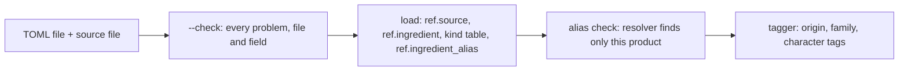

# Verification: s8-ingredient-intake

Overall: ✅ all 7 checks and 779 tests pass

## Part 1: Summary

🎯 **Goal:** add a fermentable, hop or yeast by filling one TOML template and running one command, with no LLM.

🛠️ **How:** an intake folder with templates, `loaders/extra_ingredients.py` (`--check` and load), a new `ref.ingredient_alias` table the resolver reads first, and a tagger that reads intake rows.

🤔 **Why this way:** one file per ingredient keeps diffs and deletes per item and lets the later n8n form just create files; aliases in a table need no SQL edit.

🏁 **Result:** the intake path works and is proven by 5 fixture files (59 intake tests, full suite 779 passed); the live `ref` holds 0 intake rows by design.

### 🚦 Steps

- ✅ 📝 **Brief:** already approved and committed (1806ce3); R11 and A8, A9, A11, A12 changed by a recorded deviation (no real items).
- ✅ 🗺️ **Plan:** run twice; the first draft asked about Special B and a culture, the revised one drops real items. Approved, da0e722.
- ⚠️ 🔨 **Implement:** 7 tasks plus 2 fix rounds, all ticked.
  - ⚠️ Task 1: tests were written after the SQL was applied, never seen failing first.
  - ⚠️ Tasks 3–4: 3 tests failed (test_mash_mapping, test_reference_recipes[b12], [b22]) because the branch predated the s5 merge; gone after merging main.
  - ⚠️ Task 5: the idempotence test did not fail with the alias delete removed; full suite was not re-run after its last test fix.
  - ⚠️ Task 6: two new tests were never seen failing first.
  - ⚠️ `<field>_source` is an optional key that appears in the templates only as a comment.
- ❌ 🔍 **Review:** first review "fixes needed" (must-fix 1 re-load keeps cleared values, 2 alias takes over another new file's name; should-fix 3–5) 🔧 fixed in d8d5678; re-review "ready for testing" with should-fix 11 (`--check` missed a kind-word name takeover) and note 12 (test count) 🔧 fixed in 030b1b1. No third review was run.
- ✅ 🧪 **Verify:** all checks pass, A12 done by hand; 🧮 spot checks ✅ 7/7 · 🧪 tests ✅ 779/779

👀 **Start here:** `shared/ingredients/README.md`, then run `.venv/bin/python -m loaders.extra_ingredients --check tests/fixtures/ingredients` and see `ok: 5 files`.

📁 **Changed files:**
- `PROJECT.md`
- `db/010_ref_schema.sql`
- `db/036_ingredient_resolver.sql`
- `db/checks/ref_spotcheck.sql`
- `docs/DATABASE.md`
- `docs/INGREDIENT-INTAKE.md`
- `docs/work/s10-ingredient-form/brief.md`
- `docs/work/s8-ingredient-intake/brief.md`
- `docs/work/s8-ingredient-intake/plan.md`
- `docs/work/s8-ingredient-intake/review.md`
- `docs/work/s9-misc-extras/brief.md`
- `loaders/extra_ingredients.py`
- `loaders/tags.py`
- `shared/ingredients/README.md`
- `shared/ingredients/_templates/fermentable.toml`
- `shared/ingredients/_templates/hop.toml`
- `shared/ingredients/_templates/source.toml`
- `shared/ingredients/_templates/yeast.toml`
- `shared/ingredients/fermentable/.gitkeep`
- `shared/ingredients/hop/.gitkeep`
- `shared/ingredients/sources/.gitkeep`
- `shared/ingredients/yeast/.gitkeep`
- `tests/fixtures/ingredients/fermentable/fixture-crystal.toml`
- `tests/fixtures/ingredients/hop/fixture-hop.toml`
- `tests/fixtures/ingredients/sources/fixture-data-sheet.toml`
- `tests/fixtures/ingredients/yeast/fixture-ale.toml`
- `tests/fixtures/ingredients/yeast/fixture-lacto.toml`
- `tests/test_extra_ingredients.py`
- `tests/test_fermentable_facts.py`
- `tests/test_ingredient_resolver.py`
- `tests/test_tags.py`

## Part 2: Showcase

Schema change and data flow: a file in `shared/ingredients/<kind>/` is checked, loaded with its source and aliases, then tagged.



| Added | What it does |
|---|---|
| `ref.ingredient_alias` | words a brewer types for one intake product |
| `app.resolve_ingredient` | tries aliases first, then the unchanged name rules (`resolve_ingredient_by_name`) |
| `loaders.extra_ingredients` | `--check` and load for fermentable, hop, yeast and source files |

**Check the empty intake folder (what ships today)**

```bash
.venv/bin/python -m loaders.extra_ingredients --check
```

```text
ok: 0 files (fermentable 0, hop 0, yeast 0, sources 0)
```

**Check the five test fixtures**

```bash
.venv/bin/python -m loaders.extra_ingredients --check tests/fixtures/ingredients
```

```text
ok: 5 files (fermentable 1, hop 1, yeast 2, sources 1)
```

**Load the fixtures, resolve names and read the tags (rolled back, nothing is saved)**

```bash
.venv/bin/python - <<'PY'
from pathlib import Path
from loaders import extra_ingredients as extra, tags
from loaders.db import connect
conn = connect()
try:
    sources, ing = extra.read_folder(Path("tests/fixtures/ingredients"))
    out = extra.load(conn, sources, ing)
    v = tags.read_vocab(); tags.load_vocab(conn, v); tags.derive_tags(conn, v)
    print("loaded:", out["counts"], "aliases:", out["aliases"])
    for w in ["fixture crystal", "Fixture Lacto LB-1"]:
        print(w, "->", conn.execute("select ingredient_id, rule from app.resolve_ingredient(%s)", (w,)).fetchall())
    for r in conn.execute("""select i.name, i.kind, (select string_agg(t.name, ',' order by t.name) from ref.ingredient_tag it join ref.tag t on t.id=it.tag_id where it.ingredient_id=i.id)
       from ref.ingredient i where raw ? 'intake' order by i.id"""): print(r)
finally:
    conn.rollback(); conn.close()
PY
```

```text
loaded: {'fermentable': 1, 'hop': 1, 'yeast': 2} aliases: 4
fixture crystal -> [(11306, 'alias')]
Fixture Lacto LB-1 -> [(11309, 'same name')]
('Fixture Crystal 120', 'fermentable', 'caramel,crystal,dried-fruit')
('Fixture Hop', 'hop', 'citrus,pine,US')
('Fixture Ale FA-1', 'yeast', 'ale,fruity')
('Fixture Lacto LB-1', 'yeast', 'sour,sour')
```

(The lacto culture shows `sour` twice: the family tag and the character tag from its descriptor; the ids differ per run.)

**A hopline product still resolves as before**

```bash
docker exec supabase-db psql -U postgres -d postgres -tAc "select ingredient_id, rule from app.resolve_ingredient('Cascade')"
```

```text
464|same name
```

**Spot-check pack on the live `ref` (no intake rows by design)**

```bash
docker exec -i supabase-db psql -U postgres -d postgres < db/checks/ref_spotcheck.sql | grep -A6 "Intake rows with their source"
```

```text
== Intake rows with their source ==
 kind | producer | name | source | edition | file | aliases 
------+----------+------+--------+---------+------+---------
(0 rows)
```

## Part 3: Spot checks

### ✅ C1 · Live ref has no intake row (R11, A11)

```bash
docker exec supabase-db psql -U postgres -d postgres -tAc "select count(*) from ref.ingredient where raw ? 'intake'"
```

| Expected | Actual | Result |
|---|---|---|
| 0 | 0 | ✅ pass |

### ✅ C2 · Alias table exists and is empty (R6)

```bash
docker exec supabase-db psql -U postgres -d postgres -tAc "select to_regclass('ref.ingredient_alias'), (select count(*) from ref.ingredient_alias)"
```

| Expected | Actual | Result |
|---|---|---|
| `ref.ingredient_alias\|0` | `ref.ingredient_alias\|0` | ✅ pass |

### ✅ C3 · Folder, templates and README exist (R1, A1)

```bash
ls shared/ingredients shared/ingredients/_templates
```

| Expected | Actual | Result |
|---|---|---|
| README.md, fermentable, hop, sources, yeast, _templates; 4 templates | all present; fermentable.toml hop.toml source.toml yeast.toml | ✅ pass |

### ✅ C4 · `--check` on the empty folder (plan Task 6)

```bash
.venv/bin/python -m loaders.extra_ingredients --check
```

| Expected | Actual | Result |
|---|---|---|
| ok, 0 files | `ok: 0 files (fermentable 0, hop 0, yeast 0, sources 0)` | ✅ pass |

### ✅ C5 · `--check` on the fixtures (A1)

```bash
.venv/bin/python -m loaders.extra_ingredients --check tests/fixtures/ingredients
```

| Expected | Actual | Result |
|---|---|---|
| ok, 5 files | `ok: 5 files (fermentable 1, hop 1, yeast 2, sources 1)` | ✅ pass |

### ✅ C6 · Spot-check pack runs and lists 0 intake rows live (R8, A9)

```bash
docker exec -i supabase-db psql -U postgres -d postgres < db/checks/ref_spotcheck.sql | grep -A3 "Intake rows per kind"
```

| Expected | Actual | Result |
|---|---|---|
| `(0 rows)` | `(0 rows)` | ✅ pass |

### ✅ C7 · A12: one template filled by hand passes `--check`, a bad value is refused

I copied `_templates/yeast.toml` to a scratch folder and filled it following the README (source `beermaverick`). Then I set `type = "weird"`.

```bash
.venv/bin/python -m loaders.extra_ingredients --check <scratch folder>
```

| Expected | Actual | Result |
|---|---|---|
| ok for the filled file; a refusal naming file and field for `type` | `ok: 1 files (...yeast 1...)`; then `.../yeast/test-ale.toml: type: 'weird' is not one of ['ale', 'brett', 'kveik', 'lacto', 'lager', 'pedio']` | ✅ pass |

## Part 4: Regression tests

Command: `.venv/bin/pytest -q`  ·  Result: ✅ 779 passed (177 s)

| Test | Protects | Result |
|---|---|---|
| tests/test_ingredient_resolver.py::test_alias_finds_only_its_product, test_alias_with_kind_word | an alias finds its product only; kind words respected | ✅ |
| tests/test_ingredient_resolver.py, tests/test_step3.py (existing) | resolver without aliases unchanged | ✅ |
| tests/test_extra_ingredients.py::test_refusal[...] | each R2 refusal names file and field | ✅ |
| tests/test_extra_ingredients.py::test_check_writes_nothing | `--check` writes nothing | ✅ |
| tests/test_extra_ingredients.py::test_clash_with_db_row, test_alias_*_refused | clashes and alias takeovers refused | ✅ |
| tests/test_tags.py::test_retag_is_identical, test_intake_words, test_intake_yeast_family | old tags unchanged; intake words and lacto to sour | ✅ |
| tests/test_extra_ingredients.py::test_load_twice_same_rows, test_reload_after_editing_files | load is idempotent; a cleared field returns to NULL | ✅ |
| tests/test_extra_ingredients.py::test_field_source_covers_filled_fields | every filled field sourced | ✅ |
| tests/test_extra_ingredients.py::test_intake_fermentable_usable | intake fermentable works without `fermentable_facts.toml` | ✅ |
| tests/test_extra_ingredients.py::test_hopline_loaders_leave_intake_rows | hopline loaders leave intake rows alone | ✅ |
| tests/test_extra_ingredients.py::test_intake_rows_tagged | tagged, not flagged | ✅ |
| tests/test_extra_ingredients.py::test_every_alias_resolves | fixture products and aliases resolve | ✅ |
| tests/test_extra_ingredients.py::test_summary_counts, test_main_loads_tags_and_prints_summary | R9 summary matches `ref` | ✅ |
| tests/test_extra_ingredients.py::test_g10_counts_ignore_intake_rows | catalogue-size tests ignore intake rows | ✅ |
| tests/test_extra_ingredients.py::test_spotcheck_lists_intake_rows | spot-check pack lists intake rows | ✅ |

Failures: none.
