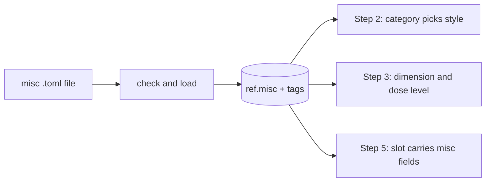

# Verification: s9-misc-extras

Stage: verify  ·  Verified at 07a1076, 2026-10-18
Overall: ❌ 1 of 14 checks failed (C6: the style-level reason prints a literal `#` in doses) · 🧪 899 of 899 tests pass

## Part 1: Summary

🎯 **Goal:** A spice, fruit, coffee or process aid added as one intake file works in steps 2, 3 and 5.

🛠️ **How:** `ref.misc` got purpose, usages, time and dose; the s8 loader, tagger and resolver take misc files; `app.style_level` rates a flavour misc on one dimension from its category and its own sourced dose; step 2 picks a specialty style by misc category; step 5 carries the misc fields.

🤔 **Why this way:** Your three-layer model (category picks the style, one existing dimension is scored, tags only describe), with every dose and cut point sourced or set by you, so a new spice needs only its file.

🏁 **Result:** 4 real misc rows (2 coffee forms, vanilla bean, orange peel), b23 picks 30A with 20B first, b24 keeps 18B with an orange-peel deviation, steps 1-5 pass 24/24 briefs, 899 tests pass.

### 🚦 Steps

- ✅ 📝 **Brief:** Revised against shipped s8 and m4, five questions answered, approved 2026-10-18 (d199ca8).
- ✅ 🗺️ **Plan:** 14 tasks, four design questions answered, approved 2026-10-18 (0b825ae).
- ⚠️ 🔨 **Implement:** 14 tasks done; doc-calc accepted by you; fixture-only tests are the proof for process aids.
  - ⚠️ Task 3: code was written before its tests.
  - ⚠️ Task 6: a noticeable spice (level 4) is above 25B's maximum (2), so tests set a 25B envelope in a rollback.
  - ⚠️ Task 9: `tests/test_contracts.py` also changed (not in the Files table).
  - ⚠️ Task 10: the model returned no 30A rows; the spice row was hand-written and you reviewed it.
  - ⚠️ Task 11: alias "coffee" dropped from the beans file (name-word clash); test counts adjusted.
  - ⚠️ Task 12: four test adjustments to fit b23 and b24.
  - ⚠️ Task 13: the n8n grep was not run then (done in review and again here).
  - ⚠️ Task 14: one test failed after Task 12, fixed.
- ❌ 🔍 **Review:** Ready for testing, 0 must-fix, 3 should-fix (status column, 30A comment, kind-word test) 🔧 fixed in 07a1076.
- ❌ 🧪 **Verify:** All acceptance criteria hold except one found here: the reason text printed by `app.style_level` shows a literal `#` and a rounded zero for doses (`3.0#`, `0.0#`). 🧮 spot checks ✅ 13/14 · 🧪 tests ✅ 899/899

👀 **Start here:** Part 2, the b23 and b24 lines: "coffee up front" gives 30A with 20B first, "a little orange peel" keeps 18B and lists the peel as a deviation.

📁 **Changed files:**
- `PROJECT.md`
- `db/012_style_fit.sql`
- `db/022_step2.sql`
- `db/033_style_fit_effects.sql`
- `db/034_style_level.sql`
- `db/036_ingredient_resolver.sql`
- `db/037_step3.sql`
- `db/041_step5.sql`
- `db/checks/ref_spotcheck.sql`
- `docs/DATABASE.md`
- `docs/INGREDIENT-INTAKE.md`
- `docs/RECIPE-ROADMAP.md`
- `docs/STYLE-FIT.md`
- `docs/WORKFLOW-ROADMAP.md`
- `docs/work/s9-misc-extras/brief.md`
- `docs/work/s9-misc-extras/doc-calc.md`
- `docs/work/s9-misc-extras/plan.md`
- `docs/work/s9-misc-extras/review.md`
- `evals/recipe_briefs.toml`
- `evals/results/2026-10-18-s9.json`
- `loaders/extra_ingredients.py`
- `loaders/style_envelopes.py`
- `loaders/style_envelopes.toml`
- `loaders/style_fit_vocab.toml`
- `loaders/tags.py`
- `shared/contracts/step5.output.schema.json`
- `shared/ingredients/README.md`
- `shared/ingredients/_templates/misc-flavour.toml`
- `shared/ingredients/_templates/misc-process.toml`
- `shared/ingredients/misc/coffee-cold-brew.toml`
- `shared/ingredients/misc/coffee-whole-beans.toml`
- `shared/ingredients/misc/orange-peel.toml`
- `shared/ingredients/misc/vanilla-bean.toml`
- `tests/fixtures/ingredients/misc/fixture-coffee-beans.toml`
- `tests/fixtures/ingredients/misc/fixture-coffee-cold-brew.toml`
- `tests/fixtures/ingredients/misc/fixture-enzyme.toml`
- `tests/fixtures/ingredients/misc/fixture-fruit.toml`
- `tests/fixtures/ingredients/misc/fixture-irish-moss.toml`
- `tests/fixtures/ingredients/misc/fixture-no-dose.toml`
- `tests/fixtures/ingredients/misc/fixture-other.toml`
- `tests/fixtures/ingredients/misc/fixture-spice-citrus.toml`
- `tests/fixtures/ingredients/misc/fixture-spice.toml`
- `tests/fixtures/ingredients/misc/fixture-vanilla-extract.toml`
- `tests/test_contracts.py`
- `tests/test_extra_ingredients.py`
- `tests/test_ingredient_resolver.py`
- `tests/test_misc.py`
- `tests/test_recipe_briefs.py`
- `tests/test_reference_recipes.py`
- `tests/test_step2_signals.py`
- `tests/test_step3.py`
- `tests/test_step5.py`
- `tests/test_style_envelopes.py`
- `tests/test_style_fit_effects.py`
- `tests/test_tags.py`

## Part 2: Showcase

What was added: `ref.misc` columns, a misc intake path, and misc handling in steps 2, 3 and 5.

| Part | What it does |
|---|---|
| `ref.misc` (purpose, usages, time_min, dose_g_per_l, description, field_source) | One row per form of a flavour misc or process aid |
| `loaders.extra_ingredients` misc branch | Checks, loads and tags `shared/ingredients/misc/*.toml` |
| `app.style_level` misc branch | Level and reason from category dimension and the entry's own sourced dose (M1 0.5, M2 2.0, M3 2/4/6) |
| `app.specialty_style()` by category | A featured coffee, spice, herb, cacao or vanilla gives 30A; fruit 29A; wood 33A; smoke 32A |
| `app.step5_misc` | Purpose, usages, time and dose range in each step 5 slot |



**The four real entries**

```bash
docker exec supabase-db psql -U postgres -d postgres -c "select i.name, m.category, m.usages, m.time_min, m.dose_g_per_l from ref.misc m join ref.ingredient i on i.id = m.ingredient_id order by i.name"
```

```text
        name         | category |   usages    | time_min | dose_g_per_l 
---------------------+----------+-------------+----------+--------------
 Coffee, cold brew   | coffee   | {packaging} |          | [6.0,6.0]
 Coffee, whole beans | coffee   | {secondary} |     2880 | [3.0,3.0]
 Orange peel         | spice    | {whirlpool} |       15 | [2.64,2.64]
 Vanilla bean        | vanilla  | {secondary} |          | [0.05,0.53]
(4 rows)
```

**A brewer's word finds the product**

```bash
docker exec supabase-db psql -U postgres -d postgres -tAc "select ingredient_id, name, rule from app.resolve_ingredient('coffee')"
```

```text
26305|Coffee, cold brew|all words
26306|Coffee, whole beans|all words
```

**Step 2 and step 3 on the two new briefs**

```bash
.venv/bin/python -c "
from loaders.db import connect
from tests.test_step4 import BRIEFS, sql
conn = connect()
for bid in ('b23', 'b24'):
    b = BRIEFS[bid]
    brief = {'named': b['named'] or None, 'stated': b['stated'], 'hints': b['hints'], 'wanted': b['wanted'], 'excluded': b['excluded'], 'inventory': b['inventory'], 'unknown': [], 'guidance': b['guidance']}
    st = sql(conn, 'step2_best_style', brief, b['request'], None)
    dev = sql(conn, 'step3_deviations', brief, st)
    print(bid, b['request'], '->', st['style']['code'], 'alt', st['alt_styles'], 'deviations', [d['subject'] for d in dev['deviations']])
"
```

```text
b23 An American stout with the coffee up front and a little vanilla in the background. -> 30A alt ['20B'] deviations []
b24 An American pale ale with a little orange peel for a hint of citrus. -> 18B alt [] deviations ['orange peel']
```

**Rating a wanted word (step 3)**

```bash
docker exec supabase-db psql -U postgres -d postgres -tAc "select app.rate_wanted('30A', 'vanilla', 'background')->>'level', app.rate_wanted('18B', 'orange peel', 'background')->>'level'"
```

```text
typical|out_of_style
```

**A dose read against the entry's own sourced dose (coffee beans, 7 g/L in 30A)**

```bash
docker exec supabase-db psql -U postgres -d postgres -tAc "select app.style_level('30A', 26306, 'secondary', '{\"g_per_l\": 7.0}')"
```

```text
{"level": "typical", "because": "spice from Coffee, whole beans: 7.0# g/L is aggressive (high) against the sourced 3.0#-3.0# g/L (M2: above 2.0 x the upper sourced dose, set by the user, 2026-10-18). Spice, Herb, or Vegetable Beer (30A) asks for spice: 'As with aroma, distinctive SHV flavors should be noticeable, and may range in intensity from subtle to aggressive.'."}
```

The stray `#` after each dose is the C6 failure. The level is also `typical` for an aggressive dose in 30A, because 30A's real envelope reaches "very high".

## Part 3: Spot checks

### ✅ C1 · `ref.misc` has the R1 columns and is owned by postgres (A1)

```bash
docker exec supabase-db psql -U postgres -d postgres -tAc "select string_agg(column_name, ',' order by column_name) from information_schema.columns where table_schema='ref' and table_name='misc'"
```

| Expected | Actual | Result |
|---|---|---|
| category, description, dose_g_per_l, field_source, ingredient_id, purpose, time_min, usages | category,description,dose_g_per_l,field_source,ingredient_id,purpose,time_min,usages | ✅ pass |

Owner (`select tableowner from pg_tables …`): `postgres`; the changed `app` functions (`style_level`, `specialty_style`, `step5_refs`, `step5_misc`, `style_fit_recipe`, `ingredient_choices`, `ingredient_kind_word`, `step2_best_style`, `usage_effects`, `style_fit_cut_points`) are all owned by `postgres`.

### ✅ C2 · The live intake files pass `--check` (A2)

```bash
.venv/bin/python -m loaders.extra_ingredients --check
```

| Expected | Actual | Result |
|---|---|---|
| ok: 4 files, misc 4 | ok: 4 files (fermentable 0, hop 0, yeast 0, misc 4, sources 0) | ✅ pass |

### ✅ C3 · The spot-check pack shows the misc rows (A2)

```bash
docker exec -i supabase-db psql -U postgres -d postgres < db/checks/ref_spotcheck.sql | grep -E "^ misc"
```

| Expected | Actual | Result |
|---|---|---|
| misc 4 in the loaded count and in the intake group | `misc | 4` (ref.ingredient per kind), `misc | intake | 4`, `misc | 4` (intake rows per kind), 4 intake rows listed with source and file | ✅ pass |

### ✅ C4 · Resolver finds misc by name, alias and kind word, and no other kind (A4)

```bash
docker exec supabase-db psql -U postgres -d postgres -tAc "select * from app.resolve_ingredient('orange zest')" -c "select count(*) from app.resolve_ingredient('herb Citra')" -tAc "select name, rule from app.resolve_ingredient('vanilla')"
```

| Expected | Actual | Result |
|---|---|---|
| orange zest finds Orange peel by alias; "herb Citra" (a hop name with a misc kind word) finds nothing; vanilla finds Vanilla bean | `26307|misc|Orange peel|alias`, count 0, `Vanilla bean|…` | ✅ pass |

(Each alias and the kind word plus name are covered by `test_misc_kind_words_find_misc_products` and `test_live_misc_entries`, Part 4.)

### ✅ C5 · Every misc cut point names its source in code (A5)

```bash
docker exec supabase-db psql -U postgres -d postgres -tAc "select app.style_fit_cut_points() -> 'misc_dose'"
```

| Expected | Actual | Result |
|---|---|---|
| M1, M2 and M3 each with a `basis` | M1 0.5 "set by the user, 2026-10-18 …", M2 2.0 "set by the user … HTB p. 225 …", M3 2/4/6 "set by the user …" | ✅ pass |

### ❌ C6 · The reason text for a dose reads correctly (A5)

```bash
docker exec supabase-db psql -U postgres -d postgres -tAc "select app.style_level('30A', 26306, 'secondary', '{\"g_per_l\": 3.0}')->>'because', app.style_level('30A', 26308, 'secondary', '{\"g_per_l\": 0.02}')->>'because'"
```

| Expected | Actual | Result |
|---|---|---|
| "3.0 g/L is noticeable … against the sourced 3.0-3.0 g/L"; "0.02 g/L is subtle … 0.05-0.53 g/L" | "3.0# g/L is noticeable … 3.0#-3.0# g/L"; "0.0# g/L is subtle … 0.1#-0.5# g/L" | ❌ fail |

Cause: code. `db/034_style_level.sql` lines 223 and 225 format doses with `to_char(x, 'FM990.0#')`; in PostgreSQL `#` is not a digit placeholder, so it prints literally, and one decimal rounds 0.02 to 0.0 and 0.05-0.53 to 0.1-0.5. The level itself is right (the cut points use the unrounded dose); only the text is misleading. No test pins the text.

### ✅ C7 · Step 3 rates every wanted misc word of b23 and b24 (A7)

```bash
.venv/bin/python -c "
from loaders.db import connect
from tests.test_step4 import BRIEFS, sql
conn = connect()
for bid in ('b23', 'b24'):
    b = BRIEFS[bid]
    brief = {'named': b['named'] or None, 'stated': b['stated'], 'hints': b['hints'], 'wanted': b['wanted'], 'excluded': b['excluded'], 'inventory': b['inventory'], 'unknown': [], 'guidance': b['guidance']}
    st = sql(conn, 'step2_best_style', brief, b['request'], None)
    print(bid, sql(conn, 'step3_deviations', brief, st)['unrated'])
"
```

| Expected | Actual | Result |
|---|---|---|
| `[]` for both | b23 `[]`, b24 `[]` | ✅ pass |

### ✅ C8 · Step 2 picks 30A for b23 and keeps 18B for b24 (A8)

Command: the Part 2 step 2 and 3 example.

| Expected | Actual | Result |
|---|---|---|
| b23: 30A, first alternative the base style 20B; b24: 18B with "orange peel" a deviation | b23 `30A alt ['20B']`; b24 `18B`, deviations `['orange peel']` (out_of_style, "specialty spice on American Pale Ale (18B)") | ✅ pass |

### ✅ C9 · Steps 1-5 pass on all 24 briefs (A10)

```bash
python3 -c "import json; d=json.load(open('evals/results/2026-10-18-s9.json')); print(d['label'], {k: (v['passed'], v['total']) for k, v in d['totals'].items() if k != 'briefs'}, d['totals']['briefs'])"
```

| Expected | Actual | Result |
|---|---|---|
| each of steps 1-5 24/24 (b01-b22 22/22), briefs 24/24, 0 not run | `s9 {'step1': (24, 24), 'step2': (24, 24), 'step3': (24, 24), 'step4': (24, 24), 'step5': (24, 24)} {'passed': 24, 'total': 24}` (`not_run` 0 on every step in the file) | ✅ pass |

This is the saved Task 13 run (live model, 2026-10-18); I did not re-run `evals.run` here. Its SQL-level equivalents run in Part 4 (`tests/test_step3.py`, `tests/test_step5.py` bars cover b01-b24).

### ✅ C10 · The live `ref` has the 4 entries with sources and no process aid (A11)

```bash
docker exec supabase-db psql -U postgres -d postgres -tAc "select count(*) filter (where purpose='process'), count(*) filter (where purpose='flavour' and dose_g_per_l is not null and field_source ? 'dose_g_per_l') from ref.misc"
```

| Expected | Actual | Result |
|---|---|---|
| 0 process rows; 4 flavour rows, each dose with a source | `0|4` | ✅ pass |

### ✅ C11 · Step 5 on b23 has misc slots with purpose, usages, time, dose range and meets the contract (A12)

Command: the Task 9 frame built as in `tests/test_misc.py::frame_with` for b23, validated with `extensions.jsonschema_validation_errors`.

| Expected | Actual | Result |
|---|---|---|
| coffee and vanilla slots carry `misc`; no contract errors | coffee: Coffee, cold brew (packaging, 6.0 g/L, no time) and Coffee, whole beans (secondary, 2880 min, 3.0 g/L); vanilla: Vanilla bean (secondary, 0.05-0.53 g/L); `contract errors: []` | ✅ pass |

### ✅ C12 · The M6 TODO is on RECIPE-ROADMAP's Later list and in the fruit fixture's summary (A13)

```bash
grep -c "fruit as a fermentable is decided with M6" docs/RECIPE-ROADMAP.md; .venv/bin/python -m loaders.extra_ingredients --check tests/fixtures/ingredients | grep "fixture-fruit"
```

| Expected | Actual | Result |
|---|---|---|
| 1 line in the roadmap; the fruit fixture "waits for maths" with the TODO | `1`; `waits: …fixture-fruit.toml: fruit sugar: waits for maths; TODO: fruit as a fermentable is decided with M6` | ✅ pass |

### ✅ C13 · Fixture checks pass with the expected waits (A2, A14)

```bash
.venv/bin/python -m loaders.extra_ingredients --check tests/fixtures/ingredients | head -4
```

| Expected | Actual | Result |
|---|---|---|
| ok; waits for the enzyme, the fruit and the vanilla extract (mL/L, not loaded) | `ok: 15 files (… misc 10 …)`; 3 `waits:` lines for fixture-enzyme, fixture-fruit, fixture-vanilla-extract | ✅ pass |

### ✅ C14 · No n8n workflow calls a changed SQL function

```bash
grep -rlE "style_fit_recipe|specialty_style|step5_refs|ingredient_choices|ingredient_kind_word" n8n/workflows | wc -l
```

| Expected | Actual | Result |
|---|---|---|
| 0 | 0 | ✅ pass |

Criteria that need a fixture load (A2 load twice, A3, A5 tag independence, A6, A9, A14 two forms, A15) cannot be read from the live `ref`, which must stay free of fixtures. They are run as rolled-back tests in Part 4; the selected nodes (`test_tags_never_change_the_level`, `test_process_aids_are_allowed_everywhere`, `test_style_fit_recipe_takes_extras`, `test_no_dose_cases`, `test_step5_slot_carries_misc_fields`, `test_misc_tags`, `test_liquid_extract_is_not_loaded`, `test_misc_rows_load`, `test_load_twice_same_rows`, `test_misc_waits_reasons`, `test_misc_columns_and_checks`) were run on their own: 11 passed.

## Part 4: Regression tests

Command: `.venv/bin/python -m pytest -q -p no:cacheprovider`  ·  Result: ✅ 899 passed in 271 s (stack up, 07a1076)

No critical test was missing; none added.

| Test | Protects | Result |
|---|---|---|
| tests/test_misc.py::test_misc_columns_and_checks | A wrong category for the purpose, or an unknown usage, cannot be stored | ✅ |
| tests/test_extra_ingredients.py::test_refusal (misc cases) | A misc file missing a field for its purpose is refused, naming file and field | ✅ |
| tests/test_extra_ingredients.py::test_misc_waits_reasons, test_liquid_extract_is_not_loaded | Liquid extract not loaded; enzyme, acid and fruit sugar marked waiting | ✅ |
| tests/test_extra_ingredients.py::test_load_twice_same_rows, test_reload_clears_a_misc_dose | Reload gives the same rows; a cleared dose becomes NULL | ✅ |
| tests/test_tags.py::test_misc_tags | A process aid gets no tags and no review row | ✅ |
| tests/test_misc.py::test_misc_kind_words_find_misc_products, tests/test_ingredient_resolver.py::test_misc_kind_words_leave_brief_words_alone | Misc kind words find only misc and leave b01-b22 words on the same products | ✅ |
| tests/test_misc.py::test_tags_never_change_the_level | Character tags never change a misc's level | ✅ |
| tests/test_misc.py::test_process_aids_are_allowed_everywhere, test_category_other_has_no_dimension, test_no_dose_cases | Process aids allowed; `other` not rated; no dose says so | ✅ |
| tests/test_style_fit_golden.py, tests/test_style_level.py | Hop, malt and yeast levels unchanged | ✅ |
| tests/test_misc.py::test_featured_misc_moves_step2_to_its_specialty_style, test_background_misc_keeps_the_base_style, tests/test_step2_pick.py | Featured misc moves to its specialty style with the base first; background keeps the base | ✅ |
| tests/test_misc.py::test_step5_slot_carries_misc_fields | Step 5 misc fields equal the row and meet the contract | ✅ |
| tests/test_step3.py, tests/test_step5.py::test_briefs_reach_the_bar | Steps 3 and 5 hold on b01-b24 | ✅ |
| tests/test_misc.py::test_live_misc_entries | The 4 live rows equal doc-calc §E; no process row | ✅ |

Failures: none. The C6 text defect is not covered by any test, which is why the suite stays green.
